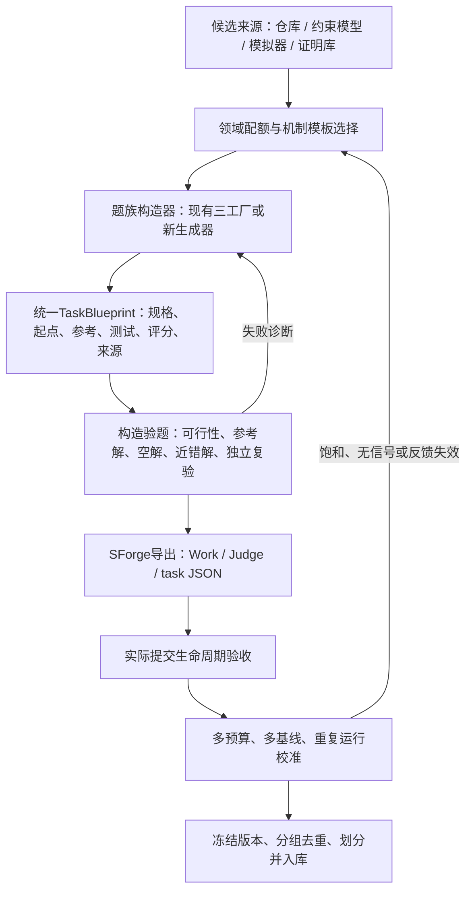

**EdgeBench 任务分类、批量实例生成与 SWE Factory 迁移调研**

调研快照：2026-10-14。研究重点为任务模板与批量实例生成；已纳入用户提供的 `swe-factory` 本地实现。

后续实施：路线优化生成原型已完成本地试产，详见 [流水线与实测结果](PIPELINE.md)。以下保留调研阶段的事实与设计状态。

**核心判断：按“领域”规划覆盖，按“构造与评测机制”组织生成器。** 一个合格的 EdgeBench 式实例需要同时产出工作环境、公开材料、可提交成果、可信评测器和能支持反复改进的反馈。最合适的工程路线是：用 `swe-factory` 承担软件题的上游构造与验题，用 SForge 承担长期运行与评分，中间新增任务导出、反馈划分和难度校准。数值优化、科学反演、证明和交互世界则分别接入自己的生成器。

本报告中的分类标签、实例蓝图和迁移方案是本次研究提案；未执行模型评测、Docker 环境或新实例生成实验。代码事实、历史运行证据与设计建议分别标注。

**资料已经落地，公开任务定义与完整运行资产需要区分。**

| 资料 | 本地位置 | 已取得内容 |
|---|---|---|
| EdgeBench 主论文 | [PDF](papers/edgebench-2607.05155.pdf) / [可检索文本](papers/edgebench-2607.05155.txt) | v1，79页；重点核对§2、附录A/C/G.4，视觉检查分类与反馈图 |
| 四篇相关论文 | [论文目录](papers/) | Reasoning Gym、ALE-Bench、RE-Bench、MLE-bench，各有PDF与TXT |
| SForge 官方仓库 | [upstream/EdgeBench](upstream/EdgeBench/) | commit `6e4e5f4aa087a9121aa09a6059e5484e5102c6ff` |
| HF公开数据 | [data/EdgeBench](data/EdgeBench/) | commit `6cc5a7f1b3288ce52484ad828177b8cc86b05b75`；51个任务JSON、任务元数据、基镜像配置、许可和已解析LFS图片 |
| 全量任务索引 | [full_task_inventory.csv](research/full_task_inventory.csv) | 从论文Table 7提取134个task ID、官方类别及是否有公开定义 |
| 逐题研究分类 | [task_taxonomy.csv](research/task_taxonomy.csv) | 51题，每题21个字段：机制、交付物、反馈、生成轴、难度轴、资产可得性和证据 |
| 公开成绩表 | [published_scores.csv](research/published_scores.csv) | 官方README的51题×5模型×6时间点，共1530个汇总单元；缺失保留为空 |
| 用户参考工厂 | [upstream/swe-factory](upstream/swe-factory/) | 完整复制原目录；HEAD `661d5b978a30e6d3517ad8232451353bb5e81ce1`；2555个工作树条目内容、链接、权限一致 |

51个JSON都引用预构建Work/Judge镜像；其中10个含评测执行或聚合包装代码，但任务原始数据、完整测试/评分器、起始工程并未全部随HF文件发布。此次未拉取Docker镜像，也未取得约3.8万小时的原始运行轨迹。成绩CSV是已发表的舍入汇总值。具体版本、SHA256和获取边界见[来源清单](research/source_manifest.json)与[本地复制校验](research/reference_copy_manifest.json)。

**官方六类适合回答“覆盖哪些能力”。** 完整数量来自论文§2.2/Table 7；公开数量由HF任务ID逐项匹配计算。[主论文](https://arxiv.org/abs/2607.05155)、[官方数据](https://huggingface.co/datasets/ByteDance-Seed/EdgeBench)。

| 官方领域 | 全部任务 | 公开任务 | 公开覆盖率 | 典型内容 |
|---|---:|---:|---:|---|
| 科学问题与机器学习 | 39 | 4 | 10.3% | 科学反演、预测、模型训练、信号处理 |
| 系统与软件工程 | 36 | 12 | 33.3% | 多模块实现、重构、兼容重建、性能优化 |
| 组合优化 | 19 | 15 | 78.9% | 路由、布局、图优化、SAT/SMT、启发式搜索 |
| 专业知识工作 | 19 | 4 | 21.1% | 金融、教育、法律、业务报告与多文件交付 |
| 形式数学与定理证明 | 13 | 8 | 61.5% | Lean/Coq工程、证明依赖链 |
| 交互游戏与模拟器 | 8 | 8 | 100% | 游戏策略程序与在线文字冒险 |
| 合计 | 134 | 51 | 38.1% | — |

公开子集偏重优化、证明和游戏。科学任务只有4/39公开，因此只读公开JSON容易低估真实数据、实验建模和专业知识类题目的构造成本。研究分类应保留“全量领域覆盖”与“公开可分析机制”两张表。

**为了造题，建议增加七个机制主类，并保留多标签。** 下表只统计公开51题，是本报告的研究分类，不是官方新分类。

| 构造/评测机制 | 数量 | 主要交付物 | 生成器需要先建立什么 | 可变化的实质 |
|---|---:|---|---|---|
| 软件功能构建 | 7 | 源码、补丁、模块 | 行为规格、可信参考实现、语义测试 | 缺失模块子图、功能需求组合、接口语义 |
| 性能优化 | 5 | 保持语义的高效实现 | 正确性oracle、可信计时/模拟器 | 工作负载分布、资源约束、数据依赖 |
| 算法与策略求解 | 21 | solver、策略程序或固定问题解 | 合法性checker、目标函数、基准解 | 约束族、目标、场景与输入分布 |
| 学习与科学拟合 | 5 | checkpoint、预测方法、反演参数 | 数据/观测过程与隐藏真值 | 物理场景、分布、噪声、可观测性 |
| 形式证明 | 8 | 证明体 | 正确命题、内核、可信依赖和公理边界 | 待补证明依赖子图与工具跨度 |
| 专业交付物 | 2 | 文档、表格、代码和成套成果 | 资料包、硬约束、专业rubric | 业务目标、知识覆盖、跨文件耦合 |
| 直接环境交互 | 3 | 在线行动序列 | 可执行世界模型、状态与奖励 | 地图、动作前置条件、谜题依赖 |

这个划分能解释领域交叉：K12推荐主要是学习系统；BipedalWalker提交冻结策略，属于学习；5个游戏bot是开发策略程序，划入算法求解；3个文字冒险由Agent直接行动，划入在线交互。SMT的软件工程量很大，但其生成与验题核心是求解理论及见证验证。CTA与投资组合任务具有多重属性，CSV保留次标签，主标签只表示本次造题分析的重心。

每题还应独立记录四个轴：交付接口（文件/补丁/模型/行动）、真值来源（执行结果/约束/参考模拟/证明内核/rubric）、反馈粒度、生成资产可得性。`structured_json`等parser只表示结果格式；同样的JSON既能装QPS，也能装预测误差，不能拿它代替任务机制分类。

**批量生成前，先固定 family、instance、case 的计量单位。**

| 单位 | 操作性定义 | 路由任务例子 |
|---|---|---|
| Task family / 题族 | 共享语义、接口、生成逻辑与验证规则的模板 | 容量约束与时间窗下的车辆路径求解 |
| Task instance / 任务实例 | 一次独立Agent挑战的完整工作包，冻结规则、材料、起点、预算与评测 | 团簇客户、紧时间窗、固定内存预算下开发通用solver，配独立开发与隐藏集合 |
| Test case / 测试样本 | 对该任务候选产物的一次输入或运行 | 一张客户地图、一组需求与时间窗 |

如果要求直接优化一张固定地图，地图可以定义一个任务实例；如果要求写通用solver，同一地图就是case。科学反演中，新污染源连同新公开观测可以构成instance；同一污染源增加一个隐藏井位通常只是评测点。seed的意义由它生成的对象决定。

因此要同时记录 `family_id、instance_id、task_seed、case_seed、agent_run_seed`。换题面措辞主要增加表述变化；换case seed增加输入覆盖；改变规则组合、工作包和任务分布才增加实例层面的多样性。ALE-Bench的生成工具主要产生同一道竞赛题的测试输入，这一点尤其值得借鉴和区分。[ALE-Bench v2](https://arxiv.org/abs/2506.09050v2)。

**可扩展的造题方法有五条，起点都是可信验证。** 以下为本次设计建议。

| 路线 | 先有什么 | 怎样产生新实例 | 关键验题条件 |
|---|---|---|---|
| 约束程序生成 | 约束模型与独立checker | 从可行解反推约束；变化结构、紧度、目标和预算 | 小规模精确解；大规模可行证书；弱强基线有区分 |
| 参考仓库反向构造 | 固定版本的正确源码和测试 | 挖空依赖模块、重建规格、生成有证据的新需求 | 原生基线健康；题目态失败；参考补丁通过；回归保留 |
| 规格生成与差分验证 | 可执行语义、解释器或参考程序 | 从类型化规则组合生成规格、骨架和输入分布 | 独立差分/性质检查；明确NULL、溢出、排序、错误语义 |
| 模拟器反演与实验 | 可信前向模型或真实观测过程 | 采样隐变量、观测布局、噪声与实验限制 | 数值稳定、可辨识/可预测、参考方法能取得有效信号 |
| 证明工程挖空 | 已由内核接受的完整证明 | 选取相互依赖的证明子图并隐藏证明体 | 签名/定义固定；传递公理检查；排除一条tactic即可全解的退化 |

LLM适合提出规则组合、恢复行为规格、写初稿和生成候选实现；合法性与得分最终由执行、约束检查、数值验证或证明内核确定。专业交付物另需校准rubric和专家抽审；文字世界需先有可验证的状态机与可解轨迹，再渲染剧情。

Reasoning Gym提供“生成器＋验证器＋难度/结构/表述参数”的参考；RE-Bench展示规格、实现、人类试跑的多阶段淘汰；MLE-bench提供真实数据改造与split/分数复核经验。它们分别解决生产、验题和数据组织的一部分。把这些方法组合到长时任务仍需实际校准。[Reasoning Gym](https://arxiv.org/abs/2505.24760v2)、[RE-Bench](https://arxiv.org/abs/2411.15114v2)、[MLE-bench](https://arxiv.org/abs/2410.07095v6)。

**用户提供的 SWE Factory，使软件类生成器有了具体工程起点。** 该目录是根据三份只读复现规约编写的本地实现。以下按当前代码分析，不将规约中提到的原系统能力全部视为这里已经实现。

| 本地工厂 | 实际构造链 | 最适合借鉴的EdgeBench任务 | 最有价值的工件与门禁 |
|---|---|---|---|
| NL2Repo | 参考Python仓库→环境A1→AST证据→规格A2→覆盖检查→公开/私有资产分离→参考解回放→受限修复→空答案检查→accepted | 从零重建、多模块功能实现 | 行为规格/API manifest、来源摘要、失败反馈、冻结题意后的修复与回滚 |
| DeepSWE A：ablation | 正确功能→消融为问题态→controller求逆并拆分答案S/测试T→红绿矩阵→导出复验 | 缺失模块恢复、相关功能重建 | 现成参考解、真实diff、生产/测试所有权、原生回归证据 |
| DeepSWE C：query | 仓库分析→新需求Q→测试T→旧行为真实失败→critic→实现S→交叉矩阵 | 新功能、兼容行为与跨模块扩展 | 需求依据、测试先行、Q/T冻结、按失败环节重试 |
| DeepSWE B：specialize | 完整参考题→恢复/增测/mask并验证Base→困难机制迁移→evolve/mask→重写题面→复验 | 同题族的新规则组合、状态机与优先级变化 | 可继承的困难机制、旧测试保留、新需求版本与来源关系 |
| ProgramBench | 固定CLI源码→builder提案→控制器独立build→重复字节probe→测试规范化→dummy/gold QC→独立镜像重建→发布 | 程序行为重建、保持兼容的性能优化 | 可观察行为oracle、probe来源、测试ID映射、参考/空程序对照、独立构建证据 |

三条DeepSWE路线是替代工艺，不是必须执行A→B→C。源码入口：[NL2Repo pipeline](upstream/swe-factory/nl2repo_factory/pipeline.py)、[DeepSWE pipeline](upstream/swe-factory/deepswe_factory/pipeline.py)、[ProgramBench pipeline](upstream/swe-factory/programbench_factory/pipeline.py)。

DeepSWE的交叉矩阵值得保留为软件题的基础验题框架。令E为问题代码，S为参考实现补丁，T为可信目标测试：

| 检查 | 执行对象 | 验证什么 |
|---|---|---|
| C1 | E的原生回归 | 原始环境健康 |
| C2 | E+T的目标测试 | 当前确实缺少目标行为，且是有效断言失败 |
| C3 | E+S的构建 | 有构建命令时必须通过；无命令记录不适用 |
| C4 | E+S的原生回归 | 参考实现没有破坏旧功能 |
| C5 | E+S+T的目标测试 | 目标可实现且参考解满足要求 |
| C6 | E+S+T的原生回归 | 注入测试本身没有污染回归 |

当前实现还要求回归测试ID集合一致，目标具有明确failed→passed，保留行为具有passed→passed；缺失、skip、collection error不能冒充通过。它比“模型声称修好了”更适合作为批量出题的控制器判据。依据：[pipeline.py的matrix](upstream/swe-factory/deepswe_factory/pipeline.py)第95–135行、[原生报告解析](upstream/swe-factory/swe_factory/reports.py)。

ProgramBench提供另一种验题：参考程序必须通过，空程序必须在目标测试上真实失败；然后在独立构建环境重建参考程序再次复验。可借用这个结构，再增加“仅实现help”“忽略边界”“丢数据但更快”等近错对照。空答案失败只能筛掉最弱测试，无法证明测试具有足够辨别力。依据：[quality.py](upstream/swe-factory/programbench_factory/quality.py)第62–94行、[delivery.py](upstream/swe-factory/programbench_factory/delivery.py)。

**已有工厂验证的是构造自洽性；长期解题质量需要独立验收。** 当前DeepSWE成功分支明确是`L2 / accepted=false`，评分仍是严格0/1。ProgramBench可在独立Docker重建后标记`published / R2`，同时保留`r3_verified=false`。抽查的历史人工示例分别止于DeepSWE L2和ProgramBench R1，均没有真实模型或Docker。此次只读核验，未重跑这些示例。依据：[DeepSWE历史summary](upstream/swe-factory/runs/deepswe-demo-02/summary.json)、[ProgramBench历史summary](upstream/swe-factory/runs/programbench-demo-02/summary.json)。

NL2Repo的文件数/API数量门槛、固定`medium`标签，以及ProgramBench按flag/子命令/测试数量计算的难度，都是结构筛选。它们尚不能判断Agent是否能在12小时内持续改进。已有legacy文本评分也不宜直接沿用到新题；优先复用共享的原生报告、测试ID和失败状态处理。

**建议采用“构造器→统一任务包→SForge导出→长期校准”的架构。** 下图中统一任务包、导出器和校准门禁均为待实现部分。



建议统一任务包至少包含：`family_id、instance_id、mechanism、spec、starter、submission_contract、public_assets、feedback_judge、final_judge、reference、resource_budget、score_contract、provenance、calibration`。私有seed、真值和参考解仅保存在出题侧。当前SForge只提取固定TaskSpec字段，自定义生成元数据应写旁路manifest。[TaskSpec](upstream/EdgeBench/sforge/harness/task_spec.py)。

实现时可新增以下组件，参考仓库保持原样：

| 建议组件 | 责任 | 现有可复用部分 |
|---|---|---|
| CandidateSelector | 领域配额、来源资格、版本固定、同源分组 | `swe_factory/snapshots.py`及现有候选输入 |
| FamilyGenerator | 按机制构造规格/材料/参考/评测 | 三个factory的构造路线；新增优化/科学生成器 |
| QualityGate | 校验题意、参考/负对照、独立报告、评分稳定性 | DeepSWE矩阵、ProgramBench QC、NL2Repo修复事务思想 |
| SForgeExporter | 将统一包编译成Work/Judge资产与task JSON | 放在现有打包完成之后，避免耦合每条构造路线 |
| DifficultyCalibrator | 多策略、多预算校准，记录收益和评测成本 | 新增；现有静态difficulty不能替代 |
| DatasetRegistry | 版本、来源、拒绝原因、split与去重 | 复用阶段账本；批量调度、恢复与并发另行设计 |

SForge对接有四个具体问题需要在实现时解决：

1. **资产映射。** E和Q进入Work；可信E/T/评分器进入Judge；参考S、校准结果和完整构造日志留在出题侧。整个现有task目录不能直接复制给Agent。
2. **提交语义。** DeepSWE的答案是可包含删除操作的patch；SForge普通tar提交采用覆盖提取。可以提交`model.patch`并在Judge回放，但每次主动提交和auto-eval都必须重新捕获，不能评到过期patch；也可设计明确支持删除语义的完整快照适配器。
3. **评分映射。** 现有`reward/healthy/tests`需映射到`score/valid/details`。有硬约束时显式采用`valid_then_score`；graded partial credit必须从冻结的行为组与权重计算，缺失测试保留在分母。性能任务先满足正确性，再测独立的效率指标。
4. **真实生命周期重验。** 导出后重新跑参考、空答案和近错答案，核对采集、提交、评测、反馈、超时、文件更新。旧host或Harbor风格包的通过记录不能代替新SForge运行证据。

依据：[DeepSWE打包与捕获](upstream/swe-factory/deepswe_factory/packaging.py)、[独立grader](upstream/swe-factory/deepswe_factory/grader.py)、[SForge归档评测](upstream/EdgeBench/sforge/harness/run_evaluation.py)、[选择策略](upstream/EdgeBench/sforge/harness/selection.py)。这些适配尚未实现。

**首批先打通一个软件实例，再扩到三个机制模板。** 当前已有SWE Factory可复用，软件题的工程投入最低；约束优化的自动checker最容易建立；科学反演能补充实验建模能力。下面参数是候选设计，实际难度须通过试跑确定。[机器可读蓝图](research/instance_blueprints.json)保存了三个模板的参数、工件、基线与验题条件。

**模板一：有依赖关系的软件功能包。** 从固定commit、测试健康的真实项目选出基础语义、跨模块组合和复杂边界三层需求。第一题用DeepSWE A的已知正确实现消融，验证参考解、问题态、补丁捕获和SForge导出；随后用C生成新需求，用B迁移规则机制。NL2Repo可用于生成完整行为规格，ProgramBench可用于可执行程序的兼容性oracle。

实例参数可写成：`repo_revision × feature_bundle × dependency_depth × starter_mode × resource_profile`。例子是一个处理JSON事件流的系统，逐步覆盖filter/project、group/window、迟到事件与watermark；不同实例改变算子组合、窗口语义和错误处理协议，测试case改变事件值与到达顺序。将其做成类型化DSL生成的规格，是这条路线的进一步自动化版本，不能假设当前AST扫描已经提供完整语义模型。

验题使用可信慢解释器、差分测试、边界和变形性质检查。评分可按行为组给部分分，完整正确性后再开放吞吐/内存目标。难度来自模块依赖与不同优化层次；重复添加相互独立的小功能会增加工作量，却未必产生可积累的学习过程。

**模板二：容量与时间窗的路线优化。** 先生成合法线路，再反推需求、服务时间和兼容时间窗，保存出题者可行证书。实例变化包括客户分布族、时间窗紧度、容量利用率、车辆目标和solver运行预算；case变化是同一合同内的一组坐标和订单。

一个候选配置可以是120客户、团簇分布、较紧时间窗；这个数值只用来表达配置粒度。独立checker核验每个客户、容量、到达时间和成本；小例子用精确算法交叉验证，大例子用插入法、savings/local search和固定预算强求解器标定。使用强参考锚点并不要求知道大实例全局最优解，但参考缺失必须使构造验题失败，不能拿参赛答案自己当标尺。

为了成为长期任务，交付物应是能处理多种未见输入的求解程序，允许在构造策略、邻域设计、搜索调度和实现效率上逐步改进。如果交付物只是一张地图的解，也可以成立，但应单独标记为固定实例优化，不据此声称算法泛化。

**模板三：隐藏场景下的科学反演。** 参考Borden的“隐含污染源→前向传输→稀疏有噪声观测→反演”结构，采样源位置/形状/释放历程、井位、观测时刻和噪声机制。每个新场景连同其公开观测形成新任务，隐藏井位与未来时刻是该任务的评测样本。

原Borden任务主要读取`answer.json`中的源参数；若新题研究跨场景泛化，可以改为提交反演程序，这会改变任务合同，需单独定义。蓝图给出了程序提交方案。评分优先考察隐藏观测预测与物理一致性；只有参数可辨识时才把参数恢复误差作为主要标准。用第二种数值实现交叉检查模拟器，剔除不可观测或数值不稳定场景。构造成本更低的替代原型是热网络系统辨识，随后再验证真实数据上的适用性。

这三类之外，形式证明可从已验证工程选择proof-hole依赖子图；游戏bot可从现有模拟器产生地图分布与资源约束；直接文字交互需新建权威世界状态机；专业交付物需资料蓝图、硬约束和校准rubric。后两类的主要瓶颈是可信验题与结构多样性，扩写题面不能解决它们。

**反馈和终评要分开，避免把反复试分误当成泛化。** EdgeBench使用本地探索和外部提交两种反馈，host auto-eval用于测量且不向Agent展示。官方实验配置通常为12小时、30分钟auto-eval间隔、120秒提交冷却，个别任务有覆盖。[实验配置](upstream/EdgeBench/examples/all-tasks-k8s/experiment.yaml)。

对新题库建议设置三层：公开本地检查、可反复获取聚合反馈的Judge集合、从不反馈的最终集合。现有标准TaskSpec只有一套Judge；独立终评是新增编排，不能当作SForge内置开关。先依据反馈集选定一个归档，再只在终评集评一次；不能反复用终评分数选checkpoint。

数据划分也有两层：先按仓库/参考题/规则结构划分task实例，再划分每个instance内的case。相同仓库的近邻commit、相同证明子图、同构图或只是重命名的规格应放在同一组。建议用带命名空间的seed派生和内容/结构去重；确定性seed只保证可复现，不保证独立样本。

反馈必须足够帮助改进，又不能逐样本透露隐藏答案。论文附录C记录了答案反推、固定种子过拟合和随机高分选择等构造期问题；因此聚合误差、隐藏多seed与独立终评应作为生成器设计的一部分。[论文附录C](https://arxiv.org/html/2607.05155v1#A3)。

**一个实例的入库，应至少回答以下六个问题。**

| 检查 | 所需证据 | 不通过时如何处理 |
|---|---|---|
| 可复现吗 | 固定代码/依赖/数据/生成版本，同seed复建摘要一致 | 修环境或版本记录，保留失败原因 |
| 有解且规则一致吗 | 完整参考通过；小例子与独立oracle一致；题面覆盖被测行为 | 修规格/生成器，语义变化生成新版本 |
| 能拒绝错误答案吗 | 空解、常数解、近错解、畸形输出、超时等负对照 | 修checker，不靠删测试让参考解通过 |
| 分数能区分质量吗 | 不同策略基线、重复评测、合法性和质量分离 | 重设实例分布、指标或噪声控制 |
| 真能支持持续改进吗 | 多预算冻结产物的质量曲线、策略变化、失败诊断 | 饱和题归短时集合；全零题检查难度与反馈 |
| 能测泛化吗 | 未反馈终评、结构留出、分组去重、同源分组统计 | 调整split与任务单位，记录相关性 |

不必要求每条曲线平滑，也不应以“是否拟合log-sigmoid”筛选实例。真正要排除的是缺少可实现路径、一次套用默认方法就饱和、只有重复随机采样带来最高分，以及单纯拖慢执行形成的长耗时。论文的总体缩放规律是研究结果，不能反过来成为造题标签。

难度参数与实际难度应分开存。节点数、依赖深度、噪声水平是控制参数；弱强基线差距、达到质量阈值所需时间、晚期收益、评测耗时与方差才是校准结果。新分布要重测归一化锚点。参考解是标尺而非自动等于最优；保留原始指标、归一化规则以及超越参考时的处理方式。

**建议的实施顺序可以直接从当前工作区开始。**

1. 选一个可控的软件候选，复用DeepSWE A完成构造，新增统一任务包和SForge导出。先证实参考/空/近错解在新运行环境中的结果与预期一致。
2. 增加公开本地检查、提交反馈、未反馈终评和连续进度分，验证patch更新与auto-eval的产物一致。使用同一冻结规格生成题面与grader配置。
3. 加入路线优化和模拟反演两个生成器。可先按每族3个结构配置×4个seed形成36个候选；这是试产规模建议，不是已经生成的题数。
4. 先跑便宜的可行性与确定性基线筛选，再对少量候选做短预算探索和完整12小时重复评测。预先确定保留标准，不从一次幸运高分选题。
5. 入库时报告题族数、实例数、case数、重复运行数、构造成功率、镜像验收率、长期校准通过率与成本。先在case内聚合，再按instance/family报告，避免某题族因为样本多支配总分。

初版无需重写现有三个工厂，也无需直接追求千题。最有价值的交付是少数可复验题族、可检查的构造证据、SForge端到端适配和真实难度曲线；它们成立后，实例扩量才有明确含义。

**阅读与复查入口。**

| 来源 | 本次最相关部分 | 对造题的用途 |
|---|---|---|
| [EdgeBench v1](https://arxiv.org/abs/2607.05155v1) | §2；附录A/C；G.4，PDF 47–52页 | 任务范围、反馈契约、失败模式、逐题设计 |
| [Reasoning Gym v2](https://arxiv.org/abs/2505.24760v2) | PDF 2–3页及生成器接口 | 参数化生成、验证器、难度/结构/表述分离 |
| [ALE-Bench v2](https://arxiv.org/abs/2506.09050v2) | PDF 3–5、21–25页 | 优化程序、输入生成与独立私有评测 |
| [RE-Bench v2](https://arxiv.org/abs/2411.15114v2) | PDF 6、8–9页 | 规格→实现→专家试跑的任务筛选 |
| [MLE-bench v6](https://arxiv.org/abs/2410.07095v6) | PDF 3–5、13–14页 | 真实数据改造、划分、评分校准 |
| [SWE Factory复现说明](upstream/swe-factory/docs/factory_reproduction.md) | 三路线、QC、交付与实现边界 | 可复用的上游构造工艺 |

逐题细节与代码依据保存在[任务分析](research/drafts/06-module-taxonomy.md)、[SForge契约](research/drafts/06-module-harness.md)、[相关生成方法](research/drafts/06-module-generation-methods.md)、[NL2Repo](research/drafts/09-reference-nl2repo.md)、[DeepSWE](research/drafts/09-reference-deepswe.md)、[ProgramBench](research/drafts/09-reference-programbench.md)。主报告的关键统计可用以下标准库脚本重新生成：

```bash
python3 scripts/extract_paper_inventory.py
python3 scripts/analyze_tasks.py
python3 scripts/extract_readme_scores.py
python3 scripts/build_source_manifest.py
python3 scripts/verify_reference_copy.py
python3 scripts/validate_artifacts.py
```

这些命令只重建分析表与校验清单，不调用模型、不构建任务镜像。参考工厂代码和三份只读原始规约保持原样。
