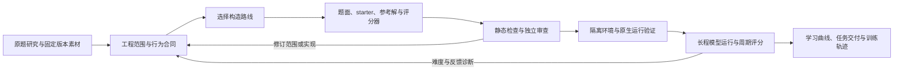

# EdgeBench 任务工厂

面向长时程 Agent 评测与训练数据构造的研发工作区。项目从真实软件、科学问题和模拟环境中获取素材，构造题面、起始工程、参考解与独立评分器，再通过模型实际运行，评估任务的可解性、评分可靠性以及数小时内的持续改进空间。

首批交付目标是 **100 道 Harbor 格式的长时程任务**。当前重点是软件工程任务生产：以 EdgeBench 原题的工程范围为尺度，结合 NL2Repo、DeepSWE 和 ProgramBench 的构造流程，建立从素材挖掘到六小时难度标定的工作链。

本页更新于 **2026-10-15**。运行进度使用带时间戳的本地记录；各批次独立保存，状态入口见下文。

Git 仓库统一收录各目录的普通文件；代码、研究与任务产物的收录范围，以及本地大数据和工具链的恢复说明见 [REPOSITORY.md](REPOSITORY.md)。

## 核心参考：NL2Repo、DeepSWE 与 ProgramBench

**本项目将 NL2Repo、DeepSWE 和 ProgramBench 定位为成熟的生产级 pipeline 参考，是任务生产最重要的工程起点，具有很高的复用价值。** 优先学习和复用的内容包括完整构造流程、作者角色分工、环境与资产组织、参考解验证、质量控制，以及失败修复和证据留存。

三条路线分别解决“如何从规格重建项目”“如何在真实仓库中构造功能任务”和“如何按可观察行为重实现程序”。本地参考资料与实现统一保存在 [upstream/swe-factory](upstream/swe-factory/README.md)。

| Pipeline | 核心生产流程 | 最值得复用的能力 | 在本项目中的用途 |
|---|---|---|---|
| **NL2Repo** | 可运行参考项目 → 环境准备 → AST/API 与测试证据 → 自然语言规格 → 公开环境与私有资产打包 → Oracle → 受限修复 | 规格抽取、API 覆盖检查、环境复建、参考回放、修复事务与回滚 | 按规格构建完整库、引擎或服务子系统，明确求解者必须实现的行为 |
| **DeepSWE 风格** | 固定仓库 → 选择消融、需求驱动或参考题演化路线 → 问题态/答案/测试 → 红绿与回归矩阵 → 独立 grader | 生产代码与测试的角色分离、逆补丁、测试先行、F2P/P2P 验证、定向修复 | 产品级功能演进、跨模块恢复、真实需求扩展与新实例演化 |
| **ProgramBench** | 固定 CLI → 构建参考程序 → 重复字节级探测 → 行为测试 → dummy/gold 质检 → 独立重建与发布 | 黑盒行为契约、输入输出溯源、弱测试过滤、确定性检查、独立重建 | CLI/格式/协议兼容重实现与语言移植；为性能题建立正确性约束 |

DeepSWE 的三种路线可按素材选择：**Ablation** 从健康实现构造待恢复缺口；**Query → Testcase → Solution** 从新需求和失败测试构造功能任务；**Specialize** 基于已有参考题扩展机制与需求。F2P 指问题态失败、参考解通过的目标测试；P2P 指两个状态都通过的受保护回归测试。

这三套流程的参考价值在于：将作者提出的题目转化为可执行、可重建、可检查的完整实验。本项目进一步补充长程工程范围筛选、强基线与捷径检查、连续反馈、快照评分和时间—分数曲线。

**参考定位与本地实现状态分别记录。** 上述“成熟、生产级”是项目对参考 pipeline 的定位。本地副本保存的是逆向复现规约及第一版参考实现，已有组件测试和人工示例记录；真实模型、Docker 与目标平台的验证范围以其 [README](upstream/swe-factory/README.md) 和 [复现说明](upstream/swe-factory/docs/factory_reproduction.md) 为准。当前软工流水线通过指导材料和作者构造流程吸收这些方法，三个参考构造器也保留各自独立 CLI。

优先阅读：

- [三套工厂如何适配 EdgeBench](research/software-engineering-2026-10-15/factory-methods.md)：方法选择、可复用模块和适配工作。
- 原始规约：[NL2Repo](upstream/swe-factory/nl2repo.md)、[DeepSWE](upstream/swe-factory/deepswe.md)、[ProgramBench](upstream/swe-factory/programbench.md)。
- 逐项分析：[NL2Repo](research/drafts/09-reference-nl2repo.md)、[DeepSWE](research/drafts/09-reference-deepswe.md)、[ProgramBench](research/drafts/09-reference-programbench.md)。

## 项目目标与整体流程

任务面向能够反复修改产物、提交评分并继续改进的 Agent。评价关注功能覆盖、行为兼容、优化质量等指标如何随交互时间变化，并按任务声明的方向选取历次最佳有效提交。



主要产物包括：

- **任务包**：任务合同、起始工程、参考解、评分器、依赖与构建上下文。
- **构造证据**：固定源码版本、许可、材料来源、范围卡、控制实验和文件摘要。
- **运行证据**：原生工具轨迹、逐次提交快照、评分记录、学习曲线和终止状态。
- **训练数据**：通过相应开发质量检查的真实工具交互轨迹及冻结代码。

## 当前主线：软件工程出题流水线 v2

当前工作以论文中 36 道软件工程原题为参照，将其划分为五条构造路线。以下分类是本项目的研究分类，详细依据见 [流水线说明](research/swe-pipeline-v2-20261015/README.md) 和 [逐题分类](research/swe-pipeline-v2-20261015/taxonomy.json)。

| 路线 | 工程任务形态 | 原题数 | 主要参考方法 | 当前候选素材示例 |
|---|---|---:|---|---|
| M1 | 产品级多目标演进 | 13 | DeepSWE query / specialize | Scrapy、MkDocs |
| M2 | 按规格构建完整系统能力 | 12 | NL2Repo | Lark、SQLGlot、Jinja |
| M3 | 正确性约束下的系统性能优化 | 6 | 参考构建与正确性检查，加专用性能测量 | DataFusion、LZ4 |
| M4 | 跨模块或跨 crate 恢复 | 3 | DeepSWE ablation | ripgrep、Click |
| M5 | 行为兼容重实现与语言移植 | 2 | ProgramBench | Ninja、yq |

一份作者任务按以下顺序组织产物：

```text
MATERIAL_MINING.json   素材调查、多个候选范围、强基线与探针
        ↓
SCOPE_CARD.json        已有能力、缺失交付、需求/模块/场景/评分对应关系
        ↓
REQUIREMENTS.json      固定行为合同
        ↓
task/                 起始环境、题面、参考解、评分器与构建文件
        ↓
AUTHOR_RESULT.json    构造结果、真实证据和待处理项
```

当前实现 [edge_factory/swe.py](edge_factory/swe.py) 提供四个入口：`catalog` 分类、`harvest` 素材线索采集、`plan` 类别专用作者任务生成、`gate` 静态准入检查。作者负责读取完整源码、选择工程范围、实现参考和评分器；独立审查与运行标定在后续阶段完成。

范围筛选重点是求解者实际还需完成的工程工作，包括完整产品能力、共享状态、多步行为、跨模块集成和真实优化空间。具体要求见 [长程工程量要求](requirements/software_long_horizon_scope_2026-10-15.md)。

### 素材池与近期进度

软件素材研究已整理 **50 项固定版本来源**，五条路线各 10 项；后续潜力复评将其中 14 项列为优先细化、23 项条件保留、13 项重设范围。素材数量、作者任务数量和验收题目数量分别统计。

- [50 项素材目录](research/software-materials-expansion-20261015/CATALOG_50.md)
- [高难潜力复评与优先名单](research/software-materials-potential-20261015/ANALYSIS_REPORT.md)
- [早期 8 个题包的独立范围与难度审查](research/swe-difficulty-review-20261015/REPORT.md)

以下是本地保存的运行快照，时间均为北京时间：

| 记录时间 | 工作 | 快照中的状态 | 证据 |
|---|---|---|---|
| 2026-10-15 21:47 | 新一批软工出题 | 10 个作者运行中：4 个候选修复、6 个新素材候选；本批启动解题运行数为 0 | [作者状态](runs/swe-route-authoring-010-20261015-r4/live-status.json) |
| 2026-10-15 22:42 | 已构造软工题的模型试跑 | 4 题满分后按用户要求停止、2 题学习中、3 题运行失败、1 题准备失败 | [解题状态](runs/rollout-status-20261015/20261015T144249Z.json) |

旧批 RESTler、pytest、Valkey、HTTPX 在约 14.0、4.5、3.5、4.5 分钟达到满分。该结果推动了工程范围扩展和强基线检查。当前的研发重点是形成可持续改进的完整任务，并补齐评分可信性与运行证据。

`requirements/current_phase.json` 保留跨阶段信息；查看具体运行时，优先使用相应批次最新的带时间戳记录。上表描述记录时刻，实时状态需要另行核验。

## 其它工作线与已有产物

### 六领域长程小样

早期按六个方向各构造一个小样，主包为 [long-horizon-built-007](samples/long-horizon-built-007/README.md)，后续运行候选分别保存在新版本目录中。

| 方向 | 代表任务或后续候选 | 主要工作 |
|---|---|---|
| 软件工程 | RESTler resilient execution / recovery | 请求执行、依赖与崩溃恢复 |
| 科学与机器学习 | 地下水反演、单细胞跨站点图学习 | 科学参数推断、跨分布建模 |
| 组合优化 | 工业排样 | 布局优化与独立几何核验 |
| 形式化数学 | Brownian multibranch proofs | Lean 证明恢复与内核检查 |
| 金融策略 | Cross-asset adaptive allocator | 因果决策、成本与风险约束 |
| 交互式游戏 | Wesnoth campaign AI | 固定游戏引擎下的策略改进 |

构造实现见 [task_factory](task_factory/README.md)；后续候选见 [runtime-pilot-candidates-001](samples/runtime-pilot-candidates-001/) 和 [remaining-three-built-001](samples/remaining-three-built-001/)。运行与曲线分别保存在 [next-two-001](runs/next-two-001/) 和 [remaining-three-001](runs/remaining-three-001/)。各任务按具体版本和运行记录判断进度。

### 路线优化与 SFT 试点

[training_factory](training_factory/) 实现了与原版路线优化合同对齐的训练任务试点：提取原始工程和检查器，构造新数据，经固定预算参考求解与分布筛选后，采集模型的真实修改、测试和反馈轨迹。

已有 **2 条真实 SFT 轨迹**，来自同一套任务。冻结代码在原版 56 例、每例 1 秒预算的迁移检查中均为 56/56 可行，相对官方 BKS 表的原始得分分别为 93.29、92.15。

- [训练 JSONL](runs/sft-release-001/train.jsonl)
- [交付与迁移审计汇总](runs/sft-release-001/delivery_summary.json)
- [训练流水线、复现命令与评价口径](PIPELINE.md)

这些是短时开发试点产物；长程评测任务按下文的独立验收证据交付。

### 原题与构造方法研究

本地研究快照包含论文中的 134 道任务索引、51 道公开任务定义，以及官方 README 中整理的 1,530 个成绩单元。它们用于分析任务形态与设计尺度。

入口：[整体研究报告](ANALYSIS_REPORT.md)、[全量任务索引](research/full_task_inventory.csv)、[公开任务分类](research/task_taxonomy.csv)、[公开成绩表](research/published_scores.csv)、[来源版本与摘要](research/source_manifest.json)。

## 目录导航

| 路径 | 职责 |
|---|---|
| [requirements/](requirements/) | 用户任务书、当前阶段记录、远端工作约定与工程范围要求 |
| [upstream/swe-factory/](upstream/swe-factory/README.md) | NL2Repo、DeepSWE、ProgramBench 的只读规约与参考实现 |
| [upstream/EdgeBench/](upstream/EdgeBench/README.md) | EdgeBench / SForge 代码快照及任务接入文档 |
| [research/](research/) | 原题分类、素材池、拟题卡、独立审查和来源证据 |
| [materials/](materials/) | 构造候选使用的项目源码与材料 |
| [papers/](papers/) | 相关论文 PDF、文本与研究材料 |
| [data/](data/) | 公开任务定义、路线优化原始资产与来源记录 |
| [edge_factory/](edge_factory/) | 当前 SWE 分类/采集/计划/静态检查入口，以及早期路线优化原型 |
| [task_factory/](task_factory/README.md) | 六领域小样的参考实现、评分器、装配和静态检查 |
| [training_factory/](training_factory/) | 路线优化对齐、校准、教师轨迹采集与 SFT 导出 |
| [agent_eval/](agent_eval/) | 按批次组织的远端构造、控制实验、解题与状态采集脚本 |
| [local_validation/](local_validation/) / [remote_smoke/](remote_smoke/) | 本地组件与远端运行验证工具 |
| [samples/](samples/) | 按版本保存的候选与题包 |
| [runs/](runs/) | 构造收据、控制结果、模型轨迹、快照、评分和失败证据 |
| [scripts/](scripts/) / [tests/](tests/) | 研究产物整理、检查脚本与本地测试 |

新批次使用新目录，保留原题、参考来源、旧评分和历史轨迹。任务包可能位于 `samples/` 或作者批次的 `jobs/<id>/task/`，以该批次结果文件中的路径为准。

## 本地使用

### 环境

工作区主体要求 Python **3.10+**；三个参考 factory 要求 **3.11+**，建议统一使用 **Python 3.12**。当前工作区已有 `.venv`，以下命令在根目录执行。

```bash
.venv/bin/python --version
.venv/bin/python -m edge_factory --help
.venv/bin/python -m edge_factory swe --help
```

新环境可以先创建虚拟环境：

```bash
python3.12 -m venv .venv
```

SWE 分类、计划生成和静态检查使用 Python 标准库，可直接从源码目录运行。路线优化参考求解器依赖见 [training_factory/requirements.txt](training_factory/requirements.txt)；具体任务的 Docker、编译器、Lean、游戏引擎等依赖由其构建文件与批次说明定义。

### 分类与素材采集

```bash
# 读取并输出全部 36 道原始软工题的五类分类
.venv/bin/python -m edge_factory swe catalog

# 访问网络，采集固定源码 tree 与公开 issue/PR 线索
# --output 必须使用尚不存在的新目录
.venv/bin/python -m edge_factory swe harvest \
  --sources research/swe-pipeline-v2-20261015/source-registry.json \
  --output /tmp/edgebench-swe-leads-001
```

`harvest` 输出来源线索与收据；完整源码获取、行为复现和任务范围选择由后续作者完成。

### 生成作者计划与检查返回结果

```bash
# 生成作者 prompt、范围指导与 launch-plan；不启动模型或连接远端
# --remote-root 是计划中记录的未来执行位置，按实际批次替换
.venv/bin/python -m edge_factory swe plan \
  --sources research/swe-pipeline-v2-20261015/source-registry.json \
  --output /tmp/edgebench-swe-plan-001 \
  --remote-root /path/to/remote/new-author-batch

# 将 --job 替换为已经返回完整构造材料的作者目录
.venv/bin/python -m edge_factory swe gate \
  --job /path/to/returned-author-job \
  --output /tmp/edgebench-swe-gate-001.json
```

`gate` 核对范围卡、真实报告文件、摘要、分数一致性和包文件；通过时输出 `needs_independent_scope_and_runtime_review`。独立工程范围审查、运行验证与长程标定各自保留结果。

### 三个参考 factory 的入口

在 `upstream/swe-factory/` 中运行，使用根目录的 Python 3.12 环境：

```bash
cd upstream/swe-factory
../../.venv/bin/python -m nl2repo_factory --help
../../.venv/bin/python -m deepswe_factory --help
../../.venv/bin/python -m programbench_factory --help
```

完整配置、构造、回放与修复命令见 [参考项目 README](upstream/swe-factory/README.md) 和 [复现说明](upstream/swe-factory/docs/factory_reproduction.md)。其中 `run` 会按配置调用模型及执行后端，`demo` 用于人工示例验证。

### 检查与复核

以下命令在工作区根目录执行：

```bash
# 检查 SWE 分类、作者计划与静态准入逻辑
.venv/bin/python -m unittest discover -s tests -p 'test_swe_pipeline.py' -v

# 核对研究表、实例蓝图和文档链接，并更新 research/artifact_validation.json
.venv/bin/python scripts/validate_artifacts.py
```

六领域题包的装配与检查命令见 [task_factory/README.md](task_factory/README.md)。远端启动脚本按批次配置，入口位于 `agent_eval/`；执行前按 [远端工作约定](requirements/remote_edge_workflow_2026-10-14.md) 核对任务版本、运行预算、账户和输出目录。

## 质量标准与交付状态

项目分别记录构造、运行和难度证据：

| 状态或证据 | 含义 | 后续工作 |
|---|---|---|
| 素材已获取 | 来源、版本、许可及设计线索已留存 | 确定范围，构造任务与完整参考 |
| `constructed_unverified` | 作者已生成题包草稿 | 独立范围审查、运行与评分检查 |
| `held` / `held_for_evidence` | 有明确缺口，需要补证据或修复 | 按结果文件逐项处理 |
| 静态检查通过 | 文件、合同、摘要与报告结构一致 | 执行真实环境与对抗控制检查 |
| 运行验证完成 | 特定版本的环境和控制实验已有真实记录 | 验证目标平台接入与长程改进空间 |
| 长程运行完成 | 保存了预算、快照、评分和终止记录 | 汇总重复运行、稳定性与正式交付证据 |
| 正式验收 | 对应版本满足完整交付要求 | 以逐题证据汇总计数 |

正式目标依据 [任务书原文](requirements/collection_brief_2026-10-14.raw.txt) 和 [结构化要求](requirements/collection_brief_2026-10-14.requirements.json)，核心要求包括：

- Harbor 任务格式，agent 与 verifier 分开构建和运行，运行阶段禁网。
- 评分只依赖声明的提交文件快照；verifier 每次独立执行，输出分数、有效性和具名检查项。
- 评分公式与常量进入机器可读元数据，同时保留原始指标和归一化分数。
- 支持多次提交、结构化反馈与历次最佳有效成绩，保存时间—分数曲线。
- 正式预算按小时计；任务书可见下限为 3 小时，当前开发标定通常采用 6 小时、每 10 分钟评分。
- 逐题提供参考解、空提交、重复模型运行及确定性证据，并完成构建与架构要求。

任务书原始粘贴存在截断，完整配额、奖励枚举及部分交付细节仍以补齐后的规范为准。各阶段的通过记录仅覆盖对应版本与验证范围。

## 接下来推进什么

1. 完成新批题包修复与素材构造，逐题核对工程范围、完整参考和强基线。
2. 修复评分协议、隔离和重建问题，保存近错实现与攻击性控制的重放结果。
3. 对具备运行条件的候选开展独立模型试跑，依据真实曲线调整范围与反馈。
4. 汇总 Harbor 接入、重复运行、稳定性和构建证据，形成可交付任务清单。
