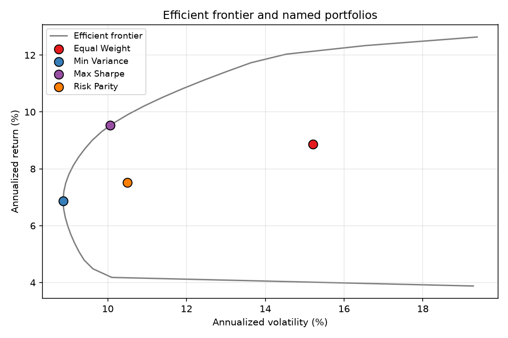
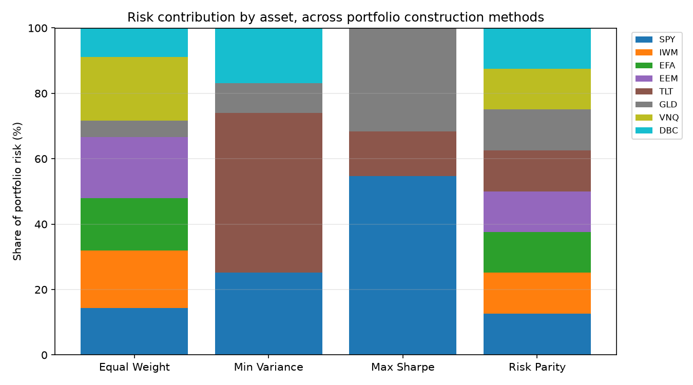
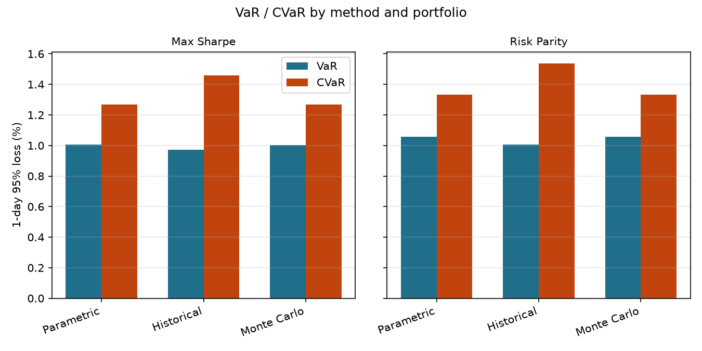
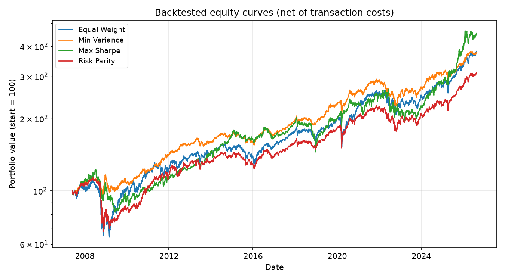
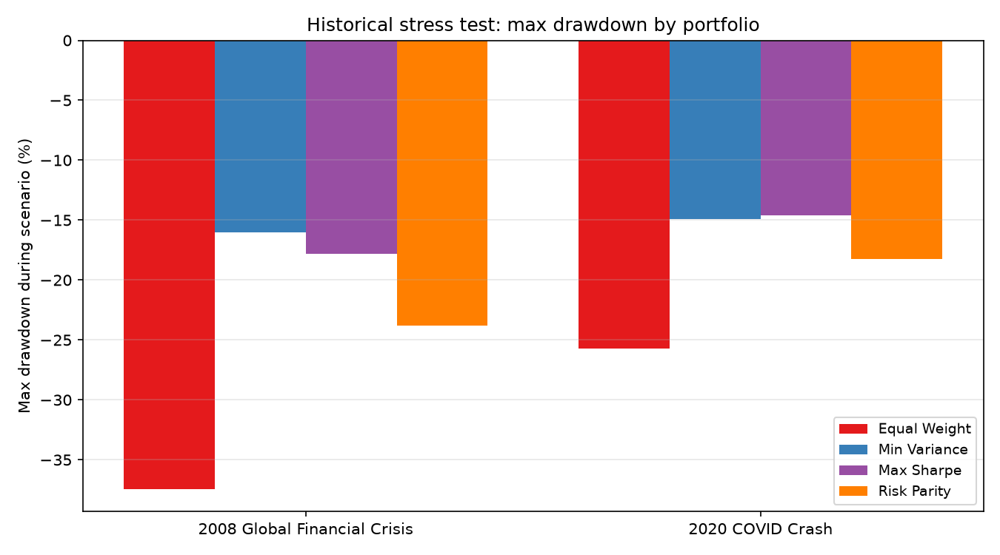

# Portfolio Risk & Optimization Engine

[](https://github.com/Seb-L-P/portfolio-risk-engine/actions/workflows/ci.yml)

Four portfolio construction methods (equal weight, minimum variance, max Sharpe, risk parity) built on a real 8-asset multi-class universe spanning 2006-2026, with VaR/CVaR measured three independent ways, rolling out-of-sample backtests with transaction costs, and stress tests against the actual 2008 and 2020 crises.

Two risk-management questions asked directly, and answered with measurements rather than assertions: **how much should you trust a risk model's number, and does yesterday's optimal portfolio actually perform well tomorrow?**

## Results

Universe: SPY, IWM, EFA, EEM (equities), TLT (bonds), GLD (gold), VNQ (REITs), DBC (commodities) — chosen for genuine asset-class diversity rather than eight similar large-cap funds. 5,083 trading days, 2006-06-01 to 2026-08-14, live-fetched (`source=yfinance`, cached to `results/prices.csv`). Reproduce with `python scripts/run_portfolio_analysis.py`.

### Four portfolios, full-sample weights

| | SPY | IWM | EFA | EEM | TLT | GLD | VNQ | DBC |
|---|---:|---:|---:|---:|---:|---:|---:|---:|
| Equal Weight | 12.5% | 12.5% | 12.5% | 12.5% | 12.5% | 12.5% | 12.5% | 12.5% |
| Min Variance | 25.2% | 0% | 0% | 0% | 48.8% | 9.1% | 0% | 16.9% |
| Max Sharpe | 41.3% | 0% | 0% | 0% | 31.0% | 27.7% | 0% | 0% |
| Risk Parity | 9.6% | 7.6% | 8.1% | 6.4% | 34.8% | 14.2% | 6.6% | 12.7% |

Mean-variance methods (min-variance, max-Sharpe) drive several assets to exactly zero — a well-known real behavior of unconstrained-except-for-long-only mean-variance optimization, not a bug: with only a long-only and sum-to-one constraint, the optimizer is free to conclude an asset simply doesn't belong, and it does so aggressively. Risk parity, by construction, never does this — every asset gets a strictly positive weight, because every asset is required to contribute risk.



Min-Variance sits exactly at the frontier's leftmost tip and Max-Sharpe sits precisely on the curve — both are supposed to, by definition, and both landing exactly there is a check on the optimizer, not just a nice picture. Equal Weight and Risk Parity sit inside the frontier, which is expected: neither targets mean-variance optimality, they target different things (naive diversification, and equal risk contribution, respectively).

### Equal capital weight is not equal risk weight



This is the single most useful chart in the project. Equal Weight puts 12.5% of *capital* into every asset, but because equities are far more volatile than bonds, that translates to equities dominating *risk* — SPY+IWM+EFA+EEM contribute roughly two-thirds of Equal Weight's total portfolio risk despite being half its capital. Max Sharpe is even more concentrated: SPY alone accounts for ~55% of that portfolio's total risk. Risk Parity is the only method that visibly spreads risk contribution evenly across all eight assets — which is exactly what it's designed to do, confirmed directly rather than just asserted (see `test_risk_parity_gives_roughly_equal_risk_contributions`).

### VaR/CVaR, three ways — and where they disagree



| Portfolio | Method | VaR (95%, 1-day) | CVaR |
|---|---|---:|---:|
| Max Sharpe | Parametric | 1.005% | 1.270% |
| Max Sharpe | Historical | 0.971% | **1.459%** |
| Max Sharpe | Monte Carlo | 1.003% | 1.269% |
| Risk Parity | Parametric | 1.057% | 1.334% |
| Risk Parity | Historical | 1.004% | **1.537%** |
| Risk Parity | Monte Carlo | 1.057% | 1.333% |

Parametric and Monte Carlo agree almost exactly (Monte Carlo samples from the *same* fitted normal distribution the parametric formula assumes, so close agreement is really a check that both are implemented correctly — the same cross-validation logic as MC-converging-to-Black-Scholes in the options-pricing project). Historical is the odd one out, and specifically in the tail: VaR (the threshold itself) is similar or even slightly *lower* than parametric, but CVaR (the average loss *beyond* that threshold) runs 15-20% higher. That's the textbook signature of fat tails — a normal-distribution model gets the "how bad is a typical bad day" question roughly right, then meaningfully underestimates "how bad is the worst 5% of bad days." It's the same lesson as the SPY volatility skew in the options-pricing project: a model that assumes a clean, symmetric distribution understates real market risk, discovered here from real returns rather than assumed going in.

### Out-of-sample backtest (20 years, quarterly rebalance, 5bps transaction costs)

| | CAGR | Ann. Vol | Sharpe | Max Drawdown | Total Turnover |
|---|---:|---:|---:|---:|---:|
| Equal Weight | 7.24% | 15.00% | 0.54 | -42.6% | 5.06 |
| **Min Variance** | 7.17% | 8.90% | **0.82** | **-22.7%** | 17.75 |
| Max Sharpe | **8.21%** | 13.19% | 0.66 | -33.6% | **51.92** |
| Risk Parity | 6.11% | 12.34% | 0.54 | -40.5% | 12.24 |



Two findings worth flagging as genuinely earned, not assumed. First: **Min-Variance had the best risk-adjusted (Sharpe) out-of-sample performance and the smallest drawdown**, despite being the simplest method that doesn't even use expected-return estimates. Second, and more striking: **Max-Sharpe's turnover is 3-10x every other method's.** That's not noise — it's the well-documented instability of mean-variance optimization when the expected-return input is a noisy trailing-window estimate: small quarter-to-quarter shifts in estimated returns can swing the "optimal" concentrated portfolio dramatically, forcing large, cost-incurring trades to chase an estimate that's mostly noise. Min-Variance and Risk Parity, which either ignore expected returns entirely or dampen any one asset's influence by construction, are far more stable rebalance to rebalance. This matches a well-known finding in the academic literature (e.g. DeMiguel, Garlappi & Uppal, "Optimal Versus Naive Diversification") — reproduced here empirically on real data rather than cited secondhand.

### Historical stress tests: 2008 and 2020, replayed against each portfolio's actual weights



| Portfolio | 2008 GFC Max DD | 2020 COVID Max DD |
|---|---:|---:|
| Equal Weight | -37.5% | -25.7% |
| Min Variance | **-16.1%** | **-14.9%** |
| Max Sharpe | -17.8% | -14.6% |
| Risk Parity | -23.8% | -18.3% |

Min-Variance and Max-Sharpe's smaller drawdowns trace directly back to the weights table above: both hold a large TLT (long Treasuries) position, and Max Sharpe additionally holds a large GLD (gold) position — both classic flight-to-quality assets that historically rally or hold up while equities fall. This isn't a coincidence the stress test discovered on its own; it's the mechanical consequence of the weights chosen for entirely different (mean-variance) reasons, and the stress test is what makes that consequence visible and quantified rather than just plausible-sounding.

## A real bug: max drawdown was silently invisible on day one

Both `stress_test.apply_scenario` and `backtest.performance_stats` compute drawdown as `value / running_max(value) - 1`. Fed straight from a return series, this has a quiet flaw: a series' own first point is trivially its own running maximum, so it always shows exactly 0% drawdown at that point — even if the very first day was a large loss. `test_max_drawdown_is_non_positive_and_at_least_as_bad_as_cumulative_loss` caught it: a scenario ending in a cumulative loss produced a max-drawdown number *less bad* than the loss it supposedly bounded, which should never happen (drawdown at the final point should be at least as bad as the cumulative return at that point, since the final value is by definition included in the running max computation).

The fix, in both places, was anchoring the series at its true pre-scenario/pre-backtest value (1.0 for the stress test, `initial_value` for the backtest, recorded as an explicit leading data point) before computing the running maximum -- so a loss on the very first day is compared against the real starting reference instead of trivially against itself. The test wasn't checking a specific value, it was checking a relationship (`max_drawdown <= cumulative_return` when the cumulative return is negative) that has to hold regardless of the input data, and that's exactly the kind of check that catches an edge case a numbers-only test would miss.

## Methodology

**Universe (`data.py`).** Eight liquid ETFs chosen for genuine asset-class spread (US large/small cap, international developed, emerging markets, long Treasuries, gold, REITs, broad commodities) rather than similar funds that would make every construction method converge to the same answer. Live-fetched via `yfinance` and cached to CSV immediately (same pattern as the options-pricing project's option-chain fetch), with a synthetic multivariate-normal fallback carrying a stylized asset-class correlation structure if the live fetch fails, so the pipeline runs end to end offline too.

**Optimization (`optimization.py`).** Long-only, sum-to-one mean-variance (`scipy.optimize.minimize`, SLSQP) for minimum variance and maximum Sharpe, plus an efficient-frontier sweep across target returns. Risk parity minimizes the sum of squared deviations between each asset's risk contribution and their common target (`portfolio_vol / n_assets`) — the risk-contribution formula itself falls out of Euler's theorem for the linearly-homogeneous risk measure `sqrt(w'Σw)`, which is why individual risk contributions sum exactly to total portfolio volatility (a good closed-form check that the implementation is right).

**VaR/CVaR (`risk_metrics.py`).** Parametric assumes portfolio returns are normal and uses the closed-form normal quantile / expected-shortfall formulas. Historical and Monte Carlo share one function (`var_cvar_from_returns`) that reads the empirical tail off *any* return series — the only difference is whether that series was actually observed (historical) or drawn from a fitted multivariate normal (Monte Carlo). That shared implementation is what makes the Monte-Carlo-vs-parametric agreement a real validation rather than two independently-written formulas that might both be subtly wrong the same way.

**Backtest (`backtest.py`).** A rolling-window, periodically-rebalanced backtest: at each rebalance, portfolio weights are re-optimized on a trailing lookback window (never using data from after the rebalance date), then held while drifting with actual asset returns until the next rebalance, with a transaction cost charged proportional to turnover. This is a genuinely sequential process — one portfolio's value path through time, not an independent-trials Monte Carlo — so unlike the batch simulations in this project's sibling repos, it's implemented as a plain day-by-day loop rather than forced into a vectorized form that nothing here actually needs.

**Stress test (`stress_test.py`).** Deliberately doesn't reuse the covariance/Monte Carlo machinery. VaR/CVaR answer "how bad could a normal day be"; a historical scenario answers "what would have happened to *this* portfolio if 2008 happened again," replaying real historical returns (correlations and all) against current weights rather than anything fitted or assumed — the standard distinction between a statistical risk measure and a scenario stress test in practice.

## Assumptions & limitations

- **Long-only, no leverage.** Every optimizer is constrained to `w >= 0`, `sum(w) = 1` — realistic for most real portfolios, but it's also what causes mean-variance methods to zero out several assets rather than short them; an unconstrained solver would behave differently.
- **Full-sample weights for the headline comparison table and stress tests** are estimated once from the entire 2006-2026 history — a look-ahead an actual investor wouldn't have had at any single point in time. The backtest section is the one part of this project that's genuinely out-of-sample; the headline weights table exists to make the four methods' *qualitative* differences (concentration, risk contribution) easy to compare, not to claim they were knowable in real time.
- **VaR/CVaR parametric and Monte Carlo methods assume returns are normally distributed and static** (one fixed mu/cov, no volatility clustering or regime-dependence) — exactly the assumption the historical-vs-parametric comparison shows real markets violate.
- **Two crisis windows only** (2008 GFC, 2020 COVID crash) — enough to make the point that different portfolio constructions behave differently under stress, not a comprehensive scenario library.
- **5bps transaction cost assumption** is a reasonable approximation for liquid ETF trading, not calibrated to any specific broker's actual fee schedule.

## Project structure

```
src/portrisk/
  data.py            live multi-asset price fetch + CSV cache + synthetic fallback
  optimization.py    min-variance, max-Sharpe, risk parity, efficient frontier
  risk_metrics.py    VaR/CVaR: parametric, historical, Monte Carlo
  backtest.py         rolling rebalance with transaction costs, performance stats
  stress_test.py      real historical crisis-window scenario replay
  plotting.py          report plots
scripts/
  run_portfolio_analysis.py   end-to-end: fetch -> optimize -> risk -> backtest -> stress test
tests/                 optimizer constraints/correctness, risk-parity equal-contribution
                        check, VaR/CVaR cross-validation, backtest accounting, stress-test
                        sanity checks (including the max-drawdown anchor bug's regression test)
results/                generated plots, CSVs, and summary.json from the run above
```

## Running it

```bash
python3 -m venv .venv && source .venv/bin/activate
pip install -r requirements.txt

pytest tests/ -v
python scripts/run_portfolio_analysis.py
```

## Possible extensions

- Black-Litterman: blend market-implied equilibrium returns with explicit views, instead of using noisy trailing-window sample means directly
- A volatility-clustering model (EWMA or GARCH) for the parametric/Monte Carlo covariance instead of a static sample covariance
- Transaction-cost-aware optimization (penalize turnover directly in the objective, rather than only measuring it after the fact)
- Factor-based risk decomposition (how much of portfolio risk comes from equity beta vs. rates vs. commodities) rather than only asset-level risk contribution
