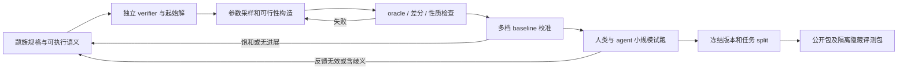

# 从已有题目扩展到可批量生产的任务实例

前一模块说明了 EdgeBench 的任务与评测接口。本模块处理其上游：怎样稳定生产有解、可验证、有优化空间的新任务。本文区分“已核实的一手机制”和“建议实现的方案”；所有试点、参数和数值门槛均为设计提案，尚未生成实例或运行 agent 实验。

## 1. 先明确三个层次

以下是为本项目提出的操作性定义，不声称是 EdgeBench 的官方术语。一个 benchmark 条目应对应一个完整、独立限时运行的 task instance，而不是一个隐藏测试输入。

| 层次 | 定义 | 例子 | 什么变化才计为新增 |
|---|---|---|---|
| Task family / 题族 | 共享参数化问题语义、可编辑产物和 verifier 契约的生成模板 | 带容量及时间窗的取送货路线优化；实现一个小语言解释器；热网络系统辨识 | 超出既有模板允许的参数组合，新增求解对象或验证契约；模板内规则组合变化仍是 instance，不能靠改名产生 family |
| Task instance / 任务实例 | 固定题族的一组规则参数、输入分布、初始代码/数据、预算与评测规则，交给 agent 完成一次长期任务 | “4 车辆、紧时间窗、团簇地点，编写泛化到新订单的求解器”，配公开反馈集与隐藏集 | 冻结新的规则组合、结构参数或待辨识系统；有独立 manifest 与完整评测包 |
| Test case / 测试样本 | 对提交产物的一次具体检查或运行 | 一张含 100 个订单的地图；一段待执行程序；一条新的激励轨迹 | 更换输入 seed 通常只增加此层，不应把 200 个 seed 计成 200 道新研究任务 |

若任务要求直接优化一张固定地图，该地图可以是 task instance；若要求写通用路线算法，该地图只是 test case。判断依据是 agent 的交付目标与一次独立运行的边界。随机实例可以提高测量稳定性，却不会自动增加语义覆盖。

建议形式化为 `F = (schema, G_task, G_case, V, R, budget)`；先由 `G_task(theta, seed_task)` 生成任务包 `I`，再由 `G_case(I, seed_case)` 生成输入 `x`。对 agent 产物 `a`，先计算合法性 `V(I, x, a)`，合法后才计算质量 `R(I, x, a)`。把 task seed、case seed、运行重复 seed 分开记录；最后一个衡量 agent 的随机性，不是新增任务。

## 2. 四篇相邻工作的实用结论

### 已核实：Reasoning Gym 解决“有 verifier 的参数化数据”

论文提出算法验证、广泛解空间和参数化难度三项原则，并把参数分成难度、结构、表述三类。其当前论文实现主要面向单轮文本推理，不能直接等同于数小时的研发任务。对本项目，最有用的是把生成器、验证器和参数 schema 绑在一起；单纯扩大数值或换表述不足以保证长期改进空间。[论文 v2，PDF p3、p10](https://arxiv.org/pdf/2505.24760v2)。

抽查官方代码得到具体机制：Mini Sudoku 先构造完整解，再逐个挖空；挖空时计数解，若破坏唯一性就恢复；实际挖空数会回填 metadata。其 `__getitem__` 使用 `Random(seed + idx)`，因此不同数据集仅换相近 seed 仍可能重叠，例如 `(seed=0, idx=1)` 与 `(seed=1, idx=0)`。这是代码层面的确定性结论，并非重复率实验。[固定 commit 代码](https://github.com/open-thought/reasoning-gym/blob/49b07130b3fcd12f2d064bba7c43869543a0e7e7/reasoning_gym/games/mini_sudoku.py#L142)。本地依据：`research/sources/reasoning-gym-mini-sudoku.py:142–179`。基类默认 answer matcher 不是任意开放任务的正确性证明，需要题族自己的 verifier：`research/sources/reasoning-gym-dataset.py:63–72`。

### 已核实：ALE-Bench 是最接近的“优化算法 + 可生成测试输入”样板

ALE-Bench 收集 40 个 AtCoder 启发式竞赛问题。每题配题面、scorer、visualizer 和人类榜单；同一生成工具可从 seed 与部分超参数产生公开、私有测试输入。公开全量评测为 50 个 case，lite 为 5 个，私有评测只在最终提交执行一次。这里的 generator 生成同一竞赛题的输入，不能据此说 ALE-Bench 自动生成了新竞赛题。[论文 v2，PDF p4、p21、p25、p28](https://arxiv.org/pdf/2506.09050v2)。

可借鉴的是把“算法开发时间”和“提交程序在每个输入上的运行上限”分别控制，并提供诊断可视化。局限是现成题与解法已公开；沿用原排行榜还受硬件、年份和规则变化影响。本项目自造任务应先用自己的 baseline 校准，不能直接赋予 AtCoder 等级。

### 已核实：RE-Bench 展示真正的新题如何验收

RE-Bench 每个环境配可运行但较弱的起始解、作者强参考解和评分函数；创建流程是规格、实现、人类试跑三轮迭代。构成最终 7 个环境的过程中，团队丢弃了超过 12 个规格和超过 5 个已完成实现。它强调反馈周期、工程复杂度、解法新颖性之间的取舍，并检查人类能否进步、得分是否符合预期和是否饱和。[论文 v2，PDF p6、p8–9、p11、p28–29](https://arxiv.org/pdf/2411.15114v2)。

启发是“生成成功”远未达到“合格 benchmark”。一个程序能稳定返回分数，仍可能太简单、不可辨识或只奖励机械搜索。参考解应当用于验题，但不能让任务产物通过直接复制参考文件获得分数；论文确实记录了这一类利用参考权重的违规尝试（PDF p42）。

### 已核实：MLE-bench 展示真实数据改造与重新划分

MLE-bench 从 Kaggle 挑选可离线评分、说明完整、数据可取得且许可允许的比赛；测试标签不公开时，从公开训练数据重建 split，并用示例提交和强提交检查分数是否与原榜单大体一致。其 validation server 检查格式而不回传测试分数，不能把所有“提交检查”混同为性能反馈。[论文 v6，PDF p3–5、p10、p13–14](https://arxiv.org/pdf/2410.07095v6)。

可借鉴的是数据单位一致的划分与评分复现审计；不能直接把公开数据切一块便声称获得新问题，或者已排除训练污染。ML 类实例还需要重新检查训练费用和完成一次反馈所需时间。

## 3. 五条造题路径：优先固定验证语义

下表全是本项目的实施建议。四篇论文分别支持程序生成、优化评测、验题和真实数据改造；repo 挖掘、模拟反演、规格生成与证明生成是据此提出的扩展路径，不声称已由这四篇实现。

| 路径 | 生成对象 | 如何先保证合法 | 如何形成长期任务 | 主要成本与失败方式 |
|---|---|---|---|---|
| 程序生成，oracle/verifier 先行 | 图、调度、路线、布局的规则组合与分布 | 可行解反推约束；小规模精确解；大规模独立合法性 checker | 交付能泛化到新 case 的优化程序，按多次迭代后的质量计分 | 同一标准算法横扫所有实例；只扩 seed；可行构造泄漏隐含解 |
| Repo 变更挖掘 | 固定 base commit 上真实 bug、性能回归或功能变更 | 重放原 PR；原版失败、参考补丁通过；加入独立回归检查 | 复杂功能或多项性能改进，保存每个 checkpoint 的成果 | 公共 patch 泄漏；测试只锁定参考实现；环境漂移；变成简单 pass/fail 修复 |
| 模拟器反演 | 隐藏物理/动力系统、观测数据与预测/控制目标 | 先采合法系统，再前向模拟；参考数值方法能恢复可观测行为 | 在实验预算内设计激励、辨识模型、改进预测或控制 | 不可辨识、多解被错判、模拟漏洞、单一拟合器迅速饱和 |
| 规格生成 + 差分验证 | 小语言、流处理、查询语义及代码骨架 | 可执行规格 + 独立 oracle；性质变换；边界与随机测试 | 先实现正确，再优化性能、覆盖规则组合 | 生成器和 oracle 共享同一 bug；没有定义 NULL、溢出、排序等语义 |
| 证明后向生成 | 从可信证明项产生目标定理，再隐藏证明 | 内核检查完整证明，不允许未经检查的公理/占位符 | 限制自动化条件，提交定理包或证明工具、逐步提高覆盖 | 重复平凡定理；单次 tactic 即解；定理依赖泄漏；深度不等于人类难度 |

优先级建议：程序生成与规格生成最适合第一批；模拟反演作为第三类提供实验设计差异。Repo 挖掘可并行建立候选池，但去污染和环境复现负担较重。证明生成应先证明其生成分布没有退化为简单定理变形，再扩大数量。

LLM 可参与提出规则组合、题面初稿、非标准 baseline 或 mutation。正确性证据应来自可执行规格、独立 verifier 或证明内核；两份模型回答互相同意不构成验题。

## 4. 统一生产线与入库对象

建议 manifest 至少包含：`family_id`、`instance_id`、`generator_commit`、`schema_version`、公开规则参数、数据分布标签、预算、容器/依赖摘要、公共资产 hash、隐藏资产 hash、验证器版本、baseline 分数与耗时、采样/拒绝原因、实际难度统计。隐藏答案、隐变量和私有 seed 只进入 grader manifest。任务可复现需要 seed、算法版本和依赖版本共同固定。

必须分开四种泛化：①同实例不同 seed 的 case 泛化；②同题族不同规则/规模的实例泛化；③结构 OOD，例如新图拓扑、规则组合；④新题族泛化。新模板采样一百万次不等于覆盖一百万种能力。统计时先在 case 层聚合，再在 task 层，再在 family 层报告，避免 case 多的题族支配总分。

生成时建议派生 seed：`H(master_key, family_id, instance_id, split, case_id)`，不要使用可能跨数据集重叠的简单相加方案。内容去重仍然必要：不同 seed 可以得到同一内容；图同构、等价程序和重命名后的规格还需结构规范化去重。

## 5. 优先试点一：带容量和软时间窗的取送货求解器

**交付物。** Agent 提交一个 `solve(input) -> routes` 程序；每个输入中每个订单必须被同一车辆先取后送，负载不能超过容量。目标是最小化 `总路长 + alpha × 总加权迟到`。第一版用软时间窗，避免大量随机生成的硬时间窗产生无解题；仍可覆盖窗口紧张时的决策困难。

**任务参数。** `N∈{50,100,250,500}`、车辆 `m∈{1,2,4,8}`、容量 `Q∈{4,8,16,32}`、订单载荷 `q∈[1,min(4,Q)]`；地理分布取 uniform / 3–8 个团簇 / 沿走廊分布；距离取 Manhattan 或欧氏距离（坐标和 rounding 在规格中明确）；软窗口宽度相对基础路程取 `{0.2,0.5,1.0}`；`alpha∈{0.5,2,8}`。一个 task instance 固定距离语义、分布混合、规模范围与预算；case 才采样实际地点和订单。

**合法性构造。** 先生成地点与正载荷，保证单订单不超过车辆容量。用随机顺序“取一单、送一单”构造一条可行路线，再按其到达时间产生时间窗并扰动。多车可以只有一辆非空，因此起始解总能合法。只用该方式可能让窗口泄漏构造顺序，应混入独立生成的软窗口，并把两种生成模式分别打标签。checker 独立重算每个订单出现次数、先后关系、车辆归属、沿途载荷、距离和迟到，不信任提交程序报告的 cost。

**评分与运行预算。** 开发反馈提供 20 个公开 case，最终冻结 200 个隐藏 case；另设 50 个超规模/不同簇形状 OOD case 单列报告。每 case 程序上限先设 1 秒、1 CPU、1 GiB；用指定参考机重新校准。合法性失败与质量分分开报告，并预先明确任何非法 case 是否令该任务零分。总分用固定 weak/strong baseline 的成本归一化，保留 raw cost；参考强解不是最优值，允许被超过。

**验题基线。** 顺序取送 → 贪心插入 → relocate/swap 局部搜索 → 固定预算模拟退火/大邻域搜索。只在 `N≤10` 的 audit 集计算精确解或枚举，用于校验 evaluator 和启发式，不要求大规模最优解。强基线从通用框架实现，不能读取构造时的隐藏路线。

**难度和 split。** 先按容量紧张度、窗口压力、团簇数分层，随后以基线间差距和收益曲线重新标注难度。训练/开发/测试按“地理结构 × 距离 × 约束组合”的规则签名分组，保留某些完整组合为结构 OOD；各组内使用不同 case seeds。禁止相同地点集只重编号后跨 split。

**拒绝门槛（建议）。** 起始解在 10,000 个生成 case 中有一次不合法即阻止发布；小规模 oracle 与 checker 任一不一致即阻止发布。若贪心相对强基线成本差不足 5%，超过 80% 候选实例判为过易；若强基线相对弱基线不能改善至少 10%，优先查目标/参数是否缺乏优化空间。固定提交重复评分必须一致；运行时间抖动另做处理。任务级长期价值还必须通过第 8 节试跑检验。

## 6. 优先试点二：规格生成的小语言/流处理引擎

**交付物。** 在固定 starter repo 中实现 `execute(program, events)`，通过语义检查后优化执行速度。第一版选小型流处理 DSL：`map`、`filter`、`group_sum`、`window_sum`、`stable_sort`、`take`，后续再加入 join。这里的 instance 是一组新的算子组合与语义规则，不是把同一解释器题换几个测试程序。

**任务参数。** 算子集合大小 `3–6`，程序深度 `2–12`，整数字段 `2–8`，字符串类别基数 `2–1000`，key skew `{uniform, Zipf}`，窗口宽度 `4–1024`；边界规则可选择 inclusive/exclusive、稳定排序或无序结果、缺失值拒绝或显式传播。一个 instance 固定这些语义，题面必须逐项写明。第一版整数用 Python 大整数语义或明确 int64 溢出策略；不混入未定义行为。

**合法性构造。** 用类型化 AST 生成合法程序，跟踪每步字段 schema；只生成有定义的表达式，非法程序另列专门错误处理 case。从规格写一个简单树解释器作为 oracle，再用独立实现或受限可翻译子集的现成引擎差分；同一个代码生成器产生两个“oracle”不算独立。加入性质检查，例如恒真 filter 不改输出、分区求和再合并与全量求和一致、稳定排序保持同 key 的原顺序。

**测试分层。** 公开 40 个小 case 和一套工作负载采样脚本；隐藏语义集 2,000 个小 case，其中至少 200 个是手工定义边界及 mutation case；隐藏性能集 30 个 case，每个 `10^5–10^6` 个事件。只有隐藏语义检查全通过才计算性能分，防止通过丢行、跳算或忽略罕见语义加速。具体数量可按初次 runtime profiling 缩减，但不得用性能样本代替语义样本。

**性能计量。** 固定进程数、CPU/内存；每个 case 预热后重复 5 次取中位数，整体报告几何平均 speedup，单列峰值内存。与正确的慢起始解释器比较，另配向量化/算子融合强基线。不让实现提交自己计时；每次评分从冻结快照启动并验证输出。输入序列化开销、编译时间、缓存复用边界需要预先决定并写进规格。

**难度和 split。** 标准解释器是合法起点；难度主要来自语义组合、跨算子优化和 key/窗口分布。按规则 AST 的规范化 hash 聚类划分实例，不能把只改算子名字的题放入测试。留出 `window→group→sort` 等组合评估组合泛化；更深程序和更偏斜分布作为 OOD，单列结果。不要声称仅留出输入 seed 就测了新语言泛化。

**验题基线与拒绝门槛（建议）。** 慢解释器、通用表格操作实现、算子融合优化三档；最少 10,000 个随机小程序经过双实现交叉核对，任何分歧先修复。注入漏掉最后事件、窗口边界偏移、错误 NULL、非稳定排序等 20 种错误，隐藏测试应检出至少 95%，且所有已知严重语义错误必须检出。若优化强基线不足起始实现 1.5×，不作为性能研发题发布；同机固定实现性能 CV 超过 5%，先修测量环境。若改名/硬编码公开输出即可过隐藏测试，直接退回测试设计。

## 7. 优先试点三：隐藏热网络的辨识与预测

**交付物。** 给出已知形式但未知参数的多房间热传导模拟系统、训练轨迹和有限实验接口，agent 提交能预测新控制输入下未来温度的模型。第一版只做辨识与预测；闭环控制可以作为后续独立题族，避免一次同时测多个不清楚的目标。

**任务参数。** 节点数 `n∈{4,8,16}`，拓扑 chain / grid / sparse-connected graph，每节点热容量 `C_i∈[1,10]`、边导热 `k_ij∈[0.02,0.5]`、对外散热 `b_i∈[0.01,0.1]`，可观测节点比例 `{0.5,0.75,1}`；噪声相对训练温差标准差 `{0,0.01,0.05}`；可选低强度分段非线性散热。每个 instance 固定拓扑、未知系数、传感器和训练数据；case 是该系统新的初始状态、外温和加热激励序列。

**合法性构造。** 从连通图产生非负对称导热矩阵、正容量与对外散热，按物理方程前向生成。选择步长满足显式积分稳定条件，或者采用有误差控制的积分器；第二种积分器复核 noiseless 轨迹，不能只验证数组非 NaN。参数不可辨识时仍可能正确预测，所以主分数是隐藏轨迹预测误差，不要求精确还原唯一参数。若出题目标是参数恢复，须另证可辨识性并处理等价参数。

**观测与预算。** 公开 20 条训练轨迹（每条 256 步），10 条验证轨迹可提供误差反馈；实验接口最多 100 次，每次允许选择 256 步合法激励并返回观测。目标提交为批量预测函数；隐藏 100 条新轨迹包含 20 个独立 seed 的多种激励，OOD 用更长 horizon 或留出的波形族。实验次数与 wall time 同时限制；这样才可比较主动实验设计和纯离线拟合。训练、验证、隐藏的激励 seed 与测量噪声 seed 均独立。

**评分。** 各节点误差除以冻结训练集尺度后计算平均 squared error，再汇总到任务级；不得用该次提交的预测值估计归一化尺度。报告 ID 与 OOD 两列，避免不同温度范围掩盖误差。存在观测噪声时给出可达到的误差下界估计和置信区间；不把 noise floor 误当成未解能力。

**验题基线。** persistence / ARX → 线性状态空间辨识 → 多起点物理参数拟合；先给全部基线同一实验预算，再比较随机激励与主动激励。仅供出题方验算的真实参数模拟器验证 noise floor，但不能把它当公平参赛强基线。小系统穷举结构或强优化做参考，记录拟合失败率。

**难度和 split。** 先检查传感器覆盖、可控性/可观测性代理指标、条件数、激励覆盖和拟合误差，不用“参数多”直接定义困难。任务按拓扑规范化 hash、观测布局与非线性类型分组；相同隐藏系统只换噪声不能跨任务 split。若需要测未知拓扑泛化，明确隐藏新拓扑类别，单独报告。

**拒绝门槛（建议）。** noiseless 双积分器的相对误差超过 `10^-6` 时先调整容差/步长；公开观测不足以区分的两系统若隐藏预测显著不同，补实验权限或删题。真实参数基线必须达到数值/噪声允许的误差水平。若一次默认最小二乘的误差已不超过强基线的 `1.05×`，且增加预算无收益，降为普通数值拟合题；若全部合法基线都不优于 persistence，查不可观测、分布或 scorer。基线排序对重复 noise seeds 极不稳定时，增加轨迹数量或降低噪声。

## 8. 什么时候才能称为 EdgeBench 式长期任务

以下门槛是建议的 pilot 决策规则，不是 EdgeBench 官方准入线，也不是已验证的最优阈值。

1. **先做低成本筛选。** 每族采 30 个候选 instance，覆盖至少三个参数层级。离线生成、oracle 和确定性基线全部通过后，保留 12–20 个候选；记录所有拒绝原因，禁止仅保存成功样本而隐藏生成失效率。
2. **证明有合法起点、有改进空间。** 起始解必须可运行且合法；至少两种不同策略的基线能产生可重复差距。若所有改进仅来自把同一现成 solver 的迭代数加长，不能据此声称测到了复杂研发能力。
3. **检查时间曲线。** 对小规模人类/agent 试跑记录 15 分钟、1 小时、4 小时的冻结产物与隐蔽独立复评。若 1 小时后曲线基本不动，不应仅把运行上限写成 12 小时便称为长期任务。首轮建议要求 1→4 小时的中位改善至少消化起始到强基线差距的 5%，且超过重评噪声的 2 个标准误；阈值通过首轮结果再固定。未通过可以保留为短时任务，不能混入长期主集。
4. **限制“反复看测试集”。** 开发反馈集、一次最终隐藏集和新的审计集分开。即使反馈只返回单一分数，也会产生适应性过拟合；hidden set 不参与 agent 的选择过程。用反馈选定产物后再看 hidden score，不根据 hidden score 重新选 checkpoint。
5. **区分计量单位。** 报告固定 task 数、family 数、每 task 的 case 数、每 agent 重复数、时间预算、调用/实验预算与总算力。case-level bootstrap 不能替代 task-level 或 family-level 不确定性；只有三个题族时，跨领域泛化结论仍然有限。
6. **保存时间与费用证据。** 每次提交存 artifact hash、时间戳、资源使用、反馈和错误类型。主要结果应包含最终隐藏分、达到质量阈值所需时间，以及完整曲线；按 log-time 的曲线面积可作辅助，但不能掩盖最终正确性。

可交付的第一阶段不是“自动生成 1,000 道题”，而是三个经独立验证的题族、约 36–60 个有难度档位的任务候选、可复现生成脚本、明确的 split 和基线报告。只有验题与曲线测试通过后，才把数量扩到千级；扩的是实例数，题族覆盖另行规划。

## 9. 来源清单与下载状态

全部下载成功，PDF 已通过 `pdfinfo` 读取，并由 `pdftotext -layout` 转为可检索文本。页码指本地 PDF 的 1-based 页面；以下各版本的主要印刷页码与 PDF 页码一致。校验值和文件大小另存 `research/sources/related-papers-manifest.json`。

| 来源 | 版本及页数 | 直接网址 | 本地文件 | 本模块重点读取 |
|---|---|---|---|---|
| Reasoning Gym | 2505.24760v2，44 页 | https://arxiv.org/abs/2505.24760v2 | `papers/reasoning-gym-2505.24760.pdf` / 同名 `.txt` | 摘要；PDF p2–3 原则与参数；p10 局限；p28 配置示例 |
| ALE-Bench | 2506.09050v2，46 页 | https://arxiv.org/abs/2506.09050v2 | `papers/ale-bench-2506.09050.pdf` / 同名 `.txt` | PDF p3–5 构建与评测；p21–23、25 生成器/实例；p28 限制 |
| RE-Bench | 2411.15114v2，68 页 | https://arxiv.org/abs/2411.15114v2 | `papers/re-bench-2411.15114.pdf` / 同名 `.txt` | 摘要；PDF p6、8–9 构建；p11、28–29 验题；p31、42 评分案例 |
| MLE-bench | 2410.07095v6，29 页 | https://arxiv.org/abs/2410.07095v6 | `papers/mle-bench-2410.07095.pdf` / 同名 `.txt` | PDF p1、3–5 任务与 split；p10 局限；p13–14 筛选标准 |

补充官方代码快照来自 Reasoning Gym commit `49b07130b3fcd12f2d064bba7c43869543a0e7e7`：

- [生成器接口](https://github.com/open-thought/reasoning-gym/blob/49b07130b3fcd12f2d064bba7c43869543a0e7e7/reasoning_gym/dataset.py)，本地 `research/sources/reasoning-gym-dataset.py`。
- [Mini Sudoku](https://github.com/open-thought/reasoning-gym/blob/49b07130b3fcd12f2d064bba7c43869543a0e7e7/reasoning_gym/games/mini_sudoku.py)，本地 `research/sources/reasoning-gym-mini-sudoku.py`。
- [官方题目贡献规范](https://github.com/open-thought/reasoning-gym/blob/49b07130b3fcd12f2d064bba7c43869543a0e7e7/CONTRIBUTING.md)，本地 `research/sources/reasoning-gym-CONTRIBUTING.md`。

已将 RE-Bench PDF p6 与 ALE-Bench PDF p22 渲染为 PNG 并目视检查，确认创建流程和生成公式的文本提取没有改变关键含义。未下载相邻工作的完整实验数据，没有运行模型、Docker、benchmark 或试点生成器。

## 10. 覆盖率明细

本模块是造题方法调研，不承担 EdgeBench/HF 51 任务或 harness 源码覆盖。覆盖范围是上面列出的与生成/验题相关章节与两个抽查生成器文件；没有把论文全文可检索等同于逐页精读。

| 对象 | 目标范围 | 实际阅读 | 达标说明 |
|---|---|---|---|
| 4 篇论文 | 摘要、构建、评测、相关局限 | 第 9 节列出的 PDF 章节 | ✅ 定向调研目标满足；未宣称全文覆盖率 |
| `reasoning-gym-dataset.py` | 全文件 148 行 | 1–148 | ✅ 100% 文件行覆盖 |
| `reasoning-gym-mini-sudoku.py` | 全文件 264 行 | 1–264 | ✅ 100% 文件行覆盖 |
| `reasoning-gym-CONTRIBUTING.md` | 全文件 96 行 | 1–96 | ✅ 100% 文件行覆盖 |
| 两段生成器代码合计 | 412 行（含注释/空行） | 412 行 | ✅ 100%；并非整个 Reasoning Gym 仓库覆盖率 |

下一模块可以把上述生成器与 EdgeBench 实际任务打包格式对齐，确定哪些字段能直接复用、哪些 verifier 和隔离机制需要新增。

