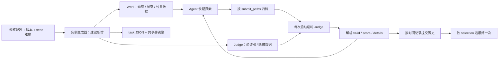

# 从任务分类到可批量生成的执行实例：SForge 契约

分类解释一个题目要求 Agent 做什么；真正要批量造题，还必须把题意、可见材料、提交协议、验证器和评分规则一起生成。SForge 已提供通用运行外壳，但本轮读取的任务契约中没有 `generator`、`seed`、`difficulty` 或独立 `holdout` 字段：这些应由出题流水线负责，再编译为普通 SForge 任务。

分析基线：官方仓库提交 `6e4e5f4aa087a9121aa09a6059e5484e5102c6ff`。下文代码路径均相对于 `upstream/EdgeBench/`。没有读取 `data/EdgeBench` 任务文件或论文；“官方行为”指已核实的框架实现，“建议”指新增题库设计。

## 1. 一个实例实际上是一个可复现实验包

官方普通任务的最小执行单位不是一道题干，而是以下契约的组合。

| 产物 | 必须解决的问题 | 官方接口与依据 |
|---|---|---|
| `BENCHMARK.yaml` | 共享运行环境与基镜像 | `name`、`base_images`；实际加载文件名是 YAML，`benchmark.py:25–47`。`task_spec.py` 部分错误消息仍写 JSON，不能照着旧措辞建文件 |
| 每实例一个 task JSON | 身份、路径、资源、镜像、提交和评分方式 | `TaskSpec`、`WorkSpec`、`JudgeSpec`，`task_spec.py:31–75,197–249` |
| Work 镜像 | Agent 能看到的题意、规格、骨架、公共数据与工具 | `work.setup_cmds` 或已发布的 `image_tag`；`dockerfiles.py:125–143` |
| Judge 镜像 | 评测程序、隐藏输入/答案、校验器和依赖 | `judge.setup_cmds` 或 `image_tag`；`dockerfiles.py:146–162` |
| 提交协议 | 哪些文件是解答，如何装入评测环境 | `submit_paths` 白名单 + `submit_exclude` 排除表；`run_evaluation.py:52–101,178–238` |
| 验证/评分程序 | 将解答变成合法性与成绩 | `judge.eval_cmd`、`eval_timeout`、`parser`；`task_spec.py:41–53,159–172` |
| 选择与归一化规则 | 哪次提交最好；跨题如何比较 | `selection`、`score_direction`、`rescale`；`selection.py:22–129`，`score_rescale.py:29–196` |

任务 JSON 的关键结构是：顶层 `task_id/name/base_image/platform/cwd/submit_paths/submit_exclude/internet/game_mode`；`work` 包含 `setup_cmds|image_tag/specs_dir/agent_query/cpu_limit/mem_limit`；`judge` 包含 `setup_cmds|image_tag/eval_cmd/eval_timeout/parser/selection/score_direction/rescale/cpu_limit/mem_limit`，游戏另加 `game_server_cmd`。`specs_dir` 和 `agent_query` 在文档中要求提供，但 loader 实际可回落到空字符串；生成器应主动校验完整性，不要把“loader 能读入”当作题目已合格。依据：`task_spec.py:197–249`，`docs/en/tasks/integration-guide.md:100–140`。

Work 和 Judge 从同一基镜像分别构建。每次普通提交都会新建临时 Judge，过滤归档路径，覆盖允许提交的文件，动态注入 `eval.sh`，执行评分，保存 `report.json`，最后清理容器。这适合长时迭代：历史尝试不会污染下一次 Judge；同时需要任务作者明确区分哪些状态应通过提交保留，例如模型权重、缓存或生成数据。依据：`run_evaluation.py:104–129,157–175,178–295`。



## 2. 批量生成器应输出什么

建议把题族模板建成五段流水线，而不是让语言模型只生成题干：

1. `sample(config, seed) -> latent_instance`：采样问题结构、规模与约束；保留一个可信可行解或可验证的生成证书。
2. `materialize(instance) -> public_bundle, feedback_bundle, final_bundle`：从同一个问题结构渲染题意、API、可见数据和隐藏检查，防止自然语言与验证器脱节。
3. `calibrate(instance, baselines) -> anchors, difficulty`：跑空解、弱基线、参考实现和强基线，测可行性、成本、区分度与可改进空间。
4. `compile_sforge(bundles, protocol) -> BENCHMARK.yaml + task.json + images`：输出上述官方契约，按提交物类型选择 parser 和 selection。
5. `validate_release(instance) -> manifest + audit`：固定生成版本、源码 commit、依赖、内容 SHA、资源限制、随机种子及校准记录；确认重复构建一致、解答合法性可核验。

这些函数名和目录是建议接口，SForge 不要求其存在。生成元数据建议放旁路 `manifest.json`，而不是假设 task JSON 中的自定义字段会被框架记录。框架的 loader 只提取固定字段，见 `task_spec.py:211–249`。

建议的产物目录：

```text
family/version/instance_id/
  manifest.json          # seed、配置、难度、来源、版本、内容哈希、校准结果
  task.json              # SForge 可读的任务契约
  public/                # 题意、骨架、公共数据、明确标注的本地反馈工具
  feedback_judge/        # 反复提交可访问的隐藏评测集与 evaluator
  final_judge/           # 仅正式终评使用的隐藏集与 evaluator（新增机制）
  reference/             # 出题者私有参考解/证书/弱强基线
```

镜像 hash 只覆盖基镜像配置、platform、cwd 和 `setup_cmds` 字符串，并不自动包含远程仓库当前内容、`agent_query`、`eval_cmd` 或 parser。故批量生成必须固定源码 commit/数据版本，并将实例内容 digest 显式写入构建来源或命令；只改同一 URL 后面的数据，不会改变镜像 hash。Work 的构建脚本还被复制到 `/tmp/setup_workspace.sh`，不要在其命令文本中放最终隐藏 seed 或参考答案。依据：`task_spec.py:56–58,96–122`，`dockerfiles.py:137–140`。

## 3. 四种可落地的生成模板

以下是按接口而非按学科组织的建议模板。它们覆盖不同题材，但共享上面的编译流水线。

| 题族模板 | 生成参数 / 生成产物 | Agent 提交接口 | Judge 与评分建议 | 为什么能批量扩展 |
|---|---|---|---|---|
| 约束优化：排程、选址、分配、图优化 | 规模、稀疏度、约束紧度、权重分布；先构造可行结构，再采样扰动；输出题目输入、实例文件、可行证书 | 固定实例优化提交 `solution.json`；考算法泛化提交 `solver.py`，按 stdin/stdout 运行隐藏实例 | 独立 checker 验证约束后计算目标值；`structured_json` + `valid_then_score`；明确 minimize/maximize | 结构采样可产生大量不同实例；通过弱强基线间的差距校准难度，不要求每个大实例都有最优解 |
| 规格驱动软件构建/修复 | API 组合、状态机、数据结构、不变量、边界条件；输出规格、骨架、参考实现/可验证 oracle、隐藏属性测试 | `src/` 或限定模块；固定 API/文件结构 | 功能任务 `pytest_v` + `pass_rate_first`；涉及性能则先正确性 gate，再 `valid_then_score`；变形/差分检查补充手工用例 | 变的是语义、组合和边界条件，而非变量改名；同一可信规格同时产出题干和测试 |
| 学习/科学计算流水线 | 数据生成机制、噪声、分布、训练预算、观测稀疏度；输出训练数据、公开验证数据、测试输入与私有真值 | `predict.py`、模型权重，或数值方法模块；约定输入输出与依赖 | 隐藏集上算误差/精度/成本；分开合法性、精度、资源指标；`structured_json` + 合适方向和 rescale | 改数据机制/参数与评价范围，可形成难度梯度；保持实际问题结构，不能仅替换随机 seed 就宣称新题族 |
| 可恢复交互环境：文本世界、工具使用、策略游戏 | 地图/对象/依赖图、初始状态、部分可观测规则；从可解计划反向生成，验证可达性 | `game_mode: true`；HTTP new/step/status/close，action 为字符串 | Judge 内运行服务器，返回 observation/score/peak_score/max_score/done/moves；另定义重置、终止和奖励规则 | 结构化状态机可系统改变规划深度和探索成本；必须验证 Agent 看到的说明足以建立正确世界模型 |

表中游戏协议与当前接口对齐：`judge_server.py:80–95,999–1063`；任务要提供 `game_server_cmd`，否则创建 session 报错，`judge_server.py:545–556`。不过当前内置游戏后端能否直接承载任意程序化生成环境，需要继续核验 `game_server_app.py` 与 `create_game_session` 未读实现段；此处不是“通用生成游戏已开箱即用”的结论。

这里最重要的接口选择是“优化当前一个公开实例”还是“写出可泛化的算法”。前者隐藏的是验证逻辑与可信计分，问题输入可公开；后者才需要隐藏新输入。二者都能长时迭代，但它们测量的能力不同，不能混在同一实例数量或泛化结论里。

## 4. 反馈、时间和 holdout 要分开设计

**官方行为。** Agent 主动 `sforge-submit` 获得成绩、失败项和摘要；后台 auto-eval 默认每 300 秒采样一次，不注入 Agent 上下文，也不受主动提交次数/冷却限制；最终成绩选 agent 与 auto 提交的最佳结果。依据：`docs/en/features/iterative-evaluation.md:18–61,98–138`。代码亦在历史查询中过滤 Agent 视图中的 `auto-*`，依据 `judge_server.py:963–995`；主动提交限额仅约束 `kind == "agent"`，`judge_server.py:371–414`。

**官方行为的边界。** task schema 只有一个 `judge`、一个 `eval_cmd`；所读执行路径将每次提交都送到相同 Judge 契约。没有发现独立最终 holdout 的标准字段或切换机制，不能把“隐藏测试”自动等同于“从不反馈的终评集”。最终取历次最佳也不等于评估固定最终代码。依据：`task_spec.py:41–75`，`run_evaluation.py:104–129,242–273`，`judge_server.py:443–469,504–534`。

**新题库建议。** 明确三层材料：公开的本地检查帮助进入有效探索；feedback Judge 提供有限诊断支持改进；final Judge 使用未反馈的实例/seed/数据，并在运行结束后对预先约定的归档检查一次。选择“末次归档”还是“根据 feedback 选出的最佳归档”必须事先固定；不要在 final 集上反复选 checkpoint，再宣称 final 是 untouched holdout。

要评估对题族的泛化，应分两层划分：先按问题结构/来源划分训练、开发、测试实例，再在单实例内部划分公共数据、反馈数据和终评数据。只给同一题换几个 seed，主要是在测试对该生成分布的泛化；结构变化的 OOD 测试要另报告。

长时改进能力建议报告固定预算时刻的 best-so-far、最终 holdout、总评测调用与成本，并保留原始曲线。框架记录 `submitted_at`、`runtime_seconds`，但 `submitted_at` 在 Judge 函数入口设置、发生于建镜像之前；它不是严格的 Agent 写盘时间，也不是评测结束时间。跨运行比较需要统一“预算从何时开始、评测等待是否计入”的口径。依据：`grading.py:46–64`，`run_evaluation.py:130–155,254–265`。本轮未核实论文具体时间曲线统计定义，需与论文分析交叉验证。

## 5. 评分契约中容易踩到的地方

推荐新题优先用 `structured_json`：

```json
{
  "valid": true,
  "score": 123.4,
  "summary": "可行；目标值 123.4",
  "details": [{"name": "feasibility", "status": "PASSED"}],
  "metrics": {"objective": 123.4, "runtime_seconds": 0.42}
}
```

这是建议输出例子，字段解释以 `log_parsers/structured_json.py:15–28` 和 `grading.py:157–221` 为准。`details.weight` 虽可携带，但框架没有自动做加权聚合；总 `score` 应由 evaluator 算好。解析器优先寻找 `>>>>> Start Structured Result` / `>>>>> End Structured Result` 之间的 JSON；建议评分器单独输出该区段，把解答程序 stdout 当作数据捕获，避免混淆谁有权给分。依据：`log_parsers/structured_json.py:37–76`。

| 注意项 | 代码事实 | 生成器/评测器应做什么 |
|---|---|---|
| 先合法后计分必须显式配置 | `score_first` 忽略 `valid`；只有 `valid_then_score` 过滤 `valid:false`，`selection.py:83–122` | 约束优化、资源限制、协议校验任务优先显式使用 `valid_then_score` |
| 默认策略不适合所有连续分数 | `pass_rate_first` 仅在两者都达到 100% 时比较 score；低于 100% 的同通过率不打分数 tie-break，`selection.py:51–80` | 不照抄迭代文档“100% 或相同通过率”的表述；按代码确定策略 |
| 无结果不会自动变非法 | structured parser 无可解析输出返回 `{}`，grader 的 `valid` 默认 true；超时仅记录 `timed_out`，`structured_json.py:76`、`grading.py:194–220` | evaluator 显式处理编译失败、超时、空解、非有限值；发布前用坏解测试，不依赖默认合法性 |
| legacy 分数解析有限 | `TOTAL_SCORE` 和 `score_sum` 正则不接收负数；`pytest_v` 把 XFAIL/XPASS 算 passed，并跳过 skipped，`grading.py:74–77`、`score_sum.py:51–65`、`pytest_v.py:47–56,84–95` | 有负收益、复杂部分分数、严格失败语义时使用 structured 输出；不要让预期失败掩盖未实现能力 |
| 归一化不是排序替代品 | `score_0_100` 单独计算；没有 rescale 时返回 None，非有限 raw 也返回 None，`score_rescale.py:66–76`；选择仍依 raw score 与方向 | 每个生成实例都要校准 anchors；不能直接套原题阈值。确认 maximize/minimize 与 rescale 单调性一致 |
| 锚点退化会坏分 | 相同锚点可返回 NaN，配置缺字段触发断言；未知 kind 回落 clip(raw)，`score_rescale.py:80–196` | 发布校验必须检查必填参数、严格单调和有限输出；不要静默接受拼错的 kind |
| score_0_100 不等于 Agent 实时反馈 | 标准 Judge worker 从返回对象移除归一化分数，`judge_server.py:530–534`，磁盘报告保留它，`run_evaluation.py:265–268` | 定义实验时分清 Agent 获知 raw metric 与研究者汇总 normalized metric |
| 提交边界是任务作者责任 | 默认仅排除 `tests/`；服务端按路径再过滤，`task_spec.py:242`、`run_evaluation.py:52–101` | 把 evaluator、私有输入、真值全部放在不允许覆盖的位置；不要只保护名为 tests 的目录 |

这些边界解释了为什么“生成很多 JSON”远远不等于“生成很多合格题”。流水线的关键输出应是通过校验的任务包：可行、可复现、有区分度、有持续改进空间，并且其反馈规则与研究问题一致。下一步应把这些契约与公开任务的实际资产对应起来，挑出生成成本最低、oracle 最可信的题族做小规模试产。

## 6. 需主分析交叉验证

- 论文如何定义时间起点、最佳成绩曲线与归一化；是否另有论文级终评数据划分，不能由本轮框架缺字段推断整篇论文没有 holdout。
- 实际发布任务是否提供 build commands 或只给 image tags；是否能取得题目材料、隐藏评测与参考答案。框架支持重建不代表发布内容都可重建。
- 程序化交互任务适配成本：继续读内置 game server 与启动参数，核实是否面向 Jericho 的专用协议。
- 自造题首批应实测：空解被拒、参考解通过、错误解失败、弱强基线排序、同 seed 重放一致、不同 seed 覆盖结构、从 feedback 到 final 的分数落差。

## 阅读覆盖明细

采用标准分析：核心 ≥60%，次要 ≥30%。只计实际逐行请求的区间并集；重复请求不重复计数。主契约文件均不足 500 行，已通读；大型 `judge_server.py` 只读相关段。总行数含注释/空行，未冒充有效 LOC；文档独立列示，不混入代码覆盖率。

| 文件 | 类型 | 总行数 | 实读区间 | 实读行数 | 覆盖率 | 达标 |
|---|---|---:|---|---:|---:|---|
| `sforge/harness/task_spec.py` | 核心 | 270 | 1–270 | 270 | 100% | ✅ |
| `sforge/harness/grading.py` | 核心 | 241 | 1–241 | 241 | 100% | ✅ |
| `sforge/harness/score_rescale.py` | 核心 | 196 | 1–196 | 196 | 100% | ✅ |
| `sforge/harness/log_parsers/__init__.py` | 核心 | 31 | 1–31 | 31 | 100% | ✅ |
| `sforge/harness/log_parsers/pytest_v.py` | 核心 | 141 | 1–141 | 141 | 100% | ✅ |
| `sforge/harness/log_parsers/score_sum.py` | 核心 | 74 | 1–74 | 74 | 100% | ✅ |
| `sforge/harness/log_parsers/structured_json.py` | 核心 | 110 | 1–110 | 110 | 100% | ✅ |
| `sforge/harness/dockerfiles.py` | 核心 | 162 | 1–162 | 162 | 100% | ✅ |
| `sforge/harness/run_evaluation.py` | 核心 | 295 | 1–295 | 295 | 100% | ✅ |
| `sforge/harness/selection.py` | 核心补充 | 129 | 1–129 | 129 | 100% | ✅ |
| `sforge/harness/benchmark.py` | 次要补充 | 47 | 1–47 | 47 | 100% | ✅ |
| `sforge/harness/judge_server.py` | 次要补充 | 1070 | 1–100,340–570,950–1070 | 452 | 42.2% | ✅ |
| **代码合计** | **12 文件** | **2766** | — | **2148** | **77.7%** | **✅** |
| `docs/en/tasks/integration-guide.md` | 文档 | 358 | 1–358 | 358 | 100% | ✅ |
| `docs/en/tasks/task-examples.md` | 文档（跳转） | 3 | 1–3 | 3 | 100% | ✅ |
| `docs/en/reference/task-schema.md` | 文档（跳转） | 7 | 1–7 | 7 | 100% | ✅ |
| `docs/en/features/iterative-evaluation.md` | 文档 | 151 | 1–151 | 151 | 100% | ✅ |
| `docs/en/features/game-mode.md` | 文档 | 56 | 1–56 | 56 | 100% | ✅ |
