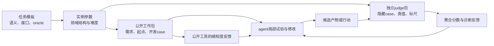

# 从官方领域到可生成任务机制

EdgeBench 的双反馈闭环解释了 agent 怎样反复改进，但还不能直接告诉我们怎样造题：相同“领域”可能要求训练 checkpoint、交付软件、搜索一个解，甚至直接操作一个持续运行的世界。这里先核对公开任务覆盖范围，再按“产物是什么、judge 怎么建立真值、哪些变量可以独立生成”重分组，为实例生成器确定接口。

本模块基于 Hugging Face 数据集快照 `6cc5a7f1b3288ce52484ad828177b8cc86b05b75`，通读 `tasks.jsonl`、51 个任务 JSON、`README.md` 和 `BENCHMARK.yaml`。本模块没有拉取任务镜像，也没有执行隐藏 evaluator。以下“可以生成”“建议”均为本次研究判断；官方事实单独给出文件证据。

## 1. 官方六领域回答“能力覆盖什么”

脚本 `python3 scripts/analyze_tasks.py` 从 `data/EdgeBench/tasks.jsonl` 逐条计算，结果如下。不要把公开 51 项的构成当成全量 134 项的构成。

| 官方类别 | 公开数量 | 公开子集比例 | 代表任务 | 元数据证据 |
|---|---:|---:|---|---|
| Scientific Problems & ML | 4 | 7.8% | BipedalWalker、Borden 反演、D-ABIC、图节点分类 | `tasks.jsonl:1` 至 `:4` |
| Systems & Software Engineering | 12 | 23.5% | ANN、编译器、Git 重写、压缩、Schemathesis | `tasks.jsonl:5` 至 `:16` |
| Combinatorial Optimization | 15 | 29.4% | 广告矩形、SMT、装箱、车辆路径、图着色 | `tasks.jsonl:17` 至 `:31` |
| Professional Knowledge Work | 4 | 7.8% | 英语组卷、CTA、K12 推荐、投资组合 | `tasks.jsonl:32` 至 `:35` |
| Formal Math & Theorem Proving | 8 | 15.7% | 7 个 Lean 工程、1 个 Coq 工程 | `tasks.jsonl:36` 至 `:43` |
| Interactive Games & Simulators | 8 | 15.7% | 3 个文字冒险、5 个策略程序任务 | `tasks.jsonl:44` 至 `:51` |
| 合计 | 51 | 100% | — | `research/task_taxonomy_stats.json` |

领域分类适合给 benchmark 做能力覆盖图，不宜直接决定造题方法。SMT 官方归优化，但也要构建一套软件；K12 官方归知识工作，但核心交付是训练与推理系统；BipedalWalker 使用游戏环境，却提交一个冻结的策略 checkpoint。这些交叉并不是分类错误，而是领域与机制两种问题的答案。

## 2. 七个机制主类回答“怎么造、怎么验”

下面是本次研究标签，每题仅有一个 primary，另保留 secondary，便于计数又不丢失跨域性质。完整 51 条见 `research/task_taxonomy.csv`。主类按 agent 主要改进的对象及反馈所衡量的行为选择，不能按任务标题或 `base_image` 决定。

| 机制主类（研究标签） | 数量 | 主要产物 | judge 的核心责任 | 最有用的生成单位 |
|---|---:|---|---|---|
| 软件功能构建 | 7 | 可编译/运行的源码补全或功能实现 | 根据固定公共契约检验隐藏语义行为 | 缺失模块子图、真实需求包、功能组合 |
| 性能优化 | 5 | 保持接口和语义的快速实现 | 独立验证正确性，再测速度/周期/压缩率 | 负载分布、资源模型、硬件/模拟架构 |
| 算法与策略求解 | 21 | 通用 solver，或指定问题的最终解 | 检查可行性/真值并计算目标值 | 约束生成族、场景参数、优化目标 |
| 学习与科学拟合 | 5 | checkpoint、预测算法或反演参数 | 在未见观测/episode/样本上测泛化 | 隐变量与观测模型、数据生成过程 |
| 形式证明 | 8 | 固定命题的证明体 | 内核验证、签名一致、可信公理与依赖闭包 | 已证工程的 proof-hole 依赖子图 |
| 专业交付物 | 2 | 多文件业务成果和可复现分析 | 文件/一致性约束、专业内容和业务目标 | 业务资料包、目标蓝图、约束与 rubric |
| 直接环境交互 | 3 | agent 的在线行动轨迹 | 维护权威世界状态并计算得分 | 可解的场景/谜题依赖图 |

跨域任务的选择依据：

- `portfolio_risk_calibration` 归算法与策略求解：公开元数据明确以样本外风险调整收益评估，交付优化器及回测结果，因此优化规则与时序场景是主生成轴；专业金融是 secondary。具体风险指标权重仍需镜像内 `scoring/score.py`，当前不能推断。（`tasks.jsonl:35`；`portfolio_risk_calibration.json:9`、`:29`）
- `cta_risk_budget_optimization` 归专业交付物：除了交易代码，还要求净值、信号、持仓、成交、预算分配、压力/敏感性分析等成套文件，任务的生成单元是业务研究包。算法与软件是 secondary。该任务也可在另一研究目的下归策略优化；本报告选择交付完整性这一设计重心，未声称官方 grader 对文档权重更大。（`cta_risk_budget_optimization.json:9`、`:47`、`:51`）
- `k12_math_recommendation` 归学习与科学拟合：需要 `train.py/infer.py/models`，元数据列出预测准确率、掌握度校准、学习增益与教学约束。（`tasks.jsonl:34`；`k12_math_recommendation.json:9`）
- `smt_solver` 归算法与策略求解：软件交付承载的核心目标是四种逻辑上的求解覆盖，反馈显式区分正确、超时、unknown、invalid_model，而非一般需求实现。（`smt_solver.json:29`、`:33`）
- 五个游戏 bot 归算法与策略求解：agent 交付一个可在多局运行的策略程序，之后由 judge 执行；游戏场景保留为 secondary。三个文字冒险归直接环境交互：agent 本身持续提交行动，连 `submit_paths` 都为空。两者的区别是“开发一个行动策略”与“在线扮演行动者”，生成器与执行接口也随之不同。（例如 `dcss_dungeon_ai.json:9`、`:19`；`anchorhead_text_adventure.json:8` 至 `:22`）

另需把评分形状作为独立标签。JSON 中有 `structured_json` 27 项、`score_sum` 18 项、`pytest_v` 3 项、空 parser 3 项；这些是输出解析接口，不是“真值类别”。同样的结构化 JSON 可以承载证明通过率、QPS、预测误差或主观 rubric。造题系统应先定义 oracle 和质量指标，再选择输出 parser，不能把“能返回一个分数”当作 judge 已经成立。

## 3. instance 至少有三层，seed 的作用取决于所在层

建议写入生成器的数据模型：

1. **任务模板/任务族**：固定问题语义、提交接口、生成分布、合法性规则、参考标尺和评分协议。例如“有容量与时间窗的车辆路径 solver 优化”。
2. **任务实例**：一次独立挑战的完整冻结包，包括具体公开材料、起始代码/模型/场景、约束、开发用 case、隐藏评测集合和配对 work/judge 环境。需要独立解决，并记录自己的参数与 provenance。
3. **测试 case / episode**：一个输入、一个图、一个局面或一局游戏，用来评测实例的候选产物。通常是一个任务实例中的重复测量单位。

只将 AHC 的 50 个隐藏 seed 换成另外 50 个，主要扩展测试分布；不能据此宣称创造 50 种新的 agent 任务。若 seed 同时生成了新的工作材料、约束和独立隐藏集合，则可以产生同模板下的新任务实例，仍不自动成为新任务族。Borden 的 seed 若控制整个污染源与观测数据，就是实例 seed；同一 Borden 场景内新增一个隐藏井位则是 case/measurement。区分的依据是工作包与求解目标是否变化，不是有没有随机数。

生成参数也须分层保存：内容参数决定实例“是什么”，难度参数决定依赖深度/规模/噪声等挑战，评测参数决定采样、预算与反馈。只增大文件或 case 数能增加运行时间，未必增加有效决策深度；把 judge 变慢也不等于形成长期学习任务。

## 4. 七类代表实例如何参数化

### 4.1 软件构建：Rust 多 crate 重建

**观察。** 任务给出类型签名和公共 API 契约，补全 `agent-start/`，grader 重新组织干净的 baseline/judge 工程，覆盖提交代码，再提供 layer 与 crate 两级通过结果。（`tasks.jsonl:12`；`rust_multicrate_reconstruction.json:25`、`:29`）这解释了为何它能持续产生收益：一处实现会解锁下游 crate 的集成路径，不只是修复一个孤立函数。

**生成模板。** 输入一个完整且测试通过的真实仓库和固定 commit；抽取模块依赖 DAG；按“基础模块→存储→跨 crate 集成→CLI”选择一组可恢复实现；删除实现体并保留签名、行为规范及有限公共测试。实例参数至少包含仓库、缺失符号集合、依赖深度、公开测试比例和接口约束。不要随机删除构建文件而意外生成不可运行任务。

**judge。** 保存完整参考源码与私有回归/性质测试。恢复环境时从干净工程开始，只复制允许提交的源码；判分按需求覆盖或能力层级设权，避免把大量重复测试当作进展。需要变异测试确认测试会拒绝常数输出、漏边界和绕过存储等弱实现。

**case 与 task。** 新增一种 key/value 输入只扩 case；换一个彼此依赖的缺失模块集合才形成同模板的新实例。换成不同语义的软件产品才扩任务族。大量遮盖局部函数若互不相关，会退化成短题集合；长期性来自可复用发现和跨模块集成。

### 4.2 性能优化：ANN 与 VLIW

**观察。** ANN 的固定目标是 SIFT-1M、Recall@10≥0.95 后最大 QPS；VLIW 则要求所有隐藏输入正确后最小化周期数。（`ann_vector_search_qps.json:15`；`vliw_kernel_optimization.json:24`、`:28`）二者都需要“语义门槛＋连续性能”，但计时噪声结构完全不同：ANN 要控制真实 CPU 与线程环境，VLIW 可用模拟周期作确定性指标。

**生成模板。** ANN 可参数化向量维度/数量、聚簇或长尾分布、距离度量、查询偏移、召回阈值和内存上限。VLIW 可参数化 kernel 数据依赖图、shape、向量宽度、issue slots、指令延迟与寄存器/访存预算。只改测试向量是 case；新实例应冻结一组具有明确瓶颈的 workload 分布及资源约束，向 agent 提供对应公共契约。

**judge。** ANN 的邻居真值和计时器在独立进程/环境计算，禁止相信提交方报出的时间。VLIW 从参考语义重算结果，并在可信模拟器中执行指令。每种新分布必须重新跑低质量 baseline 和较强参考解，验证有足够改进空间。沿用官方 `baseline/expert` 常数会把任务难度变化误计为能力变化。

**长期性。** 让优化机会分布在算法选择、索引/调度、数据布局和局部低层实现，而不是只有一个调参开关。保留短 smoke benchmark 与完整提交 benchmark 的双层反馈，避免每次改一行都等待数十分钟。

### 4.3 算法求解：CVRPTW 与递进问题包

**观察。** CVRPTW grader 在隐藏输入上重新编译 solver，逐例运行，独立检查可行性，比较车辆数和总路程与 BKS；总评测预算 20 分钟，每例最多 60 秒，最多取 56 个文件。（`vehicle_routing_time_windows.json:23`、`:27`）“有输出”与“合法”“比参考更优”分开，因此不需要为每个实例预先算出严格全局最优解。

**生成模板。** 从可行线路反推客户、需求、服务时间和时间窗，再在空间聚簇度、容量紧度、时间窗紧度、客户数上分层采样；以独立求解器建立参考标尺。完全独立随机生成时间窗可能产生不可行题，必须过滤。对 case 再按分布族分组，设置公开开发组、反复反馈组和最终未接触保留组。

**judge。** 路线合法性 checker 不应复用 agent 的计算结果；独立验证覆盖、容量、到达时间和成本。新实例必须带新 BKS/强参考，不能允许“无 BKS 则拿候选本身当基线”的退化。当前公开包装代码确实有 `bks.get(name, (nv, td))` 的 fallback，建新 benchmark 时应改成缺失标尺即使评测失败。（同一文件 `:27`）这是构建者需要修复的可靠性问题，并非 agent 的解题建议。

**case 与 task。** 换客户坐标通常是新 case；冻结不同分布、资源约束、目标组合及起始 solver 的完整包可形成新实例；引入取送货、异构车队等语义则扩任务族并要求新 checker。另一条路线是 `tree_block_partitioning`/`equivalence_class_divide_and_conquer` 的六题递进包：5/5/10/15/25/40 权重与半分子任务机制已明确，真正应生成的是六题间可迁移的方法依赖，而非随机凑六道题。（两文件 `:21`）

### 4.4 学习与科学拟合：Borden 污染源反演

**观察。** agent 从稀疏、有噪声且有删失的井位观测推断一个有限持续时间的三维矩形污染源。提交位置、半边长、浓度、起始时间、持续时间和传输模型信息；judge 只读取 `answer.json`，使用隐藏前向模型预测隐藏井位和未来时间。格式分不能绕过预测质量门控，差预测会触发 15/30/45 等级封顶。（`borden_source_inversion.json:23`、`:27`）它不是“写一篇污染治理报告”，也不是“运行脚本就得分”，核心是一个经隐藏观测验证的科学推断。

**生成模板。** 先采样物理隐变量和可接受的水文模型，用可信前向模拟得到真实浓度；再采样公开/隐藏井位和时间、加入噪声与检测下限。难度由观测密度、源形状、参数相关性、时间外推跨度和噪声决定。实例生成器应同时保存真实隐变量、干净观测、噪声机制和公开先验；agent 只能得到后两者的公开投影。

**judge。** 首先校验 schema/边界，再独立前向求解并计算留出预测误差。不要仅按参数误差判分：弱可辨识场景可能有多个参数解都解释观测。构建者应先跑识别性诊断与 oracle fit，排除几乎没有信号的题；还要避免 agent 获得的数据由一个模型生成、judge 却采用无从合理逼近的模型。

**case 与 task。** 同一源的新井位是评测点；新源＋新公开观测＋隐藏未来读数是新任务实例。只把公开数据增加几位小数不构成有意义难度。长期收益来自前向模型、数值近似、优化初始化、观测误差建模的逐层改善。

### 4.5 形式证明：从完整 Lean 工程生成缺口

**观察。** 7 个 Lean 任务共享大体接口：完成 `sorry`、不得改变既有声明签名、先 `lake build`；评测复制可信依赖与声明公理检查文件，再运行 `eval_lean.py`。Carleson、ConNF、PFR、FLT 等 prompt 显式要求传递依赖无未证前提；FLT 还用权重文件，指出上层 `fermatLastTheoremSeven` 在先决证明未完成时不计分。（`carleson_formalization.json:18`、`:22`；`flt_regular_formalization.json:18`、`:22`）不能把“新生成一个数学命题”当作这个模板的低成本等价替代。

**生成模板。** 从已被 kernel 接受、许可允许使用的完整证明仓库开始，固定 Lean/Coq 和依赖版本；抽取 theorem dependency DAG；选取一个连贯子图，删除若干证明体而保留定义和目标签名。记录删除位置、完整参考证明、公理白名单、评分权重与目标闭包。可以控制引理数、最大依赖深度、数学工具跨度、自动化 tactic 可达率。

**judge。** 从可信签名/定义与提交证明体重新构建，检查 forbidden axioms/sorry、传递依赖和命题是否被改弱。编译通过本身不充分，因为含 `sorry` 的工程也可能编译；字符串中找不到 `sorry` 也不充分，因为可通过新公理或改定义改变命题。

**case 与 task。** 重命名变量和重排声明通常只是表面变体；改变待补证明子图是同模板新实例；新的数学领域/库组织可扩任务族。随机挖空过多底层定义可能让所有上层目标都无从取得局部进展，随机挖空太少又会被自动 tactic 一次补完。需要用分层 baseline 验证“先学会一组基础引理，再解锁后续目标”的路径存在。

### 4.6 专业交付：五套英语试卷

**观察。** 文件合同列出 A–E 五套试卷，每套原卷与答案评分细则的 DOCX/PDF，加蓝图与重复率两个 XLSX，共 22 个明确路径；唯一允许联网的公开任务也是此题。评分入口为 `grade_with_codex.py`，但完整 `task_instruction.md`、教材输入和 rubric 都在镜像里，不能仅凭入口文件名断言全评分由 LLM 主观打分。（`college_english_exam_bank.json:7`、`:9` 至 `:31`、`:41`、`:45`）

**生成模板。** 输入已获授权的教材/知识点资料、教学目标、目标能力水平、题型比例、总分和重复率约束，生成一份机器可读 blueprint；再生成 agent-facing 要求和对应 rubric。把教学难度、知识点覆盖与跨卷差异当作内容参数，文件名和排版当作交付合同。更换课程、能力蓝图和资料库能形成新实例，仅更换封面姓名不行。

**judge。** 机器检查文件齐全、可打开、DOCX/PDF一致、分数求和、答案对应、重复率与蓝图覆盖；学科专家/校准后的内容评审检查题意、唯一答案、干扰项与难度。固定 rubric、参考样例和多次评分方差，必要时人工抽审。不能让 LLM 同时随意编题和随意编评分标准，这会让实例难度与分数漂移。

**长期性。** 让五套之间有真正的覆盖/难度/重复率耦合，局部修一道题会影响整套蓝图；反馈则分别暴露文件缺失、答案不一致、覆盖缺口、跨卷重复。否则它会退化成“一次长文生成”，没有可靠的多轮改进信号。

### 4.7 策略程序：DCSS 与 OpenTTD

**观察。** DCSS 提交 Lua bot，固定角色武器，5 个隐藏 seed 各跑 900 秒，返回 morgue 分数；本地 1..100 seed 与 holdout 分开。prompt 明确 `Pass rate` 只表示成功生成可接受 morgue，不代表策略质量；相同代码反复提交不应靠随机地图碰运气。（`dcss_dungeon_ai.json:19`）OpenTTD 则提交 Squirrel AI，20 个游戏年、多个地图，测公司价值。（`openttd_transport_ai.json:15`、`:19`）

**生成模板。** 先使用引擎已有的地图/episode生成器获取大量 case，再将不同角色、初始资源、地图拓扑、经济约束或对手配置成任务实例。保留“公开本地种子＋固定反馈种子＋最终未反馈保留种子”。从这类模板生出新的 task 比文字冒险容易，因为地图生成器和引擎规则已经提供可重复模拟与奖励。

**judge。** 在可信引擎中执行策略，不读策略打印的自报分数；动作 API 只允许合法决策，并从游戏引擎状态计算得分。按 seed 成对比较候选与 baseline；区分加载失败、动作失败、提前死亡与低收益。wall-clock 任务还需固定硬件与并行度，否则“更多可执行回合”混入测量波动。

**case 与 task。** 换一个 DCSS seed 是一局新测量；换角色/资源/目标分布并提供完整独立工作包是新实例。它的 agent 行为是“写、测、改 bot”，因此归算法与策略求解；游戏引擎只是策略的被执行环境。

### 4.8 直接交互：文字冒险世界

**观察。** Anchorhead、Trinity、Tryst 三项都有 `game_mode=true`、空 `submit_paths`、空 `eval_cmd/parser`，而在 judge 中配置不同 ROM 的 `game_server_cmd`。这说明 agent 的主要产物不是一个提交文件，而是对持续世界的一串 HTTP 行动。（三个 JSON 均 `:8`、`:10`、`:18` 至 `:22`）

**生成模板。** 要低成本批量造这类实例，需先做显式状态机/世界模型：房间图、物品与容器、动作前置条件、状态变化、谜题依赖 DAG、不可逆分支与计分点。先生成一个有可验证解轨迹的世界，再由语言模型渲染描述和线索。仅让 LLM 自由续写剧情，很难保证线索充分、状态一致和任务可解。

**judge。** 权威状态迁移和奖励应由引擎决定；参考 planner 或已知解轨迹验证可达性，并通过随机策略与较强策略检查难度。复位、保存和最高分统计必须规定清楚。生成器应记录世界结构真值，不向 agent 暴露隐藏路线或完整状态图。

**case 与 task。** 同一固定 ROM 重开仍是同题；改人物地名是低多样性表面变体；改变物品/谜题依赖和分支才形成结构新实例。当前 HF JSON 只指向现成 ROM，并未公开这种世界生成器；所以这类题的模板化可行性低于数值优化和性能 workload，不能因为“HTTP 能连上”就声称可以大规模造新题。

## 5. 公开下载究竟给了什么

51 个任务 JSON 的 work 都只有 `image_tag/specs_dir/agent_query` 三个字段，judge 也全部包含 `image_tag`。因此是 51 对预构建镜像引用，共 102 个引用位置；三个文字冒险共享 work tag，并非 102 个不同镜像。`BENCHMARK.yaml` 提供 Java/Rust/Python/C++/Coq/Lean 等基础镜像和公共依赖安装描述，并不包含这 51 个任务各自的输入数据、起始仓库、checker、Docker 构建来源。（`BENCHMARK.yaml:1` 起；逐任务字段的统计见 `task_taxonomy_stats.json`）

当前 HF 文件树包含 README/许可、资源图片、`BENCHMARK.yaml`、`tasks.jsonl` 与 51 个任务 JSON，没有这些 JSON 引用的 `public_problem_config.json`、数据 CSV/HDF5、目标 Lean 工程、ROM、`scoring/score.py`、`/opt/tests/test.sh` 等实体。能确认它们应在相应任务镜像中，不能据此称本地已经取得完整环境/原始数据集/完整 grader。

但“没有判分代码”也不准确：10 个 JSON 的 `eval_cmd` 包含 Python 等执行/聚合包装代码，涵盖 Arc、FFmpeg、Juliet、Rust 重建、三项 Schemathesis、VLIW、SMT、CVRPTW。CVRPTW 甚至直接公开目标公式，Schemathesis 公开 phase聚合与反馈整理；它们仍调用未随 JSON 下载的测试/验证程序或数据。应区分**公开合同与包装器**、**可拉取运行镜像**、**可复建的任务源码/生成器**三个层次。批量出题主要需要最后一个层次；重复运行既有镜像不等于可以构造新的实例。

可生成性在 CSV 中是有条件的工程判断，不能读作源码已经到手。优先顺序建议：

| 路线 | 批量化基础 | 仍需取得或重建 | 主要成本 |
|---|---|---|---|
| 优化 case / solver 工作包 | 现成 generator/tester 接口或可控约束模型 | generator/checker源码、独立强参考、公开/隐藏分割 | 难度与参考标尺校准 |
| 性能任务 | 已有参考语义与可参数化 workload | 输入生成器、可信计时/模拟器、固定资源环境 | 噪声控制与基线重测 |
| 仓库挖空 / proof-hole | 完整正确源码或完整证明 | 锁版本依赖、语义测试或kernel验证、目标依赖图 | 防退化、挖空选择、难度校准 |
| 科学/学习场景 | 可用前向模型或可信数据生成过程 | 观测生成器、留出真值、可辨识性/泛化评估 | 数据真实性与病态性控制 |
| 专业交付与文本世界 | 业务目标/状态模型可形式化 | 内容资料、专家rubric或可解世界模型 | 专家正确性、评分一致性、结构新颖性 |

## 6. 可复用的优点与造题时应修正的细节

最值得保留的是“有低质量合法起点、局部可诊断反馈、可信全局提交分数”的组合。Borden 的格式与预测质量分离、VLIW 的全正确门槛、Lean 的传递依赖、Rust 的 layer/crate反馈，都说明长时任务不是单纯把提示写长：它要允许小幅进步，同时让高分必须依赖更深的实质工作。

当前数据也暴露出生成器应该自动检查的合同问题：

- `tasks.jsonl.language` 不是可靠的实际实现语言：Arc 标 Python 但描述 TypeScript；Git 标 C++ 却要求 Zig；OpenRCT2 标 Python 却要求 ES5。研究分类与打包依赖应读实际提交接口，保留官方字段时标明其含义不可靠。（`tasks.jsonl:6`、`:9`、`:47`）
- FFmpeg 的单个 prompt 同时保留“26/30且四处失败”和尾部“当前30/30”的历史指导。新模板必须由一个结构化规格源生成 prompt、baseline状态、judge和元数据，避免不同版本文字拼接。（`ffmpeg_swscale_reimplementation.json:21`）
- 有些原始指标越小越好，有些经过 `rescale` 映射后才便于跨任务比较；预算和分布改变后需重新标定。CSV保留显式方向和完整rescale，未把缺省方向擅自填成已有事实。游戏 `Pass rate` 与质量分也必须分开。（`vliw_kernel_optimization.json:31` 至 `:36`；`dcss_dungeon_ai.json:19`）
- 原题是否允许 agent 自行生成本地 case 是独立约束：广告布局鼓励无限 seed，三角剖分题则只允许三个固定公开 case，明确禁止本地生成。我们给 benchmark 构建者提出的生成轴，不是给运行原题的 agent 增加权限。（`ad_placement_optimization.json:15`；`triangulation_coloring_optimization.json:15`）

由此，下一步的实例生成器应输出一对可审计的 work/judge 构建产物，而不仅是一条自然语言问题；并以参考解可行、评分可信、反馈有用、不同预算仍有进步空间作为实例入库条件。

## 覆盖记录

核心模块要求至少 60%；本模块全部 54 个文本文件按物理行通读。JSON 的 `agent_query/eval_cmd` 常把多行内容编码到一个物理行，阅读时已检查其完整字段内容；覆盖率仅针对下载文本，不包括镜像内任务工程。统计脚本生成逐文件明细至 `research/task_taxonomy_stats.json`，以下汇总由相同文件行数计算。

| 文件组 | 文件数 | 总行数 | 已读行数 | 覆盖率 | 达标 |
|---|---:|---:|---:|---:|---|
| 51 个任务 JSON（核心） | 51 | 1789 | 1789 | 100% | ✅ |
| `tasks.jsonl`（核心） | 1 | 51 | 51 | 100% | ✅ |
| `README.md`（次要） | 1 | 214 | 214 | 100% | ✅ |
| `BENCHMARK.yaml`（核心） | 1 | 130 | 130 | 100% | ✅ |
| 合计 | 54 | 2184 | 2184 | 100% | ✅ |
