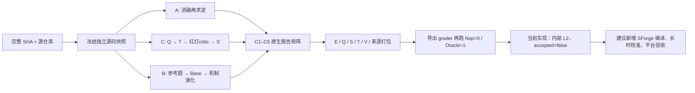

# DeepSWE 工厂如何作为 EdgeBench 式任务生成层

这份参考项目适合复用的核心是“生产一个可回放的题目实验包”，而不是直接充当长时评测平台。它把固定源码、题面、答案、隐藏测试和原生报告连接起来；SForge 可接手 Agent 的长期运行、周期采样和反馈，二者之间仍需编译与验收层。下文未执行模型、Docker 或 demo，仅只读核对代码与保存的历史证据。路径除明确标注 EdgeBench 外，均相对 `upstream/swe-factory/`。

## 1. 三条路线，共用同一个任务契约

规格把实例写成 `I=(E,Q,S,T,V,P)`：问题环境、题面、参考解补丁、隐藏测试补丁、验证器、来源证据（`deepswe.md:35–64`）。三条路线是替代工艺，不能当成必须串行的 A→B→C。

| 路线 | 代码实际的数据流 | 适合产出的变化 |
|---|---|---|
| `ablation` / A | 完整功能 F → 只读分析 → 消融成 E → controller 求 `diff(E,F)`，按生产/测试路径拆成 S/T → 矩阵与打包复验 | 从可信现成功能产生“恢复缺失行为”题；当前是 existing 测试模式，选中测试须整文件删除，不能随意削弱测试。`pipeline.py:153–172` |
| `query` / C | 固定 E → analyze/query → testcase T → 在旧行为上真实失败 → 只读 critic → solution S → 矩阵 → 导出复验 | 新需求、跨模块兼容行为、边界扩展；query 要求至少两个真实证据文件和 requirements。修 Q 增版本并重做 T/S，修 S 复用 Q/T；共享 repair budget。`pipeline.py:174–213` |
| `specialize` / B | 完整参考题 → 应用参考 S/T → 加独立测试 → mask → 验证 Base；再从原问题态+原 T 的 scaffold 规划新需求 → evolve → mask → 改写题面 → 验证 | 迁移优先级、状态机、兼容性等“困难机制”，而非换实体名。原测试不能被改写；新题不是在已恢复的参考 gold 上直接继续开发。`pipeline.py:215–262` |

这里的 pipeline 指 `deepswe_factory/pipeline.py`。代码只检查改写前后结构化 requirements 相等，并明确记录 `rewrite_semantic_review="not_independently_verified"`，不能据此声称自然语言语义等价（第 258–262 行）。B 对 reference 的检查是选中 task_id 恰有一个且 ext_id 非空；文档所说全局 ext_id 唯一并未在此处完整实现（第 218–221 行）。

## 2. 应直接复用的可靠性约束

源码冻结要求完整 40 位 SHA；远程/本地来源都独立 clone、detached checkout、核验实际 HEAD，再复制去掉 `.git` 等非任务目录的快照，并记录内容 digest。快照拒绝符号链接，新目录不得覆盖旧产物。`swe_factory/snapshots.py:12–39,117–133`。这比仅记录一个 GitHub URL 更接近可复现实例，但镜像仍需另行固定 digest。

Agent 可以编辑工作区或返回 patch，二选一；controller 从真实前后状态生成二进制 diff，不信任角色声称改了哪些文件。只读角色若发生变化直接拒绝；生产与测试路径不能重叠；S/T 回放再按真实文件变化核验所有权。`swe_factory/roles.py:15–43`，`snapshots.py:73–114`，`pipeline.py:49–54,83–86,97–102`。这是构造期/验收期的权限检查，不是外部 Agent 进程沙箱。

| 矩阵项 | 初始代码状态与命令 | 通过条件和意义 |
|---|---|---|
| C1 | E，原生回归 | 真实执行且全绿；基线不健康直接输入/环境失败，不能修题掩盖 |
| C2 | E+T，目标测试 | 健康的断言失败；C 路线另由 critic 判断是否对应需求，而非 import/依赖崩溃 |
| C3 | E+S，build | 指定时真实通过；未指定时记录 `not_applicable`，不是已执行 |
| C4 | E+S，原生回归 | 全绿，证明答案保留既有行为 |
| C5 | E+S+T，目标测试 | 全绿，证明需求可实现 |
| C6 | E+S+T，原生回归 | 全绿，且 C1/C4/C6 测试 ID 集合相同，检查 T 是否污染回归 |

矩阵实现为 `pipeline.py:95–135`。F2P 必须明确 failed→passed、P2P 必须非空且两态 passed；before/after 缺少必需 ID、skip/error 不计通过。报告只认实际 JUnit，重复 ID 取较差状态；collection/setup error、无报告、无测试均使报告不健康。`swe_factory/reports.py:10–58`。native command 由角色提供，可能是子集，所以“回归通过”不自动表示全仓库 suite 通过。

执行器把每次状态放进新工作区，保存 argv、stdout/stderr、退出码、超时、原生报告。Docker 路径指定断网、资源/PID 限制、cap-drop、no-new-privileges 并记录 image identity；host 路径明确 `isolated:false`。pytest 自动加 JUnit，其他 runner 必须显式 `{report}`。这是代码能力，不能替代真实 Docker 验收证据。`swe_factory/runtime.py:47–113`。

## 3. 打包、评分与当前验收边界

`packaging.emit` 输出 `environment/problem/`、题面、S、T、config、独立 grader/reports，以及初始化与提交捕获脚本（`deepswe_factory/packaging.py:12–41`）。独立 grader 从干净 E 开始，先应用候选 patch 并检查仅改 production，再注入可信 T，执行 build/target/regression，解析 JUnit；评分为 F2P 非空且所有 F2P+P2P 通过才得 1，否则为 0。`deepswe_factory/grader.py:50–113`，`swe_factory/reports.py:39–40`。

`selfcheck` 真正重跑导出包的 Nop/Oracle，检查包装器执行健康且奖励恰为 0/1（`packaging.py:44–58`）。但当前 `Pipeline.run` 成功时固定写 `status=internally_verified, level=L2, accepted=false, outer_harbor_verified=false`（`pipeline.py:67–70`）。规格 L3 还要求指定平台的提交捕获/隔离有效，L4 再加语义、泄漏、强度、稳定性、去重划分；该分级最初是规格建议，不能把旧规格中的完整工艺当作当前代码已实现（`deepswe.md:635–659`）。

历史证据确实支持“人工三路线本地链路跑通”：`runs/deepswe-demo-02/summary.json:2–6` 明确 synthetic fixture、无模型、无 Docker、无 Harbor；三路线均 Nop=0/Oracle=1、L2/accepted=false（第 19–27、49–59、84–108 行）。抽查 query 的 `validation/gate.json:1–14` 有四个 F2P、一个 P2P；`packaged/oracle/execution.json:12–21` 是退出 0 的 host/非隔离执行，保存的 `workspace/verification/report.json:25–35` 含真实 pytest 4+1 测试输出。它支持局部回放，不是 Docker、真实模型批量产题或目标 Harbor 验收。

## 4. 编译到 SForge：哪些能搬，哪里要新增

| 工厂资产/接口 | 映射或新增建议 | 关键原因 |
|---|---|---|
| E + Q | Work 镜像只放 `environment/problem/` 和 `instruction.md`；公共回归/本地工具按反馈策略显式筛选 | 禁止把整个 task 目录复制进 Work，否则 S/T/V 一并暴露 |
| E + T + V/config | Judge 镜像持有可信任务包；wrapper 调 `grader.verify`，将报告转为 SForge `structured_json` | 现有输出叫 `reward/healthy/tests`，并非 SForge 原生 `score/valid/details`，需要映射而不是仅换 parser |
| S + 来源/矩阵/报告 | 留在出题者 QA 资产和 manifest；对每个新镜像重跑参考解 | 不能只复用旧 host 的 Nop/Oracle 结果作为新镜像验收 |
| production_paths/test_paths | 编译进允许提交的 patch 范围，并保留 grader 的再次检查 | SForge 路径过滤保护归档；原 grader 保护补丁实际改动；二者是不同层次 |
| `start.sh/pre_artifacts.sh` | 复用冻结基线与 `git diff --cached --binary <baseline>` 的捕获语义，增加 SForge 提交/周期采样钩子 | SForge 普通 tar 是覆盖提取，不能自然表达文件删除；可提交 `model.patch`，但 auto-eval 每次必须重新捕获，不能采样陈旧 patch |
| `Pipeline.finish` / `packaging.emit` | 新增 `emit_sforge(task, evaluation_profile)` 导出器，生成 BENCHMARK.yaml、task JSON、两镜像构建资产 | 这是与三路线最小耦合的接点：题目已通过矩阵且完整工件齐备；现有 Harbor 风格布局仍可保留 |

迁移依据：工厂 `packaging.py:12–41`、`grader.py:50–110`；EdgeBench 的 `sforge/harness/run_evaluation.py:178–245` 为归档覆盖与 eval 注入，`task_spec.py:31–75` 为 Work/Judge 契约。具体导出器与采样钩子在当前两个仓库中均未实现，属于建议。

还需增加三项 EdgeBench 式研究设计：

1. **连续进步信号。** 保留原二元 reward 做正确性结果；若任务适合部分分，则从冻结的行为分组/测试 ID 算覆盖得分，missing/skip 保留在分母，P2P 可作为硬 gate。性能题必须另测时间/资源/质量目标和 rescale 锚点。不能只把 0/1 乘 100 就称为持续优化任务；也不能把增加测试数量当作增加能力层次。
2. **本地与外部反馈，以及最终 holdout。** 从需求模型生成公开本地检查与独立 feedback Judge；额外冻结不反馈的 final T/config。当前工厂只有一份 T，SForge 标准任务也只有一套 Judge，三者都不会自动替你提供独立 holdout。先确定按 feedback 选最优归档还是取最终归档，再只做一次 final 评估。
3. **长时难度校准。** 在接受为 EdgeBench 式题前，用多个求解器/重复运行测 0.5h、2h、6h、12h 的进步、饱和与失败原因，记录调用/计算成本；题面复杂或 patch 大不等于存在 12h 的有效探索空间。构造修复预算与求解时间预算是两回事；当前 `repair_rounds` 只管产题修复（`pipeline.py:174–213`）。

首批建议 A 路线验证导出与测量闭环，再用 C 扩需求覆盖、B 扩难点结构；按仓库/参考题/机制 family 分组去重与划分。现有 query 仅单候选、B 仅单参考一次演化，没有规格中的 taxonomy seed 调度、分布式 claim 或自动 resume；批量规模层应新增在 candidate orchestration 外部，而不是放宽已有质量门禁。实现边界见 `docs/factory_reproduction.md:104–118`。

## 阅读覆盖

标准分析，核心≥60%、次要≥30%；计实际读取行区间并集，代码文件均已全读。分母为物理源码行（含注释/空行），不是声称有效 LOC。以下相对 `upstream/swe-factory/`。

| 文件 | 角色 | 总行/实读 | 实读区间 | 覆盖/达标 |
|---|---|---:|---|---|
| `deepswe_factory/pipeline.py` | 核心 | 262/262 | 1–262 | 100% ✅ |
| `deepswe_factory/grader.py` | 核心 | 128/128 | 1–128 | 100% ✅ |
| `deepswe_factory/packaging.py` | 核心 | 58/58 | 1–58 | 100% ✅ |
| `swe_factory/snapshots.py` | 核心 | 133/133 | 1–133 | 100% ✅ |
| `swe_factory/reports.py` | 核心 | 58/58 | 1–58 | 100% ✅ |
| `swe_factory/runtime.py` | 核心 | 113/113 | 1–113 | 100% ✅ |
| `swe_factory/roles.py` | 次要 | 43/43 | 1–43 | 100% ✅ |
| `swe_factory/config.py` | 次要 | 59/59 | 1–59 | 100% ✅ |
| **代码合计** | **8 文件** | **854/854** | — | **100% ✅** |
| `AGENTS.md` / `README.md` / `docs/factory_reproduction.md` | 文档 | 402/402 | 各全文 | 100% |
| `deepswe.md` | 原始规格 | 828/437 | 1–96,170–427,593–675 | 52.8% |
| 历史 summary / query gate / oracle execution / oracle report | 历史证据 | 194/194 | 各全文 | 100% |
