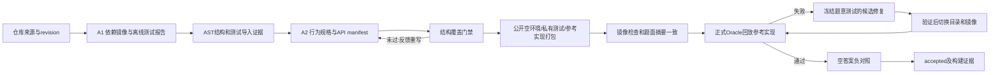

# NL2Repo：把可运行项目变成 EdgeBench 式任务的上游构造器

前面的 EdgeBench 下载提供任务合同、镜像引用和部分评测包装代码，但缺少批量生成器。用户提供的 `upstream/swe-factory` 正好补充上游思路：NL2Repo 从**完整、可运行、带测试的参考 Python 项目**反向生成行为规格，再把源码隐藏，让求解者从空目录重建项目。它最适合七机制分类中的“软件功能构建”；其构造闭环可以借用到其他机制，但尚不是通用 EdgeBench 工厂。本文只做静态分析，没有运行模型、Docker 或修改参考仓库。以下短路径均相对 `upstream/swe-factory/`。

## 1. 先区分规格、本地代码与实跑证据

| 证据层 | 能支持的判断 | 不能升级成的结论 |
|---|---|---|
| 只读 `nl2repo.md` | 描述逆向规格生成方法、原基线兼容行为及增强项；明确初始工作区仅有 start.md（`:13`、`:22`） | 不是原批次数据/模型/镜像复现记录（`:24` 至 `:32`） |
| 当前 `nl2repo_factory/` 实现 | 存在 A1/A2、AST、打包、Docker Oracle、受限修复、接收状态的实际接口和分支 | 有代码不等于已在真实仓库和目标运行器完成端到端验证 |
| README 的历史陈述 | TagKit 宿主示例参考/空/缺类型检查分数为 1/0/0.75；没有模型、Docker（`README.md:73` 起） | 本轮未独立打开 runs 报告，不能把文档中的历史值写成当前实测 |
| `demo.py` 可见程序逻辑 | 使用人工 fixture 和真实 pytest/导出 verifier，明确写出 model_called=false、docker_executed=false、production_instance_accepted=false（`:23`、`:54`、`:70`） | 不是模型生成题面、Docker隔离、长时任务有效性的证据 |

因此可称“已有本地构造器实现与有限宿主示例证据”，不宜称“已有可生产 EdgeBench 数据的经验证系统”。此外，规格说基线先构建镜像再清理题面（`nl2repo.md:580`），本地代码已经先定稿再构建（`pipeline.py:178`、`:246`），评估当前能力应以代码为准。

## 2. 一条 instance 怎样构造与接收

**输入和身份。** 每条候选提供仓库 URL，允许固定 commit 或本地来源。获取到任务专属副本后保存 `source.json`；未指定 commit 的本地 Git 工作树包含未提交内容，HEAD 仅作来源记录。批处理逐仓库串行，重复 ID 单列冲突，checkpoint 明确 `automatic_resume=false`。（`pipeline.py:34`、`:59`、`:107`、`:126`）这已经有批量流水线骨架，但还没有“同仓库×不同模块/约束”参数化生成；新实例需要把 revision、模板参数和生成 seed 纳入身份，而不只沿用 URL 派生身份（`:108`）。

**A1 把项目变成可复验原料。** 环境 agent 负责 Docker 内安装第三方依赖、验证原项目测试、移除目标项目安装而保留依赖，输出镜像、测试命令、测试/fixture路径和报告。`validate_a1` 检查报告结构、正测试数、声明通过与断网命令，不独立重放 A1 的全部动作；真正独立验证留给下游 Oracle。（`prompts/agent1.md:1`；`contracts.py:13` 至 `:45`；`pipeline.py:133`）

**AST 给规格生成提供证据，而非生成新需求。** 扫描器固定 Python 3.11 语法、不导入项目，提取目录、公开类/函数、签名、返回/异常/调用摘要及测试导入符号；至少 5 个实现 Python 文件才继续。它没有构建可直接用于分层造题的完整依赖 DAG，也不理解所有运行时语义。（`ast_scan.py:96`、`:121`、`:187`、`:218`；`pipeline.py:230` 至 `:239`）

**A2 的价值在恢复行为合同。** 模型读测试、fixture、README、接口和实现，输出 `start.md` 和 `api_manifest.json`：参数默认值、异常、状态变化、文件/CLI协议、可观察边界都应写入规格，不复制函数体或断言。确定性门禁检查必选符号别名覆盖、连续且非空 Node、实现目录树、至少5个Python文件、最多60个core API；失败把缺失符号和来源反馈给A2。（`prompts/agent2.md:1`；`specification.py:90` 至 `:196`；`pipeline.py:151` 至 `:196`）符号在manifest或正文出现即可覆盖，因此门禁通过只说明结构完整，未证明“陌生求解者只凭题面能实现全部被测行为”。

**打包明确分离四类资产。** 环境 Dockerfile 从A1依赖镜像删除常见目标源码目录与editable关联，只拷 `start.md` 到 `/workspace`；完整参考仓库进入 `solution/oracle`，`solve.sh` 仅将其拷回工作区；原测试、包配置、fixtures进入 `tests/reference`，独立 verifier负责恢复和执行。打包器输出实例目录和镜像构建上下文，本身不构建镜像。（`packaging.py:31` 至 `:63`、`:152`、`:170` 至 `:245`）控制器随后构建/检查/归档镜像，记录源码来源、镜像与题面及prompt摘要，初始 accepted=false。（`pipeline.py:243` 至 `:264`）

**正式 Oracle验证构造闭环。** 每次加载归档，在断网、CPU/内存/PID受限的新容器中复制私有tests，Oracle模式额外复制solution，执行参考恢复和同一verifier。奖励≥0.999999才算通过；基础设施失败、超时、缺分独立标记。（`oracle.py:19` 至 `:95`）默认还要求空答案不能拿满分，成功才将元数据与终态写成accepted；跳过Oracle得到built_unverified，不能算接收。（`config.py:29`；`pipeline.py:272` 至 `:296`）这里的Oracle是在回放已有参考实现，不是模型只读题面的独立求解。

**修复保住同一道题。** 控制器复制候选、附失败报告与文件索引，要求声明改动。题面、API manifest、通用instruction和既有测试源码冻结；不允许删测试、减少函数/断言、增加skip/xfail，分母下调须来自可信的全通过实际计数。校验通过后构建候选镜像，切换目录和镜像再复查Oracle，失败回滚、通过提交。（`repair.py:24`、`:205` 至 `:354`；`pipeline.py:299` 至 `:376`）事务记录先于切换并保留摘要/备份，支持中断恢复；它是可恢复双资产事务，既非跨文件系统原子事务，也不支持多个控制器并写。（`repair.py:357`、`:427` 至 `:537`）

## 3. 面向 EdgeBench 的复用边界

| 模块/设计 | 复用判断 | 面向 EdgeBench 应怎样接 |
|---|---|---|
| 来源副本、阶段账本、摘要和失败状态 | 构造侧可直接复用 | 扩展实例身份与参数manifest；保留每次构建和校准证据，不将“目录存在”当成功 |
| A1 环境构造及正式参考回放 | 软件题可复用控制流程 | 按语言/任务族替换环境与oracle适配器；基于真实容器重验，不依赖模型自报 |
| AST＋A2规格生成 | Python软件重建最适配；其他语言需接口替换 | 加 Rust/TS/C++分析器、行为依赖图和需求包选择；数学/科学任务需要别的证据抽取器 |
| 确定性规格门禁 | 可复用“检查→反馈→重试”机制 | 加入需求→测试映射、状态/异常/资源契约及仅看题面的独立求解检查；5个文件和60 API不能充当难度条件 |
| 公开/私有/参考资产分离 | 概念和构造函数可复用，输出接口需改 | 从现有单空环境＋运行时注入tests/solution，导出SForge的work/judge两镜像及task JSON；匹配cwd、submit_paths、eval_cmd、parser、rescale |
| 受限修复与事务 | 可复用冻结、证据、复查、回滚规则 | 若SForge导出多于一个镜像/manifest，事务资源集合要扩展；改变题意或评分目标应版本化为新实例，而不是环境修复 |
| 现有文本评分器 | 不建议原样迁移 | 保留执行日志接口，改用可信原生报告和任务专属指标；转换成SForge结构化反馈 |

评分器不能原样沿用的原因直接关系造题可信度：`verifier.py:27` 的兼容算法对同一nodeid重复计数，无逐项结果时从任意输出摘要回退，原生命令退出码不参与分数；奖励是passed/max(配置总数,观测总数)。代码对此有明确说明（`:1` 至 `:5`、`:46` 至 `:55`），本地仅额外把超时奖励置零（`:219` 至 `:225`）。另外测试根启发式可能恢复整个生产包，打包器只发 `implementation_in_reference` 警告（`packaging.py:224` 至 `:231`）。迁移时要明确资产归属和原生评分协议，不把“参考实现满分”误判为求解者必须实现了目标能力。

## 4. 怎样从 NL2Repo 新增“EdgeBench 式长时实例”

建议第一条路线是**参考仓库→行为模块图→可组合重建/扩展任务**，而不是把NL2Repo现有包直接改名。原料为固定revision的中等规模真实项目；先提取可观察行为和模块依赖，再选一个有基础功能、跨模块集成、复杂边界三个层次的需求包。每个实例保存 `repo_revision、feature_bundle、dependency_depth、public_fixture_seed、judge_seed、resource_budget、feedback_policy`，并从同一规格源生成题面、起始材料、开发验证器与judge。当前AST只能提供部分结构证据，上述选择器和参数模型是待新增设计。

工作区可以按模板选择“从零重建”或“保留骨架补全/新增功能”：前者最接近现NL2Repo；后者更接近EdgeBench的Rust/Schemathesis类题，需修改目前清空工作区的打包策略。将测试拆为公开快速检查、反复提交的隐藏验证、最终未反馈保留三层；不能把原repo全测试都设私有后只提供一个末次分数，就认为已实现EdgeBench的双反馈闭环。公开层用于定位局部错误，提交层衡量整体改善，最终层检查是否只学会反复反馈集合。

接收门槛也要从“可运行、自洽”扩成“具有长期改进空间”：先运行可信完整参考和空/近错实现，再对多个求解基线、多个时间预算记录成功子功能、总分与边际收益；过滤一步满分、长时间全零、只增case数造成变慢的实例。官方12+小时是评测设计目标，不是把 `task.toml` 中固定3600秒直接放大就能达到；`difficulty=medium`也只是模板常量（`packaging.py:126` 至 `:148`；`nl2repo.md:713`）。对性能/学习/科学题，还应将“参考必须1.0”的构造验收改为该机制的合法性、稳定性和标尺校准，保留软件重建路线的满分一致性门槛。

这条路线的投入顺序应是：先让一个有层次的软件任务通过端到端构造与SForge重验，再批量变更需求包/骨架/难度参数，最后以时间—质量轨迹筛选。形式证明可借用“完整gold→隐藏证明→kernel验证”的资产与门禁思想；数值优化、学习和游戏还缺各自生成器、可信oracle和难度模型，不能由NL2Repo的Python AST自动推得。

SForge在此承担已构造任务的长期运行、候选提交、隔离评分和轨迹记录；NL2Repo提供上游来源、规格、环境和自洽性验证。两者之间应新增明确的导出与长时校准门禁，而不是把生产构造成功、参考回放成功和agent学习成功合成一个状态。

## 覆盖记录

核心阈值60%、次要阈值30%；行数由本地脚本计算。除repair外的6个核心文件通读；repair仅读冻结与事务核心。未读其他factory/shared源码，未执行模型或Docker，历史runs报告未单独核验。

| 文件/组 | 类型 | 总行数 | 已读范围/行数 | 覆盖率 | 达标 |
|---|---|---:|---|---:|---|
| `pipeline.py` | 核心 | 376 | 1–376 / 376 | 100% | ✅ |
| `packaging.py` | 核心 | 254 | 1–254 / 254 | 100% | ✅ |
| `oracle.py` | 核心 | 95 | 1–95 / 95 | 100% | ✅ |
| `verifier.py` | 核心 | 244 | 1–244 / 244 | 100% | ✅ |
| `specification.py` | 核心 | 196 | 1–196 / 196 | 100% | ✅ |
| `ast_scan.py` | 核心 | 252 | 1–252 / 252 | 100% | ✅ |
| `repair.py` | 核心 | 537 | 1–36、205–537 / 369 | 68.7% | ✅ |
| `nl2repo.md` | 次要 | 1516 | 1–104、224–307、386–801、928–977 / 654 | 43.1% | ✅ |
| AGENTS/README、config/contracts/demo、A1/A2 prompts | 次要，7文件 | 793 | 全读 / 793 | 100% | ✅ |
| 合计，15文件 | — | 4263 | 3233 | 75.8% | ✅ |
