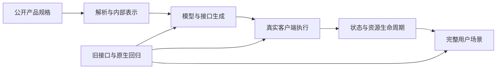

# EdgeBench 全部软工题的难度来源与新题构造方法

分析日期：2026-10-15。

**构造类似难度的新题，应先确定一个完整的软件交付范围，再选择能带来实际实现、集成或优化工作的需求。** 全部 36 道原题支持多条路线：产品版本演进、系统能力构建、跨模块恢复、兼容重实现，以及正确性约束下的性能搜索。不同路线需要不同的难度设计，不能统一用文件数、功能数量或代码量筛选。

本报告覆盖全部 36 道软工题的设计材料，并对材料充分的任务进一步深读：12 份公开 JSON，Schemathesis datagen 的一份镜像层 TODO，以及官方公布的时间分数表。另 24 道以论文逐题设计说明为依据。逐题的已知交付、难点推断、扩展建议和未知项见 [36 道逐题难度表](ALL_36_TASKS.md)。这是任务合同层的全量分析；全部生产源码和隐藏测试尚未取得。新题方向是设计方案，尚未构造成新题或完成难度标定。

## 1. 全量题目带来的范围校正

下列分类是本地按主要交付形态的归类，类别数量由全部任务索引重算，非官方软工子类。每题只计入一个主类，同时可以有多个难度来源。

| 主要形态 | 题数 | 原题例子 | 构题应继承的工作 |
|---|---:|---|---|
| 多目标工程演进 | 13 | Schemathesis 三题、Copier、Litestar、Vault SDK、Zstd API | 一个真实产品版本中多个可用能力的交付，以及必要的集成和兼容 |
| 从规格构建系统能力 | 12 | Arc、依赖类型检查器、OData、PostgreSQL-on-SQLite、QUIC、CPU full flow | 实现明确范围内的完整能力链，使规格最终成为可运行系统 |
| 正确性约束下性能优化 | 6 | ANN、exchange-core、swscale、整数编码、notebook 压缩、VLIW | 在强合理基线之后继续改善算法、表示、调度或资源利用 |
| 缺失或退化实现恢复 | 3 | Rust CAS、Codeflash、regex-automata | 诊断并恢复一条真实行为链，处理模块之间的语义与性能影响 |
| 行为等价重实现与移植 | 2 | Git→Zig、Expat→汇编 | 在明确的命令/API/ABI 范围中重现输出、错误、副作用和生命周期 |

全量索引和每类完整任务 ID 已列在 [逐题表](ALL_36_TASKS.md)。分类依据的原始材料是 [论文逐题设计说明](https://arxiv.org/html/2607.05155v1#A7.SS4) 及 [本地 36 题索引](../software-engineering-2026-10-15/software-task-map.csv)。论文的软工总体说明强调生产工程、跨模块推理及正确性和性能要求；具体任务仍需分别判断。

三个反例防止归纳过度：

- **产品宽度可以包含独立目标。** PocketBase tools 是多个工具包；Schemathesis 实际 TODO 也明确有 independent improvements。合理 roadmap 无需把所有目标强行串联。
- **小文件也可有深优化。** VLIW 仅提交一个生成器文件，难点在生成指令和调度；ANN 允许使用 FAISS，难点也可能在选择、测量和适配。
- **领域和名称不能替代评分证据。** Zstd API 演进不自动等于压缩率优化；object mapper 名称中的 high performance 也不足以确认性能如何计分。

## 2. 哪些变化会增加实质工作

以下是从全量设计中归纳出的构造方法。每项只在相应产品需求中使用，不要求一道题同时具备全部维度。

| 可以扩展的地方 | 为什么会增加工作 | 具体构造方式 | 判据要看什么 |
|---|---|---|---|
| 完整产品交付范围 | 单项功能完成后仍有独立可用能力尚未实现 | 从“增加重试”扩大为明确的客户端执行层；从一个 helper 扩为一组产品版本目标 | 每项目标能从公共入口使用，完整用户流程可运行 |
| 同一语义穿过多个阶段 | 各层局部实现必须共享一致的表示和约束 | schema→类型模型→生成代码→请求编码→响应解析；语言→AST→类型→代码生成 | 实际运行最终产物，并定位每层错误 |
| 合法功能组合 | 独立正确的实现未必能同时工作，可能需要修订共享抽象 | 鉴权覆盖＋multipart＋流式响应＋取消；过滤＋排序＋分页＋投影 | 端到端组合结果，以及异常和资源释放 |
| 跨操作状态和历史 | 一步写出的状态必须能被后续步骤、连接或进程正确消费 | 命令序列、事务、会话、文件格式、重开；有产品需要时加入恢复 | 连续操作后的外部状态，而非单次返回值 |
| 原有兼容面 | 新实现必须和旧 API、扩展点及调用方式共存 | 配置迁移、插件调用、sync/async、ABI、原有测试 | 冻结调用方、原生回归、跨版本或跨入口行为 |
| 真实性能与资源取舍 | 一种优化可能牺牲另一种负载或资源，需要多轮实验 | 内存内排序/外排、压缩大小/解码吞吐、召回/QPS、向量化/边界处理 | 独立正确性、原始性能、资源使用和重复测量 |

**测试的作用是让这些要求可观测。** 新增有产品意义的语义场景会暴露原先未实现的工作；重复增加同构输入只能提高检测密度，不能单独证明题目成为长程任务。

一个典型的纵向链路如下。图中“生成成功”只是中间成果，后续运行和生命周期要求会继续检验前面的表示设计。

## 3. 原题中可以具体借鉴的设计

**产品演进：借鉴完整发行目标。** Schemathesis datagen 实际 TODO 包含八项能力，既有 headers、重试、错误报告等交付宽度，也有 discriminator 在生成与校验两端的一致处理。Coverage hook 还涉及阶段、作用域与旧 skip 行为。可迁移的是“多个真实用户目标＋共享语义＋既有流程兼容”，不应把每一项小修复都当成独立长期阶段。[实际 TODO](../comparison-2026-10-14/original_image_metadata/author_only/schemathesis_datagen_pipeline/layer_8/app/TODO.md)

**系统构建：借鉴自然依赖链。** Arc、OData、原生编译器、CPU full flow 的已知交付都跨越多种表示或执行层。新题可以先交付一个可运行纵向切片，再扩展类型、操作或协议状态。关键是每层的结果被下一层真实消费，规格和局部反馈足以定位失败。[全部系统构建题](ALL_36_TASKS.md)

**恢复与兼容：借鉴共享数据和连续工作流。** Rust CAS、regex-automata 和 Codeflash 的已知范围覆盖多模块；Git 则明确要求仓库状态等价。新题可以围绕同一数据模型恢复多个模块，或用“创建→修改→查询→重开”检查实现一致性。实际支持的命令、恢复范围和错误语义应先公开限定。[原题证据拆解](drafts/original.md)

**性能任务：借鉴强约束下的剩余空间。** ANN 的召回门槛、codec 的精确无损、swscale 的输出质量、VLIW 的模拟正确性，决定哪些提速仍是有效成果。先给强正常配置和可运行起点，再判断结构优化是否还有收益。性能空间必须测，无法从项目名或算法复杂度直接推定。

## 4. 现有候选需要怎样扩展

当前候选中的真实工作并不相同，扩大范围前应先辨认已有代码替求解者完成了什么。下表的新增范围均是下一修订的设计建议。

| 候选 | 当前主要工作 | 更接近项目级交付的范围 | 先检查的简单完成路径 |
|---|---|---|---|
| OpenAPI SDK | 生成器中的一个流式特性，加鉴权和请求体交互 | 可发布的生成器版本：模型/响应表示、流式会话、限定游标恢复、错误模型及普通接口兼容 | 正常模板定制＋HTTPX＋通用 schema 预处理是否已能全部完成 |
| RESTler | 单 worker、BFS 下的恢复与重放 | 完整 campaign 恢复层：调度、请求身份、资源依赖、GC/checker、认证更新、checkpoint 生命周期 | journal＋response replay＋既有 hook 的独立强实现 |
| HTTPX | 一项可选执行策略 | deadline/尝试预算、可重放 body、重试调度、auth/redirect、取消和 origin 资源管理组成的执行层 | 现有 retry 库＋共享预算＋有界 replay 的合理组合 |
| EdgeKV | Python 服务中的事务、WATCH 与效果日志 | 持久状态产品：在线 checkpoint、日志代际、发布/回收、恢复及独立读取/导入 | 成熟嵌入式存储或普通全量 snapshot＋事务日志 |
| Tree-sitter | 恢复 edit/ranges/reuse 相关 API；当前不要求高效增量 | 可另选完整文档解析服务，或实测确有瓶颈的解析优化任务 | 现成 parser＋全量 parse/query 是否满足真实延迟和内存需求 |
| TOML | 三文件四 helper 的恢复 | 保格式配置迁移产品，或一个完整关联解析/编辑子系统的恢复 | toml_edit/serde＋普通 path walker 是否已满足要求 |

现有证据的关键区分：OpenAPI 的独立薄包装历史得分为 0.60；Tree-sitter 的完整 API＋全量重解析对照为 1，但它复制了完整参考 API。后者说明当前评分不要求高效复用，不能推出从受损 starter 盲解很快。参考消融、正常强基线与真实求解轨迹分别回答不同问题。[候选逐项分析及原始证据路径](drafts/candidates.md)

## 5. 三个可以交给作者细化的新题蓝图

### 可恢复的类型化事件流 SDK 生成器

交付修改后的生成器，用户提供规范即可生成能运行的 sync/async SDK。需求包括类型化事件模型、按需消费、响应所有权、错误处理、限定断线恢复及旧普通端点兼容。可从模型表示、模板和流会话分别形成可用成果。

关键组合场景：共享 authenticated client 打开匿名事件流，逐条得到模型；断线后按服务端 cursor 恢复并去除合同内的一条重发；消费者取消后响应关闭，原 client 仍能正常请求。恢复只适用于列明的 GET，multipart POST 不自动重发；服务端重放规则、重试预算和错误分类必须明确。

构造前先尝试最强正常模板＋HTTPX 包装。若已可完成全部产品目标，就重新评估范围。完整合同、阶段成果和判据见 [蓝图 1](drafts/blueprints.md)。

### 可维护的事务与持久状态服务

交付一个可持续运行的单节点服务：事务、逻辑 TTL、持久确认、在线 checkpoint 和日志代际形成同一状态合同。相较已有 EdgeKV 事务/journal 草案，实质新增是维护过程中继续写入，以及新旧代际发布和恢复的一致性。

关键组合场景：checkpoint 截取序号 S 后继续成功提交 INCR 和到期更新；分别在新代际发布前后崩溃；恢复均保留已确认变化，不重复 INCR、不复活过期键。故障模型限定为进程终止和可截断短尾，文件事件边界公开。独立状态模型和文件分析器判断结果。

先测普通单锁状态机、完整事务日志、全量 snapshot，以及合同允许的成熟存储适配。格式互通必须服务独立读取/迁移等真实交付，不为阻止复用而自造限制。[蓝图 2](drafts/blueprints.md)

### DataFusion 内存预算下的排序子系统优化

保留真实 SortExec/TopK/spill/merge 路径，交付正确且整体更有效的引擎改造。实际取舍包括小 K 与大 K、窄键与宽 payload、内存内与外排、多分区归并。已有功能不作为新增实现量。

关键组合场景：宽字符串、多批次、NULL/重复键、受限内存和多个分区共同出现；候选同时满足结果顺序、payload 和资源要求，再比较延迟与 I/O。现有排序属性、阈值、batch 和压缩配置先形成最强合理基线。该方向当前缺少足以发布新性能合同的测量，先验证空间，再固定指标与锚点。[蓝图 3](drafts/blueprints.md)

这些蓝图分别展示产品演进、状态系统与性能路线；全量逐题表还覆盖实现恢复、行为重实现、语言工具、协议适配和硬件软件集成，不把三份例子作为整个软工分布。

## 6. 把难度分析变成出题输入

每个候选先交付一份可审阅的构造卡，顺序如下：

1. **产品交付。** 谁能用它完成什么完整工作流；支持边界和兼容承诺是什么。
2. **原题参照。** 明确对应的原题和继承的难点，同时写出当前明显较小或不同的地方。
3. **已有与缺失。** starter、依赖和正常工具已经做了什么；求解者还须实现什么。
4. **工程关系。** 需求→模块/数据/状态→用户场景；独立目标与相互作用分别说明。
5. **阶段成果。** 初步可运行之后，仍有哪些具体能力、集成问题或优化路径；早中晚表示成果顺序，不预言耗时。
6. **独立判据。** requirement ID→具名检查→原始指标；运行最终系统，保留原生回归和实际副作用观察。
7. **参考和强基线。** 完整参考验证可实现；正常库/配置/包装检验简单路径；参考消融检验评分是否看见缺陷。
8. **退出条件。** 合法简单方案完成全合同、starter 已达有效上限、性能收益被噪声覆盖、规格不足或只能等待时，修改范围或更换任务。

参考实现和评分闭合之后，冻结一个新修订做实际长程校准。保存源码快照、各能力组结果、失败原因、有效工具交互和阶段成果；复评同一快照区分真实改善与噪声。扩题应形成新版本，保留旧题面、评分和曲线。

官方公开时间表本身包含持续增长和平台期，因此“难”与“更多时间仍能改进”要分别检验。新题是否达到类似难度，最终需要在对齐的模型、工具、资源和预算下观察；本文提供的是构造依据与可推翻的难度假设。[官方时间表](https://github.com/ByteDance-Seed/EdgeBench#leaderboard)

## 7. 本轮证据与复核

- 已复核 36 个逐题卡 ID 与索引集合相等，缺失、额外、重复均为 0；主类合计 36，公开 JSON 为 12。
- 抽查了实际 TODO 的独立改进与八目标范围、论文中的 Arc/CPU/压缩引擎说明，以及 OpenAPI 薄包装、Tree-sitter 参考派生对照的构造代码。
- 在线复核了 [官方仓库](https://github.com/ByteDance-Seed/EdgeBench) 和 [论文 v1](https://arxiv.org/html/2607.05155v1)。本地逐题卡仍绑定已有材料，未知的起点、API 和 hidden judge 细节逐题保留。
- 本轮产物仅是分析报告、全量难度表和设计蓝图；没有改动既有题包或分数，没有运行新的模型、容器或性能实验。

详细证据与实际读取范围：[原题锚点](drafts/original.md)、[候选差距](drafts/candidates.md)、[新题蓝图](drafts/blueprints.md)、[覆盖和来源摘要校验](validation.json)。
