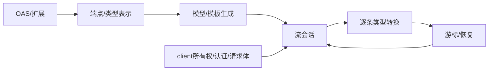
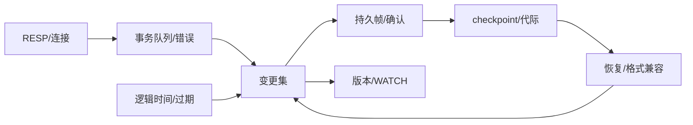
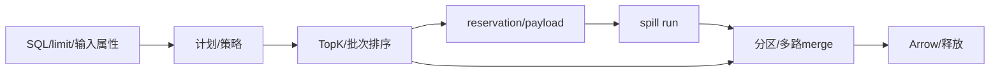

# 三个项目级软件工程新题蓝图

状态：仅完成本地材料分析与合同设计，未构造 starter/gold、未运行模型、未测性能，也未证明六小时难度。本文将“源码已存在”“拟提供的 starter”“拟新增的产品要求”分别说明。三个方向对应产品 roadmap、完整状态系统、性能子系统，不以删代码量、隐藏禁令或构建等待制造难度。

## 1. 可恢复的类型化事件流 SDK 生成器

**产品交付。** 为真实 `openapi-python-client` 增加事件流 SDK：用户提供规范后，生成的包能同步/异步消费带类型的 NDJSON，断线后按服务端游标恢复，提前退出时释放响应；同一包的普通 JSON、认证与 multipart 接口继续可用。交付修改后的生成器、模板及必要运行时；验收生成并执行 SDK。不是交付某个固定服务的手写客户端。

**材料与 starter。** 固定 `0a283fe21eeaa23046faf622d4ff4b2c826d2edb`。源码已有普通 sync/async 请求：端点模板 `endpoint_module.py.jinja:110–159` 调用 httpx `request`，`101–107` 将 `response.content` 放进完整 Response；README `62–75` 说明生成的 client/api/models。拟提供完整离线仓库、原生回归、健康的普通调用，以及可控事件服务。缺口是流式端点表示、生成签名、每条记录模型转换、游标会话状态与资源管理。已有 multipart 不能重复宣称为新能力（CHANGELOG `275–294`）。只审计到端点模板，parser、client 模板与 httpx 具体版本行为仍需构造前追踪。

**合同先固定。** 采用任务自定义扩展，例如 `x-event-stream` 指定 event schema、`cursor` 字段和 resume header；不把它冒称 OAS 原生语义。服务端按严格递增整数序号输出 `{cursor, payload}`，首次流从头开始；恢复请求带最后已交付 cursor，服务端只可能重发该 cursor 对应的一条记录，之后继续更大的 cursor，重发内容相同。SDK 仅消除这一条已交付重发；不承担任意乱序、任意重复或应用处理的 exactly-once。模型转换成功、控制权将交给迭代者时更新会话内游标；游标不跨 SDK 进程保存。

只对列明的 GET 事件流自动恢复，最多 `max_reconnects` 次；重连预算包含首次断线之后的连接失败与可重试状态，每次失败消耗一次，不得无限重试。仅指定连接/读断开及列明的 HTTP 502/503 可重试；错误 JSON、非法 UTF-8、类型错误、401/403 和用户取消立即结束。失败和关闭事件不消耗事件序号。空行忽略；最后一条完整 JSON 即使没有换行也可交付；不完整/非法末尾记录抛出明示解析异常。背压合同为请求下一条记录前，不向应用交付后续记录；测试使用服务端分步放行证明没有等待 EOF 才产生首条，不以网络任意分块大小强求零预读。

multipart 上传可返回事件流，但该 POST 在响应中断时**不自动重发请求体**；调用者获得异常与已交付游标，由产品的独立 GET 事件端点继续观察。客户端不承诺上传 exactly-once。认证覆盖明确为 `inherit / anonymous / explicit token`，匿名不得携带共享 client 的 Authorization；复用 httpx client 时不得关闭调用者持有的 client，只关闭当前 response。异步取消必须传播，退出 context 后当前响应已关闭。

| 早/中/晚 | 可用工程成果 | 为什么后续会检验前面设计 |
|---|---|---|
| 早 | 从规范生成能导入的 sync/async SDK，实时交付一个事件模型 | 产生实际可调用产物，验证 schema→模板→运行时整条链 |
| 中 | 单次会话能解析跨块 UTF-8/多种事件模型，正确处理出错和提前关闭 | 把“请求后返回对象”的抽象改成拥有生命周期的会话 |
| 晚 | 在限定重放合同下恢复连接，保持认证、共享连接和普通调用兼容 | 游标、错误分类、client 所有权必须同时成立 |

**三个组合验收场景。**

1. 服务端分两次写入带中文的事件，第二段前暂停；消费者先得到第一条带类型对象，再继续读取。下一事件使用明确 discriminator 的另一种 payload；此后解析失败应保留之前产出并关闭响应。它测试真实生成产物，不能只验证 decoder helper。
2. GET 先交付 cursor=7，连接中断；重连服务端重发 7 再发 8；消费者只收到一次 7 和一次 8。连续连接失败耗尽预算后抛错。换成 POST multipart 上传后中断，观测器必须看到仅一次 POST，没有静默重传文件。
3. 同一 authenticated client 先正常请求，再打开 anonymous 流并取消，再发 authenticated 普通请求；匿名请求无凭据，取消被传播，响应已关闭，普通请求依旧成功。sync 提前 break 的等价合同通过显式 context exit 验证。

**参考、强基线与判据。** 参考实现必须真实生成 SDK；独立本地 HTTP 观测器记录请求头、重连 cursor、POST 次数、首条产出与服务端放行次序、close 事件。用独立事件序列状态机判断输出；原生 functional tests 的“生成→导入→执行”框架可沿用，证据见 functional README `3–24`。按生成/流交付/生命周期/恢复/兼容行为组给固定权重，不按新增 case 个数稀释分母。先测最强廉价实现：改模板、复用 `iter_lines/aiter_lines`、小型重连包装，以及合法现成流库/其他生成器适配。依赖正常允许；若简单适配已经完成合同，承认该版本工作量不足。

**退出或降级。** 固定版本已有全部能力；流式接口仅需少数模板变化且强基线能完成全部组合；合同需要无法观测的网络 exactly-once；或独立生成产物无法离线运行，均停止按长程题推进。合法重用降低工作量时不靠追加禁止条款挽救。只有轨迹显示后期仍产生可用产品改进，才把它标为长程候选。

## 2. EdgeKV：从在线事务到可维护的持久状态服务

**产品交付。** 把一个可用的内存 KV 服务升级为可重启、可维护的多客户端事务服务：事务与 WATCH、逻辑 TTL、持久提交、checkpoint 和日志代际轮换形成同一状态合同。面向本地嵌入式服务的实际用途：运维 checkpoint 时仍能接受后续事务，恢复后既不丢已确认提交，也不重复应用 INCR。原有事务+journal 候选到此新增的是“在线 checkpoint→新旧日志交错→代际发布→恢复”的完整维护链，而非再加几个命令。

**材料与 starter。** Valkey `cf5efa70192faedacb6741ee2a8f800d0482862f` 作为事务语义参考，不将完整 Valkey 的已有事务假称缺口。已读 `multi.c:145–187,313–438`：排队错误、WATCH 冲突、执行与清理有不同路径；`aof.c:1532–1539,1691–1757` 追踪合法边界并回退不完整事务。拟提供健康的 RESP 请求/响应、GET/SET/DEL/INCR、连接管理、逻辑时钟、文件操作适配层，以及 starter 的静态存储格式 v1；交易、watch、日志恢复和 checkpoint 尚未实现。需要由作者先构造并验证这份 starter，当前没有称其已存在。

**合同先固定。** 命令仅列明子集，单进程按调度器给定的请求顺序执行；事务执行期间其他客户端命令不穿插。未知命令/错误参数在排队阶段使事务 dirty，EXEC 全部中止；INCR 非整数等执行期错误作为该项结果返回，其余已排队命令继续，不承诺回滚。WATCH 观察 key 版本；本合同明确成功 SET 即使写入相同值也使版本变化，DEL 缺失 key 不改变版本，逻辑时间越过仍存在 key 的到期时间使其过期并失效 WATCH。时间只由控制接口推进；未触达未来时间也不依赖墙钟。EXEC/DISCARD/断连清除本连接 watch 与队列。

每次成功变更或 EXEC 形成一个持久提交帧；事务帧包含顺序号与完整变更集，读取/执行期错误没有额外变更。逻辑时钟推进也作为持久变更。对外确认必须在该帧完整写入并完成任务文件适配层的 sync 之后。恢复包含全部已确认帧；崩溃前完成持久写入但未收到确认的帧可以存在，客户端不具有自动重试 exactly-once。恢复按帧号只应用一次。TTL 保存绝对逻辑截止时间；重启沿用持久化逻辑时钟，不把剩余 TTL 重新计时。

故障模型限于进程在明示文件事件边界被终止；写入可以留下最终帧的任意短前缀，已完成 sync 的字节不丢失，rename 原子，目录发布按提供的文件适配层合同执行。末尾短帧截断到最后完整帧；中间 CRC/版本错误拒绝启动且不改坏文件。覆盖进程崩溃与 torn tail，不据此宣称真实掉电/任意磁盘损坏安全。所有 failpoint 名称、适配层事件、文件格式均公开。

checkpoint 选择已提交序号 S，写 snapshot 的状态与元数据后再发布；其间大于 S 的提交仍进入日志并可返回成功。控制器只在 `snapshot_data_written`、`manifest_before_publish`、`old_generation_before_retire` 等公开边界暂停维护流程并穿插完整客户端请求，不在任意字节上抢占事务。恢复选择合法已发布代际，再重放 `seq>S`；旧代际不得在新代际发布前删除。允许单线程事件循环/后台线程/短暂停顿取快照等任何可满足合同的设计，无需强迫某种 COW 算法。文件格式和公开离线 inspect/export CLI 是产品互通交付，不能用仅能查询某个外部服务来替代。

| 早/中/晚 | 可用工程成果 | 后续集成压力 |
|---|---|---|
| 早 | 多客户端事务与 WATCH 可工作，错误后连接可继续使用 | 所有写入和过期路径要统一维护 key 版本 |
| 中 | 提交持久化、重启恢复，能识别合法尾部与损坏 | ACK、内存应用、日志帧与执行期错误必须一致 |
| 晚 | checkpoint 与在线提交交错，轮换后可恢复并保持旧格式导入 | snapshot 切点、序号、时钟、发布顺序与清理组成一个系统 |

**三个组合验收场景。**

1. A WATCH 一个带 TTL 的 key，排队 SET/INCR；逻辑时间由 B 推进至到期，A EXEC 中止。随后 A 新事务包含执行期 INCR 错误与成功 SET，返回逐项结果，成功 SET 持久化；断连重连不能继承旧 WATCH。先由独立状态模型确定这些结果。
2. 先完成一个已确认事务，再在下个事务帧的短写边界崩溃。恢复保留前者、丢弃不完整后者，并能继续写入；同样内容的中间 CRC 损坏则拒绝启动，不能当作尾部截断后悄悄丢数据。
3. checkpoint 截取 S 后暂停文件发布，B 成功执行 INCR 和到期更新；分别在 manifest 发布前后、旧代际删除前崩溃。每种合法恢复路径都保留已确认变化，INCR 不被重放两次，TTL 不复活；连续重启两次结果相同。

**参考、强基线与判据。** Valkey 仅对共同命令子集提供差分行为；任务定义的写帧、逻辑时钟与 checkpoint 由独立串行状态模型和文件前缀分析器判定。先冻结 near-miss：每条命令单独落盘、ACK 先于 sync、snapshot 后漏日志、manifest 前删旧代际、重放重复 INCR、过期不改版本；检查每种都被对应场景区分。分组为在线状态、隔离/错误、持久提交、恢复/损坏、维护代际，组内包含跨模块场景。强基线包括单锁状态机+整事务日志+全量 snapshot，以及合法嵌入/适配 Redis/Valkey 或成熟日志库；不禁止正常复用。若给定文件互通与生命周期合同仍可由小型适配器完成，应判此设计偏短。

**退出或降级。** 纯字典+几个 if 即能覆盖合同；调度依赖碰运气；需要真实电源故障才可判断；参考模型与产品共享同一恢复实现；或合法现成服务适配已完成全部交付，均退选或降低定位。不得用增加命令数量/命令冷僻程度救难度。

## 3. DataFusion：内存预算下的排序与 Top-K 性能子系统

**产品交付。** 在真实 DataFusion 50.0.0 的排序路径上提高既定工作负载的执行质量，保留 SQL 结果、内存管理和溢写行为。交付引擎源码及必要配置；编译后的真实执行计划输出 Arrow RecordBatch，并报告执行指标。目标是一个排序子系统，不同时拼接 join/aggregate 重写。

**材料与 starter。** 固定 `10343c18292fc3a9ca62b59c8bb530169fe79b82`，不是早期调研的另一 revision。已有 ExternalSorter、TopK、spill、merge 与输入顺序捷径：`sort.rs:315–370,643–709,1203–1279`。拟提供完整 vendor、编好的基线、可增量编译环境、健康回归与真实 profiling harness；不删除已有能力，也不把尚未测出的瓶颈命名为事实。首先验证 workload 对候选路径的真实覆盖，再决定是否发布这一题。

**合同和取舍。** 冻结查询族、数据生成器、内存预算、CPU/线程、磁盘与缓存策略。键覆盖整数/UTF-8/NULL，明确每键 ASC/DESC、NULLS FIRST/LAST；第一版不纳入 NaN/locale collation，避免未定义比较语义。性能查询加入唯一 row_id 作最终排序键，结果完全确定；其他合法并列排序在正确性集按等价类比较。fetch/offset、空批次、多分区与宽 payload 的语义明确。计划不能以输入“通常有序”假定跳过未保证有序的行。

真实取舍来自源码已有分支：小批次 concat 后排序与分批 sort/merge 的开销不同（`643–709`）；溢写前释放/预留 merge 空间会影响 OOM 与额外落盘（`323–369,579–580`）；字符串保留的底层 buffer 影响实际写盘量（该段需后续完整审计）；fetch 可以选择 TopK，但 K 接近 N、宽 payload 与输入前缀排序可能改变最优策略（TopK 的内部机制尚未读取）。作者可以改善一个共享数据路径或自适应策略，不预设必须实现某个新算法。若只调现有开关已足够，则该版本不作为高难题。

| 早/中/晚 | 可用工程成果 | 后续集成压力 |
|---|---|---|
| 早 | 在真实 profile 中找到热点，交付保持正确性的局部优化 | 小数据收益要与编译、读取输入时间区分 |
| 中 | 优化在不同 K/N、payload 宽度与批次大小下有效 | CPU 少复制与保留内存之间出现取舍 |
| 晚 | 低内存、多分区和 spill 下仍正确且总体更快 | 调整策略不能通过过度 reservation/OOM/拖慢另一 workload 获利 |

**三个组合验收场景。**

1. 多批次、双键、NULL 与重复 key 的小 K，分别使用乱序和仅前缀有序输入；结果与独立排序模型一致，实际计划应运行预期排序/TopK 路径。记录延迟、分配/峰值内存，不用“出现 TopK 名字”判优化成功。
2. 宽 UTF-8 payload 与较大 K 在受限 memory pool 中执行；若发生 spill，结果与非受限参考一致，写盘量与峰值 RSS 被独立记录。减少 spill 次数却导致隐藏内存增长的实现不能越过资源门槛。
3. 同一排序在多个 partition、不同批次切分与输入分布上执行全排序和 offset/limit；merge 后行数、顺序、payload 一致。长字符串/倾斜输入审计集检验针对公开样本的阈值是否泛化；它不用于事后选择正式提交。

**参考、强基线与判据。** 正确性从小规模独立 comparator 和冻结引擎输出交叉确认，性能使用同版本真实引擎。先公开列出且测量：默认配置、现有阈值/batch size/spill compression 的配置扫描、编译选项一致的最佳合法配置，以及作者至少一种真实优化分支。强基线不能故意选择变慢配置。reference 是可验证结果，不自动作为性能上限。

只有实测后才冻结归一化常量：每 workload 使用其正确性门槛和资源门槛；合格时以重复测量的延迟相对固定基线和可达参考区间映射 [0,1]，按预先冻结的语义 workload 组聚合，保留原始时间/内存/I/O与噪声。公式方向、超时、OOM、部分失败如何计分必须随题公开；不临时按提交结果改 endpoint。预热、重复次数、隔离方式在 pilot 后写入机器元数据；编译和依赖安装不计入执行延迟。若无法稳定测量，先不发性能分。

**退出或降级。** profiler 证明候选路径不是瓶颈；已有配置扫描已吃掉改善空间；计时噪声不小于收益；新方案只在一个 seed 上生效或通过错误结果/资源逃逸提速；主要时间是构建等待，均停止当前性能 profile。换 seed 不能算新题，允许正常依赖与源码复用。延续到长程题之前必须观察真实工程迭代，而不能先写“可提升 xx%”。

## 共同构造与难度证据

先把其中一个蓝图构造成可回放题包，冻结 requirement ID→可观察行为→public/feedback/author-audit tests→gold 模块的映射。新增需求必须服务同一产品；roadmap 可有独立里程碑，其相互作用则通过明确组合场景验收。保留早期可运行成果，不要求所有大模块完成后才得到首个反馈。每次 verifier 从源码/静态配置快照重建，状态服务每场景重置；性能环境固定。基础设施故障单独报告，不冒充 candidate 低分。

上述选择依据本地 `factory-methods.md:29–37,49–51,71–82` 与 `candidate-designs.md:12–30,39–51,70–79`：合同与交付先于题包，廉价强基线先于长程试跑，真实轨迹先于时长标签。0.5/2/4/6h 保存工件与实际提交，分别解释早满、持续进展、后期突破、全程无进展及环境等待；此处只规定审计方法，未声称任何一次试跑已完成。Nop/Oracle 与 statically valid 仅是质量证据的一层，不能替代容器和长程验收。

## 本轮阅读覆盖与限制

全部路径相对仓库根；行号是本轮本地文件，不宣称已读取上游完整仓库。

| 材料 | 实读范围与用途 |
|---|---|
| `research/software-engineering-2026-10-15/factory-methods.md` | 全文 1–130；构造方法、评分与校准边界 |
| `research/software-engineering-2026-10-15/candidate-designs.md` | 全文 1–81；已有方向、退选与生产计划；未将其中旧 revision 混作本轮源码 |
| `research/software-candidates-016-20261015/cards/{01_openapi_streaming,09_valkey_transactions,10_datafusion_sort}.md` | 各全文；材料身份、现有能力、合法强基线 |
| `.../sources/01_openapi_streaming/files/openapi_python_client/templates/endpoint_module.py.jinja` | 全文 1–160；实际生成请求/响应路径 |
| 同目录 `README.md`；`end_to_end_tests/functional_tests/README.md`；`CHANGELOG.md` | 1–180；全文 1–77；270–316；产品输出、运行生成代码、已有 multipart |
| `.../sources/09_valkey_transactions/files/src/multi.c` | 1–490；客户端队列、错误、EXEC/WATCH 结构；未通读余下 WATCH 实现 |
| 同目录 `src/aof.c` | 1526–1547、1680–1772，并检索截断/加载入口；未审计完整 fsync/manifest 实现 |
| 同目录 `tests/unit/multi.tcl` | 145–243；其余仅关键词索引定位，未称全文读过 |
| `.../sources/10_datafusion_sort/files/datafusion/physical-plan/src/sorts/sort.rs` | 300–409、570–720、850–1070、1203–1305；另作函数/指标检索。300–510 输出被工具截断，不据此宣称完成字符串 buffer 审计 |
| 同目录 `benchmarks/README.md` | 489–551，并关键词定位 memory profiling 等入口；未读全部 benchmark 业务代码 |

`client.py.jinja` 本地未取得，读路径失败一次，未据此推断其内部所有权。未读取原版任务 JSON、候选评分报告或旧求解轨迹；未联网、未运行构建/测试/模型，未修改任何现有任务。三份 source 目录是选读文件集合，正式构造仍需完整 checkout、离线依赖、许可汇总与独立执行验证。
