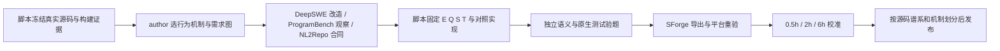

# 三个 SWE 工厂怎样适配 EdgeBench 软件工程造题

**结论：把 DeepSWE 用作已有仓库功能改造的主流程，ProgramBench 用作黑盒行为与兼容性任务的来源，NL2Repo 用作完整行为规格抽取器。** 三者已有价值集中在“可信素材→可回放题目→参考答案验证”。连续目标、独立反馈/保留集和 6 小时难度校准需要新增；把现有 factory 改一个超时参数不能完成这一步。

本报告复核了此前 `research/drafts/09-reference-*.md`，并重新读取相关代码和历史 summary。路径均相对 `upstream/swe-factory/`；结论分为代码已实现、历史报告支持和本项目建议。此次只读参考仓库，没有运行模型、Docker、SSH 或新实验。

## 1. 各 factory 的适用边界

| 工厂 | 真实素材与构造机制 | 最适合的 SWE 任务 | 可沿用的实现 | 为长期优化必须新增 |
|---|---|---|---|---|
| DeepSWE A：ablation | 完成功能及原生测试→选一个行为消融→由 controller 从快照求逆得到答案 S 与隐藏测试 T | 恢复缺失子系统、补全已定义协议/解析器/状态机；适合作为构造闭环的首批样本 | 生产/测试路径所有权、完整源码快照、逆补丁、C1–C6 矩阵、导出 Nop/Oracle 复验 | 挑选连贯的行为包；不能只按删除行数筛难度；现有二元评分要增加适当的进步指标 |
| DeepSWE C：query | 在固定旧版本提出一个仓库自身的新需求→先写会失败的测试→critic 核查失败原因→实现参考解 | 跨模块功能、兼容层、状态/异常语义扩展、真实软件迁移 | requirement/version 机制、测试先行、定向修复、真实红绿矩阵 | 需求依赖图与多层验收；公共反馈和作者质量审计保留集；性能需求需要独立测量 |
| DeepSWE B：specialize | 从参考题提取困难机制→补边界测试验证 Base→迁移到不同扩展点→实现、mask、改写 | 同一机制的新实例，如优先级/生命周期/增量更新与其他功能的交互 | 原测试不可改、参考版本绑定、Base 验证、结构化 requirements 固定 | 机制相似性去重、独立语义审查、演化难度实测；不把改名计为创新 |
| ProgramBench | 固定 CLI→构建 gold→字节级 probe→黑盒测试→dummy/gold QC→独立重建 | CLI 重实现、格式/协议兼容、压缩/解析工具的行为重建；可扩展到保持语义的性能优化 | build/probe 工件、测试 ID 映射、负对照、独立镜像重建与发布门禁 | 求解 R3 runner、受控 gold 查询接口、泛化输入生成器、连续覆盖/性能分 |
| NL2Repo | 完整 Python 项目+原测试→依赖环境→AST 辅助抽取→自然语言规格→清空工作区重建 | 从规格实现库/服务子系统、多个 API 共享状态与数据格式的重建 | A1/A2 角色契约、规格检查反馈、公开/私有资产分离、参考回放与受限修复 | 按行为包选择任务；其他语言的证据抽取器；规格可实现性审查；正式评分协议升级 |

代码依据：DeepSWE `deepswe_factory/pipeline.py:153–262`；ProgramBench `programbench_factory/pipeline.py:59–159`；NL2Repo `nl2repo_factory/pipeline.py:209–296`。A/B/C 是可选构造路线，不是顺序经过的三个阶段。

“可沿用”指可保留模块逻辑及其测试契约，不代表现有包已符合 SForge。DeepSWE 导出 `environment/problem + instruction + solution.patch + test.patch + grader`（`deepswe_factory/packaging.py:12–41`）；ProgramBench 导出 `task.yaml + tests.json + eval`；NL2Repo 导出空环境、题面、完整参考实现与私有测试（`nl2repo_factory/packaging.py:202–223`）。SForge 适配应在产物出口增加转换器，不改变已经通过验证的上游题意。

## 2. 素材获取：现在有冻结器，还没有自动发现好题的系统

DeepSWE/ProgramBench 的共享 `acquire()` 要求完整 40 位 SHA，独立 clone/checkout、核验 HEAD、保存内容摘要（`swe_factory/snapshots.py:117–133`）。NL2Repo 接受 JSONL 候选，做 URL 规范化和选取；没有仓库/issue 搜索器（`nl2repo_factory/source.py:52–100`）。它允许不指定 commit 的工作树快照，身份默认仅由 URL 派生（`source.py:28–45`；`pipeline.py:34–73`）。

因此下一步应新增一个轻量 **素材清单**：`repo_revision、license、build_recipe、native_test_command、public_interfaces、target_mechanism、source_evidence、estimated_feedback_cost`。获取代码、固定 revision、校验 hash、缓存依赖和重放已知 recipe 可由脚本完成；判断哪个行为值得出题、如何脱离历史 patch 形成新需求，需要作者分析。下载仓库不等于找到了题，收集很多 issue 也不等于选好了任务。

首批素材应优先满足：能在准备好的环境里离线执行、基线测试健康、有可观察的核心行为、参考解能在预算内验证。GitHub 历史 PR 可以提供实现与测试证据，但该参考库当前没有自动 PR 挖掘、跨版本 issue 合并或候选难度排序模块。统一身份应包含 revision、行为包与模板版本，避免同仓库不同题覆盖或错误计为独立样本。

## 3. 为什么“合并几个 issue”或“删多些代码”不等于 6 小时题

**删除只建立一个有答案的缺口。** A 路线保证参考实现可恢复、目标测试能从失败变成功，同时保留回归；它不检查缺口的算法新颖性、依赖深度或求解时间（`deepswe_factory/pipeline.py:153–172`）。删除一个大型但重复的适配层可能很快恢复；删除关键框架导致全仓不可运行则可能只是坏题。Gold 的存在证明有限范围的可解性，不证明题面充分或任务有长期进步空间。

**issue 数量通常只是工作量代理。** 若五个需求彼此独立，拼成一题主要增加待办数量，也允许并行分治；若它们来自不兼容版本，拼接还会造成矛盾合同。合理的同一产品 roadmap 可以包含相对独立的目标，自然工程工作量也可能支撑长程任务，不能一概退选。共享状态、数据模型、执行顺序、错误传播、资源约束及可验收的交互，则能进一步形成系统设计难度。两种情况都需要实际轨迹，现有代码没有自动保证。

**应构造一个连贯的需求依赖图。** 例如流处理工具的“解析→窗口状态→乱序事件→checkpoint/replay→增量优化”共享同一状态合同；每层能交付可用进展，后层又要求修改前层的设计。相反，“支持一种新 flag、修 README、改颜色、另加文件后缀”合并后仍主要是四件独立小事。建议任务包保留 requirement ID、前置条件、可观察结果、交互测试和参考实现模块的对应表。

**实际难度必须靠轨迹标注。** 建议固定预算、资源与反馈规则，对至少几种求解策略重复试跑，在同一轨迹上保存 0.5h/2h/6h 产物，独立复评。区分早期满分、持续可改进、晚期突破、一直无进展四类；环境安装/等待耗时单列。结合评测噪声与轨迹解释 2→6h 的变化，不能仅用总运行时长声称出现新的工程能力。这是描述性校准，不新增最低增长门槛；正式验收遵循任务书。尚无本轮实验支持任何候选已经达到 6 小时难度。

现成难度字段也不能代替校准：NL2Repo 的 `difficulty="medium"` 和 agent 3600 秒是打包常量（`nl2repo_factory/packaging.py:126–148`）；ProgramBench 用 flags、子命令、branch 和有效测试数算接口规模标签（`programbench_factory/quality.py:86–94`）；DeepSWE 的 `repair_rounds` 是出题修复预算（`deepswe_factory/pipeline.py:174–213`）。

## 4. 连续可改进目标：三个现成评分器并不相同

| 已有机制 | 当前代码实际判定 | 适配建议 |
|---|---|---|
| DeepSWE | 所有 F2P/P2P 通过才 reward=1，否则0；`swe_factory/reports.py:39–40` | 二元完成结果仅保留为原生测试/内部诊断；正式 `task.toml` 主分按任务书声明 `bounded_continuous`，使用机器可读归一化；可按冻结行为组或正确性约束下的性能质量构造主分 |
| ProgramBench | `classify()` 判定构造期哪些测试有效；R2 再复验 K，并不是解题 agent 的完整 scorer；`quality.py:62–83`、`pipeline.py:204–247` | 将 K 及行为组交给新 R3 grader；评分不能看 `eval/run.sh` 的退出码，因为脚本含 `|| true`（`pipeline.py:143–144`） |
| NL2Repo | `passed/max(configured_total,observed_total)` 的文本统计兼容评分；`nl2repo_factory/verifier.py:27–55` | 可以借鉴部分进度的目的，但新正式 scorer 应使用固定测试身份和真实报告，不原样沿用文本累计/摘要回退规则 |

本项目建议使用两种明确目标。**功能/兼容性任务：**先冻结必须保持的回归集合，再对若干有语义的行为组计分；同一组内增加 1,000 个随机 case 不应获得 1,000 倍权重。缺失、跳过和超时仍占原有分母，不能靠缩减被执行测试提高分数。**性能任务：**正确性全部通过后，在独立 workload 上测 throughput、latency、memory 或 cost；用固定弱/强基线归一化，并保留原始单位和噪声范围。参考实现给出可验证行为，不自动给出性能最优值。

真正值得迁移的目标不是“越来越多的测试”，而是“能够在同一清晰合同下持续提高实现质量”。接口越多未必越难；更慢的 evaluator 也不会让任务更有研究价值。性能评测需明确预热、重复、编译时间、缓存、线程与硬件，这些当前三个 factory 都没有提供完整通用实现。

## 5. Author agent 与规则脚本的分工

这里需要的是有文件/命令工具的作者，而不是某一指定品牌的 CLI。现有 `CommandAgent` 负责交接 prompt、workspace、response、超时和轨迹，工具循环由外部 CLI 自己完成（`nl2repo_factory/agents.py:58–102`）；`Roles.run()` 为每个角色建立独立副本并从实际文件差异捕获 patch（`swe_factory/roles.py:15–43`）。

| 阶段 | 作者 agent 应承担的开放决策 | 应交给确定性脚本的部分 |
|---|---|---|
| 素材理解/环境首次适配 | 阅读入口、依赖与测试，决定真实 binary/API target，诊断特殊构建失败 | clone/checkout、hash、按锁定 recipe 构建、记录退出码与资源 |
| DeepSWE A | 选择可独立说明的行为缺口、保持骨架、写充分题面 | 求逆 diff、分离 S/T、所有权检查、补丁回放、红绿矩阵 |
| DeepSWE C | 从真实扩展点提出新需求；编写测试；判断失败是否对应需求；实现参考解 | requirements/version 账本、执行测试、固定资产、独立导出复验 |
| DeepSWE B | 理解参考题的困难机制并迁移；设计新交互与边界；重写合同 | 校验参考版本、保护原测试、生成 mask 逆补丁、固定 requirements、重跑验收 |
| ProgramBench | 选有效 probes、由观察恢复行为、设计有辨别力的断言、交付 build recipe | 控制器重建 gold、重复字节观察、展平 ID、dummy/gold/gold-repeat、R2 发布 |
| NL2Repo | A1 首次适配环境；A2 从测试/fixture/实现恢复完整行为合同；有证据地诊断构造失败 | AST 抽取、格式/覆盖检查、打包、镜像/参考复验、受限候选修复与回滚 |
| 难度与评分 | 人/作者定义任务测什么、哪些妥协合理、何种变化算新实例 | 固定 scorer、运行多基线、采样 checkpoint、统计曲线、split/去重 |

对应角色依据：`deepswe_factory/prompts/{analyze,ablate,query,testcase,critic,solution,plan,evolve,mask,rewrite}.md`；NL2Repo `prompts/agent1.md:1–26`、`agent2.md:5–31`；ProgramBench `prompts/builder.md:1–38`。ProgramBench 也有 `bash/write/done` JSON-action 工具循环，说明“具备工具闭环”才是条件，并非必须使用外部 CLI（`programbench_factory/actions.py:67–136`）。

**首次造新机制用作者，重复采样成熟模板用脚本。** 一个参数化题族的语义、oracle 与可行性构造已固定后，换数据、生成边界 case、重跑 grader 不需要再次调用模型。反过来，规则脚本拼题面、删函数并生成一份能过 gold 的测试，不能替代行为理解。Critic 的自然语言同意也不能代替真实失败/通过；DeepSWE 正是先执行测试，后把原生报告交给 critic（`deepswe_factory/pipeline.py:192–201`）。

## 6. “独立验证”需要四个不同层次

| 层次 | 现有证据能覆盖什么 | 下一步增加什么 |
|---|---|---|
| 执行可回放 | DeepSWE 从新 E 注入候选 S 与可信 T，跑 build/target/regression；ProgramBench 独立重建 gold；NL2Repo 在新容器恢复参考并验证 | 在目标 SForge 环境重新跑同一工件，不能沿用 host 分数作为新平台证据 |
| 测试有辨别力 | Nop/Oracle、dummy/gold 对照排除部分弱测试；DeepSWE 同时检查回归 | 冻结 near-miss/mutation 实现，验证边界、状态和交互；单一空答案负对照不够 |
| 合同与测试一致 | NL2Repo 符号覆盖、DeepSWE requirements 保持、ProgramBench test→probe 关联 | 从仅可见材料独立实现，或者逐需求审计；程序能过自己的测试不证明题面充分 |
| 长时与泛化有效 | 三个 factory 当前均未形成完整校准证据 | 公共本地集、重复反馈集、作者质量审计保留集；跨源/机制 split；多时长、多次求解曲线 |

具体边界：NL2Repo 的覆盖检查允许符号别名在 manifest 或正文出现即计覆盖（`specification.py:111–140`）；DeepSWE 的 rewrite 只比较结构化 requirements，相等后仍记 `not_independently_verified`（`pipeline.py:258–262`）；ProgramBench 来源检查验证引用 probe ID 存在（`pipeline.py:99–106`）。这些门禁应保留，但不扩大其证明范围。

独立执行器也未必意味着独立测试设计：若同一个作者同时写需求、测试和 gold，三者可能共同遗漏一种合法行为。建议在冻结合同后另设验题阶段，只准补测试或拒绝候选；需要改合同则版本化并重做下游。这里的 holdout 仅指作者质量审计保留集，用于检查题目质量与泛化，不参与挑选正式提交。正式成绩遵守任务书：一次运行内全部提交按冻结评分规则取 best-of-run；不能改为最后一次提交，也不能依据作者审计集事后挑选提交。

## 7. 推荐组合方式与首批实例

优先从 **已有仓库的一个连贯子系统扩展** 起步：用 DeepSWE C 产生新合同、测试和 gold；用 NL2Repo A2 的证据→规格方法补齐行为说明；若存在成熟 CLI，则用 ProgramBench probes 建立可执行兼容性基线。三者组合的是能力，不要求一个实例完整跑遍三套 pipeline。

第二类是 **黑盒工具重建并逐步扩展兼容行为**：ProgramBench 提供可观察 gold 与测试来源，新增可控输入生成器和独立 R3；先检验功能进步曲线，不强行增加性能目标。第三类是 **正确性固定的性能改造**：DeepSWE 保存补丁/回归契约，ProgramBench 方法提供字节和副作用对照，再另写资源测量器。它们比拼多个无关 issue 更容易形成清晰、可解释的质量—时间曲线。

结合本轮主调研已固定 revision 的四个候选，建议如下。此表是待验证设计；本子报告未独立读取这些候选的业务源码，也没有把它们标为已达标实例。

| 候选方向 | 适配工厂与作者必须完成的设计 | 可脚本化的验题/采样 |
|---|---|---|
| **优先：openapi-python-client 功能演进** | DeepSWE C 为主，NL2Repo A2 补合同；作者追踪 parser/schema/template/生成客户端的跨层语义，设计一个连贯的功能包和交互，不按文件数凑规模 | 冻结规范输入、生成、编译/导入并运行客户端；合法 schema 参数采样、行为断言与回归；实际 generator/客户端链路须再核实 |
| **优先：DataFusion 正确性约束性能优化** | DeepSWE 的补丁/回归结构；作者选有明确瓶颈、语义边界和资源取舍的算子/查询路径，并实现可信 reference/baseline | 固定数据与查询 workload、结果对照、资源隔离、重复计时与作者质量审计保留集；新增性能 scorer，不能使用现成二元完成分替代 |
| **后续：Polaris stateful API 工作负载** | DeepSWE C + NL2Repo 合同方法；作者定义跨请求状态、权限、生命周期或事务交互，形成可复现业务序列 | 服务 reset、序列回放、可观察状态断言、故障/边界组合和资源计量；先确认离线依赖与稳定 reset 成本 |
| **备选：jq 行为重建** | ProgramBench；作者选择有辨别力的语义覆盖，并明确允许的外部依赖与复用边界 | 输入生成、重复观测和差分测试；若现成 jaq/gojq 足以满足任务，直接包装会缩短解题路径，应在基线阶段量化而非仅靠隐藏测试假设消除 |

每个实例至少保存 `source_revision、mechanism_id、requirement_graph、starter_digest、oracle_digest、public/feedback/author_audit_split、resource_profile、scoring_version、baseline_results、calibration_traces`。同源版本、同机制迁移和等价改名应分组；同一任务不同 test seed 只增加测试样本。扩量应发生在这一实例合同稳定之后。

## 8. 本地状态与本轮读取范围

已实际打开历史 summary：NL2Repo `runs/tagkit-final/summary.json` 为 host 人工样例、无模型/Docker、`production_instance_accepted=false`；DeepSWE `runs/deepswe-demo-02/{ablation,query,specialize}/summary.json` 均 Nop=0、Oracle=1、L2、`accepted=false`；ProgramBench `runs/programbench-demo-02/summary.json` 为 R1、11/12 有效测试、未 published/R2/R3。此前 NL2Repo 草稿没有单独打开 runs，本轮补核实了其状态。上述均是历史证据，没有被写成今天重跑结果。

| 本轮阅读对象 | 实读范围 |
|---|---|
| 根 `AGENTS.md`、`README.md`、`docs/factory_reproduction.md` | 全文 |
| 既有三篇 `09-reference-*.md` | 复核已有结论；ProgramBench 延续前轮完整源码阅读，另重点重读下列段落 |
| `deepswe_factory/pipeline.py` / `grader.py` / `packaging.py` | 全文 262/128/58 行 |
| `deepswe_factory/prompts/*.md` | 11 个角色 prompt 全文 |
| `swe_factory/snapshots.py` / `roles.py` / `reports.py` | 全文 133/43/58 行 |
| `nl2repo_factory/pipeline.py` / `source.py` / `agents.py` / `oracle.py` | 全文 376/100/102/95 行 |
| `nl2repo_factory/specification.py` | 85–196；主要验证门禁 |
| `nl2repo_factory/packaging.py` / `verifier.py` | 120–254；1–110、170–244 |
| NL2Repo A1/A2/repair prompts | 全文；修复事务底层未在本轮重新全读 |
| ProgramBench `pipeline.py` / `quality.py` / `actions.py` | 本轮重读 59–159 / 62–94 / 67–136；前轮完整读过本模块 680 行源码及 builder prompt |
| 历史 summary | 上述命名路径，只提取必要状态/分数，没有展示配置或认证字段 |

本报告是相关模块比较，不声称覆盖整个参考仓库；没有重新审计共享 runtime、Docker adapter、NL2Repo repair 细节或运行环境。下一步实现应先收敛一个题族的完整验题与反馈合同，再调用 author agent 批量构造。
