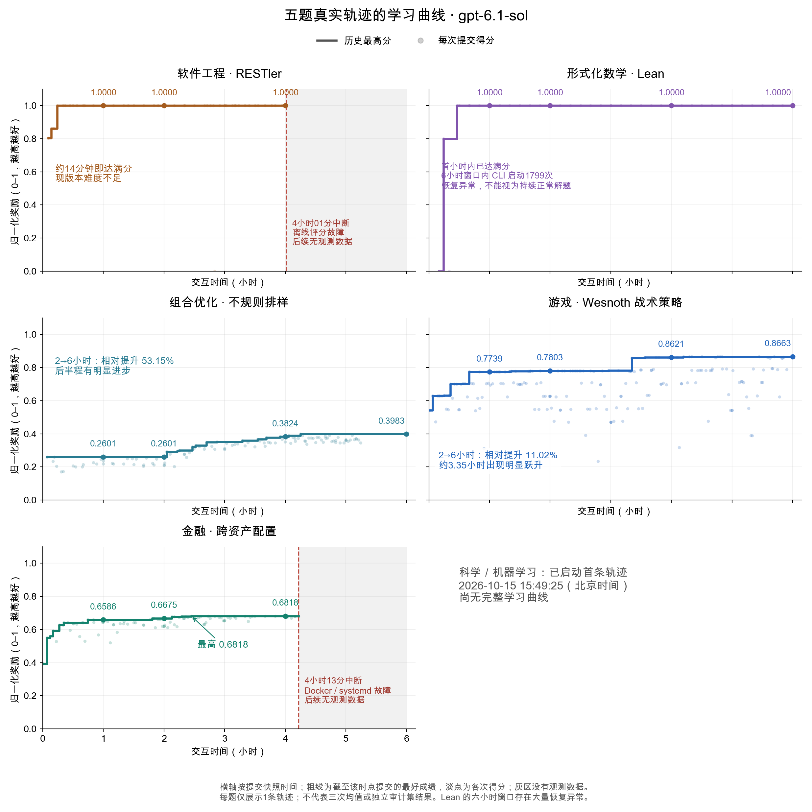

# 已运行五题的曲线

|题目|1小时|2小时|4小时|6小时|备注|
|---|---:|---:|---:|---:|---|
|RESTler|1.0000|1.0000|1.0000|未完成|约14分钟满分；4h01m评分故障中断|
|Lean|1.0000|1.0000|1.0000|1.0000|首小时满分；1799次CLI启动，恢复质量待核查|
|排样|0.2601|0.2601|0.3824|0.3983|2→6h相对提升53.15%|
|游戏|0.7739|0.7803|0.8621|0.8663|2→6h相对提升11.02%|
|金融|0.6586|0.6675|0.6818|未完成|4h13m评分基础设施故障中断|

各展示一条真实轨迹；按提交快照时间累计取最高分，原始分数不重映射。灰区没有数据，不延伸中断后的曲线。Lean仅确认六小时窗口结束，不能据此宣称全程正常工作。科学题于北京时间2026-10-15 15:49:25开始首条六小时轨迹，尚无完整曲线。

[PDF](learning_curves.pdf) · [逐次记录CSV](submissions.csv)
